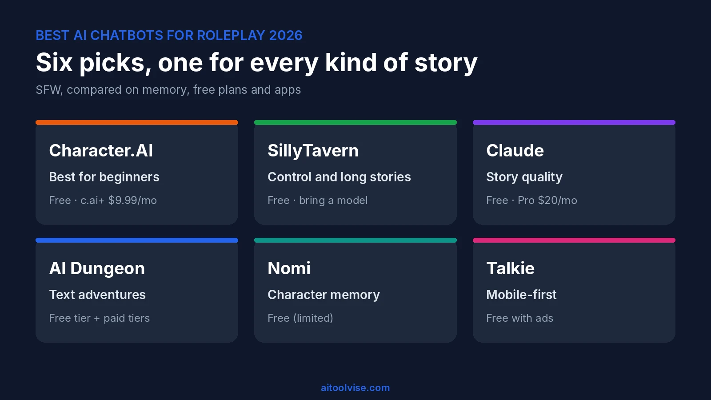
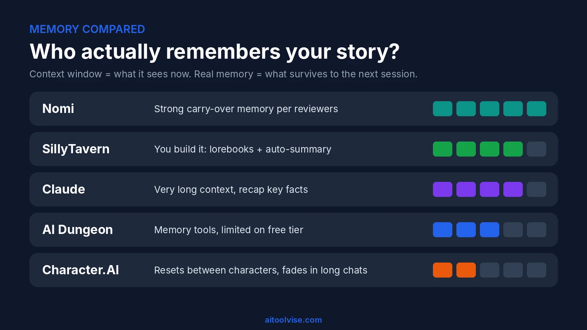
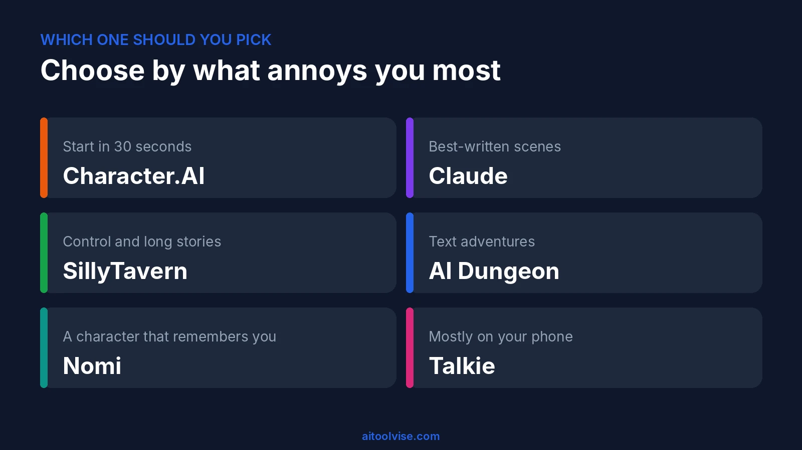

Not every good chatbot is a good roleplay partner. A roleplay partner has to remember who your character is, stay in the part for hours, and keep a scene moving without suddenly sounding like a customer-service agent. Plenty of chatbots can't manage that. The ones that can all come with some kind of catch, whether that's memory, filters, price or the app itself. So here are six that held up in 2026, ranging from a beginner-friendly app to a free tool you can fully control. Everything below is SFW, and aimed at adults or supervised teens. If chatbots in general are new to you, our [best AI tools for content creation](/best-tools/best-ai-tools-content-creation/) roundup is a decent warm-up.

## Best AI Chatbots for Roleplay at a Glance

Short on time? For the best AI chatbots for roleplay, I'd start with Character.AI if you want it easy, Claude if the writing matters most, and SillyTavern if you like control. Here are all six side by side:

| Tool | Best for | Price | Memory | Apps |
|---|---|---|---|---|
| Character.AI | Beginners | Free, c.ai+ $9.99/mo | Weak across characters | Web, iOS, Android |
| SillyTavern | Long stories, control | Free (you pay for a model) | You build it | Desktop, Android via Termux |
| Claude | Story quality | Free, Pro $20/mo | Long context, recap needed | Web, iOS, Android |
| AI Dungeon | Text adventures | Free tier, paid tiers | Limited on free | Browser, check stores |
| Nomi | Character memory | Free (limited), about $15.99/mo | Strong per reviewers | iOS confirmed |
| Talkie | Mobile-first | Free with ads | Session-focused | Android, check iOS |

## How We Picked the Best AI Chatbots for Roleplay

Here's my problem with most lists of the best AI chatbots for roleplay: they're written by companies that sell one of the apps, and half of them never say how anything was tested. So I did it differently. Only tools with a clear SFW mode made the cut. I checked claims against official docs and recent reporting, and if I couldn't confirm a price, I left it out. When something comes from a single review or from users, I say so. And I judged them on what roleplayers actually grumble about: memory, how long a free plan lasts, whether the phone app is any good, and how often a filter kills the mood.

## 1. Character.AI: Best for Beginners

This is where most people start, and honestly it makes sense. Sign up, pick a character from the giant community library, and you're talking in under a minute. There are web, iOS and Android apps. The free plan has ads, slow mode when it's busy, and caps on swipes and voice calls. c.ai+ costs $9.99 a month and removes most of that. One review site lists a cheaper annual price, but the numbers don't agree with each other, so check in the app.

Now the catches. Explicit content isn't allowed. Character.AI also stopped open-ended chat for under-18 users by November 25, 2025, [according to Fortune](https://fortune.com/2025/10/29/character-ai-ban-children-teens-chatbots-regulatory-pressure-age-verification-online-harms), and it brought in age checks. Memory is the other sore spot. Reviewers say it resets between characters and fades in long chats. Good first stop, not always a good place to stay.

## 2. SillyTavern: Best for Control and Long Stories

SillyTavern isn't really a chatbot at all. It's the window you chat through. According to [its docs](https://docs.sillytavern.app/), it's free, open source and lives on your own machine, and you connect whatever language model you want, through an API or one you run locally. Sounds like homework? It kind of is. But the payoff is real: character cards, group chats, lorebooks (it calls them World Info) and an auto-summary extension that takes some of the pain out of memory.

You'll need Node.js 20 or newer, and there are install guides for Windows, Mac, Linux, Android (through Termux) and Docker. The software is free. The model you hook up might not be. If you enjoy tinkering and want a setup nobody can change on you overnight, I'd start here.

## 3. Claude (and ChatGPT): Best for Story Quality

General chatbots weren't built for roleplay, but the good ones write better scenes than most dedicated apps. Claude is my pick for quality. It keeps characters consistent, handles long scenes and is good at atmosphere. There's a free tier, and [Claude Pro](https://claude.com/pricing) is $20 a month, or $17 if you pay yearly. ChatGPT Plus costs about the same and works too.

The downsides: both have their own safety rules, so they'll steer away from some content, and neither has a character library or saved character memory out of the box. So I write a detailed character sheet at the start of each session, or keep it in a project, and drop in a recap every so often. Weighing the two? Our [ChatGPT vs Claude](/compare/chatgpt-vs-claude/) comparison covers the differences, and the [Claude pricing review](/reviews/claude-pricing-review/) goes through every plan.

## 4. AI Dungeon: Best for Text Adventures

AI Dungeon is the oldest name here, and it's still my pick when you want a game and not a chat. You type what you do, the AI narrates what happens next. Fantasy, mystery and survival stories all work well. There's a free tier, and the paid ones add memory and stronger models. One third-party review says the free tier's memory is about 2,000 tokens and paid plans start around $10 a month. I couldn't confirm that on the official site, so look before you pay.

Expect filters that sometimes cut into a story, and memory you'll have to manage in long adventures. The memory and story-summary tools help keep the plot straight.

## 5. Nomi: Best for Long-Term Character Memory

Nomi is a different animal. It's a companion app, built around a single character you keep talking to for weeks or months, and reviewers keep calling its memory the best in the category. One [2026 comparison](https://tech-insider.org/?p=17991) reports a free tier with one companion and roughly 50 messages a day, Premium at about $15.99 a month, and a confirmed iOS app. The same site warns that prices on third-party pages don't always match Nomi's own, so double-check.

I only looked at it for SFW storytelling and friendship-style roleplay. It's a companion product, so teens and parents should read its age rules before signing up. Choose Nomi when continuity matters more than a big library of characters.

## 6. Talkie: Best Mobile-First Option

Talkie is clearly made for the phone. On Google Play it shows up as "Talkie: Creative AI Community," with ads and in-app purchases, and the character-and-story format feels polished. One recent write-up says its terms set a minimum account age of 16. I couldn't check that on the official site, so take it with a pinch of salt. Its filters block explicit content too, though not perfectly.

It's freemium, with virtual currency, and prices differ by country and app version, so I'm not quoting any. The iOS app is harder to identify, so look at the developer name in the App Store. Pick it if you mostly play on your phone and want something quick.

## Best AI Roleplay Chatbot With the Best Memory

"Memory" means two different things in roleplay, and people mix them up all the time, which is why so many chatbots feel forgetful. One is the context window: how much of the current chat the AI can see at once. The other is real memory, what survives into the next session. Most chatbots only have the first.

Among apps, Nomi is the standout for carry-over memory. SillyTavern lets you build your own with lorebooks and auto-summaries. Claude has a very long context window, so lengthy scenes go well, but I'd still recap the key facts. Character.AI is the weakest here, which is why a lot of people eventually leave.

## Free AI Roleplay Apps and No-Sign-Up Options

Almost every roleplay app wants an account, and the free plans come with strings: ads, slow mode, daily message caps or small memory. For casual use, Character.AI's free plan is the most generous. Claude and AI Dungeon both have free tiers worth trying, and SillyTavern is free if you can bring a model. For no sign-up at all, the nearest thing is SillyTavern with AI Horde, which its docs say works for instant chatting, though you still have to install it. One roundup lists Perchance as account-free. I haven't tested it, so take that as a lead and not a recommendation.

## Best AI Roleplay Apps for iOS and Android

Character.AI has both iOS and Android apps, so it's the easy default. Claude and ChatGPT have phone apps too, and I find those better for longer story scenes. Nomi has a confirmed iOS app, while Talkie has an Android listing and a murkier iOS situation. SillyTavern can run on Android via Termux, but it's fiddly. Before downloading anything, check the developer name and age rating in the store. There are a lot of lookalikes.

## Best Fantasy Roleplay AI

For fantasy, AI Dungeon was built for it. SillyTavern wins when you've designed your own world, because lorebooks let you store races, places and rules so the AI stops forgetting them. Claude is great at atmosphere and at keeping a large cast consistent. One trick that works anywhere: write a one-page "world bible" and paste it at the start of every session. If you want to turn a finished story into visuals, our [best AI music video generators](/best-tools/best-ai-music-video-generators/) guide is a fun next step.

## What About "No Filter" Roleplay Chatbots?

"No filter" is one of the biggest searches around this topic, so let me be straight about it. Filters exist for a reason. They stop chats drifting into harmful territory, especially for younger users, and they're part of why Character.AI tightened its age rules. Some tools have lighter restrictions and ask for age verification, and open-source setups like SillyTavern let you pick your own model.

I don't review adult or fully unfiltered services here. If you're an adult, read each platform's content policy and age rules before you sign up. If you're under 18, stick to apps that really check ages. And assume your chats might be stored.

## What Reddit Says About AI Roleplay Sites

Reddit has a lot to say about this. In the Google results for this search I saw a thread with 160+ comments asking for the best roleplay chatbots, another with over 200 answers asking which sites are actually good, and a subreddit, [r/CharacterAIrunaways](https://www.reddit.com/r/CharacterAIrunaways/), for people leaving Character.AI. I couldn't open Reddit directly, so I'm not quoting any posts.

From the titles and the usual themes, people argue about memory that fades, filters that interrupt a scene, price changes and which new app is "the next Character.AI." The recommendations shift every month, and some are ads in disguise. Use Reddit for ideas, then test two apps yourself.

## How to Get Better Roleplay From Any Chatbot

These habits matter more than which of the best AI chatbots for roleplay you pick:

- **Start with a character sheet.** Two or three paragraphs: personality, voice, goals, and one thing the character would never do.
- **Set the scene first.** Where, when, the mood, and what's at stake.
- **Recap now and then.** A short "so far" paragraph rescues a chat when memory slips.
- **Pick a style.** Short replies or long, first person or third.
- **Steer gently.** If it drifts, say what you want in brackets and carry on.

## Which Roleplay Chatbot Should You Pick?

Choosing the best AI chatbot for roleplay comes down to what annoys you most about chatbots.

- **Want to start in 30 seconds?** Character.AI.
- **Want the best-written scenes?** Claude.
- **Want control and long stories?** SillyTavern.
- **Want text adventures?** AI Dungeon.
- **Want a character that remembers you?** Nomi.
- **Mostly on your phone?** Talkie.

Curious where voices fit in? Our guide to the [best free AI voice cloning tools](/best-tools/best-free-ai-voice-cloning-tools/) shows where voice tech is heading, and the [AI Tool Vise homepage](/) has more roundups like this one.

*Prices and features change fast in this category, and several apps change their rules often. Check each official site before you subscribe.*

## Affiliate Disclosure

This article may contain affiliate links. If you sign up for a product through a link on this page, we may earn a commission at no extra cost to you. This helps support the research behind guides like this one. Our picks are based on independent research and published documentation. Affiliate relationships don't influence which products we cover or how we rate them.