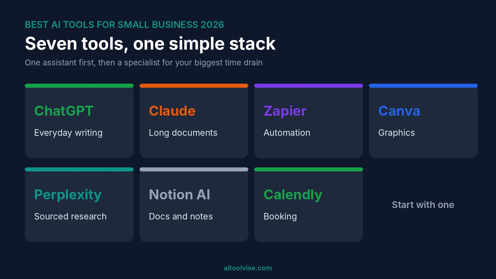
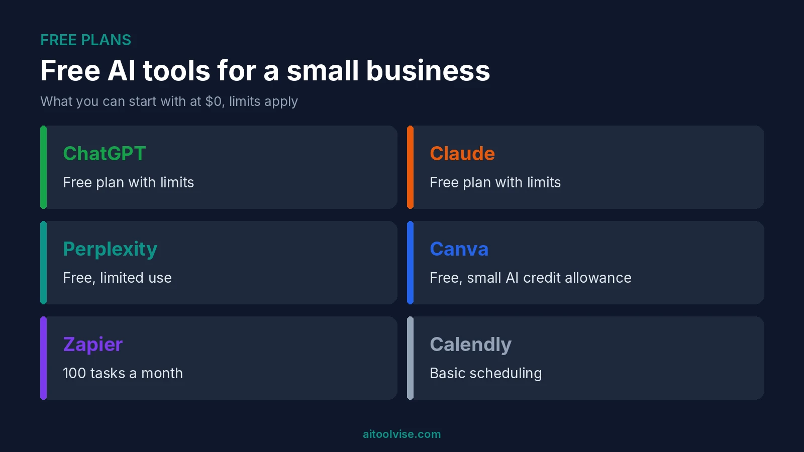
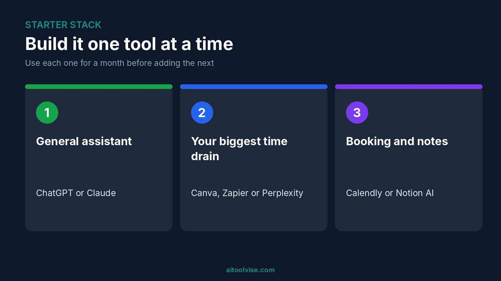

Okay, quick version. Begin with ChatGPT or Claude and use it for the daily grind. Zapier comes in if repeat admin is killing you. Canva for graphics. Perplexity for research. Those are the best AI tools for small business in 2026, as far as I can tell, and you really don't need all of them.

I read a lot of lists first. [PropelClick's April 2026 roundup](https://propelclick.com/blog/best-ai-tools-small-business-2026/) was one. Most ended up in the same spot: one general assistant, then a few specialists. Fine by me. I've seen how fast a few small subscriptions add up once you forget to cancel one.

I'll go tool by tool: what it does, roughly what it costs, who it's for. Free options, marketing, automation and where to begin come after that. If words are most of your work, our [best AI tools for content creation](/best-tools/best-ai-tools-content-creation/) roundup digs deeper.

## Best AI Tools for Small Business at a Glance

Here's the short list of the best AI tools for small business.

| Tool | Best for | Free plan | Paid from |
|---|---|---|---|
| ChatGPT | Everyday writing and thinking | Yes | $20 a month (Plus) |
| Claude | Long documents and careful writing | Yes | $20 a month (Pro) |
| Zapier | Connecting your apps | Yes, 100 tasks | About $20 a month, billed yearly |
| Canva | Design without a designer | Yes, AI credits limited | About $15 to $18 a month |
| Perplexity | Research with sources | Yes, limited | $20 a month |
| Notion AI | Documents and team knowledge | Limited trial | $20 per member, Business plan |
| Calendly | Booking and scheduling | Yes | From about $10 a month |

Prices wobble, and the pages I checked sometimes contradicted each other. So peek at the vendor's own site before you hand over a card.

## How to Choose AI Tools for a Small Business

Don't start with a tool. Think about which job keeps stealing your Tuesday. Is it answering the same customer questions again? Making graphics? Chasing invoices?

[Storyflow's guide](https://storyflow.so/blog/best-ai-tools-small-business-owners-2026) has a rule I like: one tool for that one problem, a month of really using it, and only then something new. I'd copy that.

Before paying I ask three things. Can I test it free? Will it play nicely with my other apps? And where does my customers' data end up? That last one gets skipped a lot. Please don't skip it. Skim the privacy terms before pasting anything sensitive.

## 1. ChatGPT: Best for Everyday Business Writing

If you only try one, try this (or Claude, next up). You can have it draft an email, a quote or a product blurb. Long document you can't face? It'll summarise it. And it'll brainstorm with you at 11 pm when you're the only one still working.

The free plan is enough to begin. Plus is $20 a month, and OpenAI lists a cheaper Go plan at about $8. Curious where it wins and where it stumbles? We wrote a [Perplexity vs ChatGPT comparison](/compare/perplexity-vs-chatgpt/) about exactly that.

One catch. It can say wrong things in a very sure voice. Check numbers, names and anything legal before it goes out.

## 2. Claude: Best for Long Documents and Careful Writing

Claude is the other general assistant I'd look at. Folks reach for it with contracts, reports, anything where the tone has to stay steady. Pro runs about $20 a month, though one source showed roughly $17 if you pay yearly. And yes, a free plan exists.

ChatGPT or Claude, then? I'd run both free for a week and keep whichever one you open first. If you want help deciding, there's our [ChatGPT vs Claude comparison](/compare/chatgpt-vs-claude/), and the [Claude pricing review](/reviews/claude-pricing-review/) goes through the plans one by one.

## 3. Zapier: Best for Automation Without Code

Think of Zapier as the thing that copies stuff between your apps so you stop doing it by hand. A form entry ends up in a spreadsheet. A new lead pings you. Tiny jobs, sure, but they pile up over a month.

Free gets you 100 tasks a month, and each Zap can only have two steps. For paid plans, [Jetadmin's September 2026 check](https://www.jetadmin.io/blog/zapier-pricing/) says Professional starts at $19.99 a month if you pay yearly, or $29.99 month to month. It climbs with your task count. And if you blow past your limit you can drift into pay-as-you-go, which is an easy way to get a surprise bill.

## 4. Canva: Best for Visuals and Social Graphics

No designer on staff? Canva covers a lot of that gap. Social posts, flyers, simple ads, resizing, background removal. The AI features run on credits.

On credits, [Piktochart's August 2026 breakdown](https://piktochart.com/blog/canva-pricing-2026-costs-raised/) gives Free 50 a month and Pro 500. Pro costs $18 monthly or $180 yearly, and Business is per seat. Posting mostly on social? Our [best AI tools for social media content creation](/best-tools/best-ai-tools-for-social-media-content-creation/) guide goes further.

## 5. Perplexity: Best for Quick, Sourced Research

Say you need to check a rule, spy on a competitor or find a supplier. Perplexity gives you an answer plus links to where it found the facts, which means you can go and check. Free use is limited, and Pro is $20 a month.

I'd treat it as a starting point, not the last word. Click through, especially when it's about regulations.

## 6. Notion AI: Best for Documents and Team Knowledge

Notion makes sense if your business already lives in notes, docs and wikis. The AI works inside those pages, summarising and searching and drafting.

The price has a catch. A Krater breakdown from October 2026 says full Notion AI sits on the Business plan at $20 per member a month. Free and Plus only get a limited trial. Krater sells a rival product, though, so I'd take that framing with a pinch of salt and check Notion's own page. Solo and keeping things simple? I'd probably skip this one.

## 7. Calendly: Best for Booking and Scheduling

Not every useful tool is flashy. Calendly kills the back-and-forth of finding a time. It sends reminders too, which helps with no-shows. The free plan covers one event type, and the paid plans I saw start around $10 a month. Small tool, real time saved.

## Best Free AI Tools for Small Business

You can run a decent setup for nothing. These are the best free AI tools for business owners just starting out.

ChatGPT, Claude and Perplexity all have free plans with limits. Canva Free comes with a small monthly allowance of AI credits. Zapier gives you 100 tasks. Calendly's free plan handles basic scheduling. A [Software Secrets price check from August 2026](https://softwaresecrets.com/blog/best-ai-tools-for-business/) lists most of these free tiers too. One guide also called Google Business Profile the best free step for a local business. Not even an AI tool.

Free plans run out, of course. Fine while you test. Once a tool saves you real hours, pay for that one and leave the rest free.

## Best AI Tools for Small Business Marketing in 2026

Marketing is really three jobs: writing, graphics, posting. ChatGPT or Claude drafts the captions, emails and ad copy. Canva makes the graphics. A scheduler publishes it. Buffer was listed at about $6 per channel a month in one guide and about $5 in another, so check the current rate.

Jasper comes up for marketing copy too. One guide listed it from $49 a month, which is a lot for a small shop. I'd try the general assistants first. The best AI tools for small business marketing are usually just these few, used well.

## Best AI Tools for Small Business Automation

Zapier is the easy way in. Pick one repeated process, like new leads or invoices, and automate only that.

Support is a different story. Intercom's Fin was priced at about $0.99 per resolution in one guide, but it needs Intercom itself. That's a bigger step than most one-person shops want. And don't automate a mess. If a process is confusing by hand, automating it just makes the confusion faster.

## How Can AI Help Small Businesses?

Mostly by taking boring work off your plate. The Storyflow guide listed the usual tasks. Quotes, customer replies, supplier emails, job adverts. Sourced answers about rules or competitors. Expense sorting. Booking reminders. One weekly process running by itself.

See what's missing? Replacing you. AI speeds up the grunt work, and you still make the calls.

## What Is the Easiest AI Software for a Small Business?

ChatGPT or Claude. You open a chat box and type. No setup, no training. Calendly comes next. Zapier and Notion take longer, so add those later.

## Small Business Ideas Using Artificial Intelligence

People ask about this a lot, and the real ideas are dull. Offer a local service and use AI to write quotes and replies faster. Run social posts for small shops, drafted by AI and edited by you. Build simple automations for other owners.

I won't promise an income. I found no reliable data on what these earn, and anyone quoting a number is guessing.

## What Not to Use AI For

Legal or tax decisions. Regulated documents. Fake reviews. AI images of work you didn't do. Private customer details in a tool you haven't checked.

My rule is short. AI drafts, a person decides.

## What Does an AI Stack for a Small Business Cost?

The Storyflow guide estimated about $35 to $70 a month for a good stack and said a capable free stack exists. That's the author's own figure, so treat it as rough. Say ChatGPT or Claude at $20, Canva Pro at about $15 to $18 and Zapier from about $20. You're near the top of that range.

Lots of owners need less than that. The best AI tools for small business owners are the ones that actually get opened every week. Start free. Pay for whichever one earns it.

## Where Should a Small Business Start?

Pick one general assistant, ChatGPT or Claude, and live with it for a month. It's the simplest way I know to choose AI tools for small business without wasting money. Then add one specialist for your biggest time drain.

Design? Canva. Repeated admin? Zapier. Research? Perplexity. Bookings? Calendly.

Ignore the lists promising twenty tools. A small stack you really use beats a long one you don't. Want more reading? The [home page](/) has our other reviews, comparisons and roundups. Building software on the side? Try our [best AI coding tools](/best-tools/best-ai-coding-tools/) list.

## Affiliate Disclosure

Some links on this page may be affiliate links. If you sign up through one, AIToolVise may earn a commission at no extra cost to you. We only recommend tools we'd point a friend toward, and the opinions are ours. Prices and plans shift a lot, so check each company's own pricing page before buying.