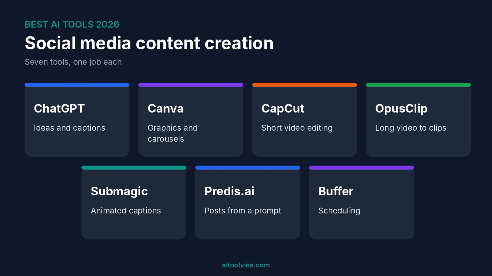
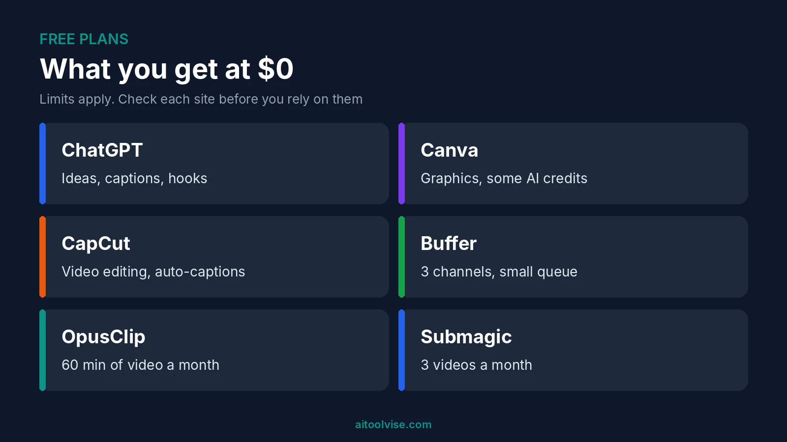
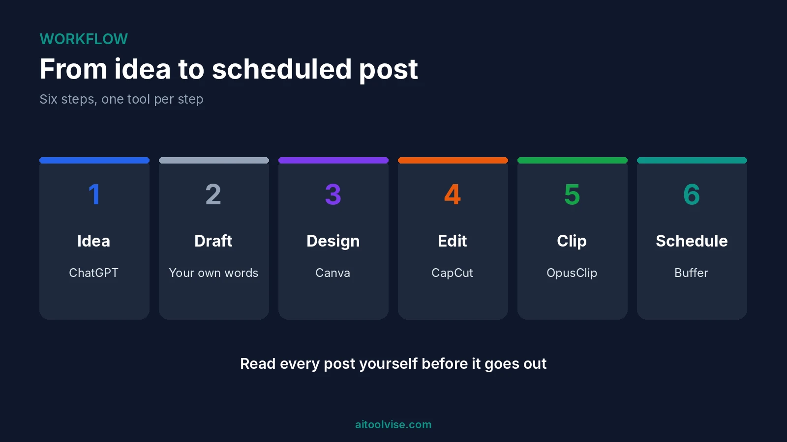

Most lists of the best AI tools for social media content creation give you twenty names and then leave. Honestly, I don't find that helpful. If all you want is to post a few times a week and still have your evenings, twenty tools is a headache. So this list has seven. Each one does a single job. Ideas and captions, graphics, short video, clipping long videos, subtitles, whole posts from a prompt, scheduling. I read through the current guides and checked every price against the newest source I could find. Where two sources disagreed, I say so. Want the bigger picture beyond social media? Our [best AI tools for content creation](/best-tools/best-ai-tools-content-creation/) guide covers research, writing and audio as well.

## Best AI Tools for Social Media Content Creation at a Glance

Short on time? Start with ChatGPT, Canva and CapCut. You can try all three free. Add the others later, once something starts to slow you down.

| Tool | Best for | Free plan | Paid from |
|---|---|---|---|
| ChatGPT | Ideas, hooks, captions | Yes | Go about $8, Plus $20 a month |
| Canva | Graphics and carousels | Yes | Pro about $15 to $18 a month |
| CapCut | Short video editing | Yes | Pro $19.99 a month |
| OpusClip | Long video into clips | Yes, 60 minutes a month | Starter $15 a month |
| Submagic | Captions on short videos | Yes, 3 videos a month | Starter $19 a month |
| Predis.ai | Posts from one prompt | Guides disagree | $19 to $32 a month (guides disagree) |
| Buffer | Scheduling | Yes, 3 channels | About $5 per channel a month |

These prices come from guides published between May and August 2026. A few of them don't match. Check each pricing page before you pay anyone.

## How I Picked These Tools

My rules were simple. One job, done well. A free plan or trial I could confirm. And at least a couple of recent guides mentioning it. When two sources gave different prices, I show both. I haven't used all seven for months on end, so the "best for" labels are a starting point, nothing more. One more thing. Plenty of guides on this topic come from a company that sells one of the tools on its own list. Keep that in mind when you read them. That goes for this one too.

## 1. ChatGPT: Best for Captions, Hooks and Ideas

Every post starts with an idea, and that's the part ChatGPT is good at. Tell it your topic, who you're talking to and how you write. Then ask for ten hooks. Eight will be bad. Two will be fine, and two is plenty. It'll also draft captions, hashtags, thread outlines and replies if you ask.

The free plan is fine to start. Plus is $20 a month, and there's a cheaper Go plan at about $8 (our [Perplexity vs ChatGPT comparison](/compare/perplexity-vs-chatgpt/) has the details). The catch is the voice. Left on its own, it writes captions that sound like everybody else's. So paste in three of your own posts first and tell it to copy them.

## 2. Canva: Best for Graphics and Carousels

If you're not a designer, Canva is the easiest way I know to get a decent graphic done. Say what you want, pick a template, drop in your brand colors. Carousels, quote cards, story frames, thumbnails. It does them all.

The free plan comes with some AI credits. One August 2026 article put it at 50 a month. [Piktochart's 2026 pricing breakdown](https://piktochart.com/blog/canva-pricing-2026-costs-raised/) lists Pro at $18 a month or $180 a year (about $15 monthly), with 500 credits, licensed to one person. Another guide says $15, so it likely depends on how you pay. Here's the thing to know. The credits are shared by every AI feature. When they run out, you wait for the monthly reset.

## 3. CapCut: Best for TikTok, Reels and Shorts Editing

For vertical video, CapCut is probably already on your phone, and on most creators' phones too. Reviewers like the auto-captions best, and one August 2026 review has them on the free plan. Pro adds AI video generation, AI avatars and 4K export.

[That tlinky review](https://tlinky.com/capcut-review/) lists Pro at $19.99 a month or $179.99 a year, and says free exports stop at 1080p. It calls the AI video output okay for rough drafts, not finished ads. Two warnings. The review contradicts itself on watermarks, so export a test clip before you commit. And CapCut's commercial music is licensed only for use inside CapCut, TikTok and TikTok for Business. Want to use that same video as an ad somewhere else? You'd need separate permission.

## 4. OpusClip: Best for Turning Long Videos Into Clips

Got a podcast, a webinar or a long YouTube video sitting around? OpusClip looks for moments that could work as shorts and cuts them out for you. If you already make long videos, it can save you hours.

[Castmagic's pricing guide](https://www.castmagic.io/blog/opus-clip-pricing) says it checked OpusClip's pricing page on August 20, 2026. It lists a free plan with 60 minutes of imported video a month (captions carry a watermark), Starter at $15 a month for 150 minutes, and Pro at $29 for 300. One credit is one minute of video you import. A different guide shows lower prices, so check the site. And watch every clip before it goes out. The AI picks what it thinks is catchy. That's not always the bit you'd pick.

## 5. Submagic: Best for Captions on Short Videos

You know those bold, bouncing subtitles on almost every short? Submagic makes those. You upload a video, it adds captions and emphasis, and you fix whatever you don't like.

One guide, a Rework roundup, lists a free plan with 3 videos a month, Starter at $19 and Pro at $39. That's the only source I found, so treat the prices as rough. And if CapCut's free captions already look fine to you, skip this one. Submagic is for when you want the polished look and can't be bothered to build it by hand.

## 6. Predis.ai: Best for Posts From a Single Prompt

Predis.ai takes a short prompt or a product link and hands back a finished post. You get a caption, an image and sometimes a short video. It's aimed at small businesses that need regular posts and have no designer.

The pricing is a mess. Two guides list a Core plan from $32 a month. Another says paid plans start at $19. One mentions a free tier of 15 posts a month, which I couldn't confirm. The posts can look a bit samey, so edit every one. I'd treat it as a quick first draft.

## 7. Buffer: Best for Scheduling and Cheap Publishing

Making posts is only half the job. Getting them out on time is the other half. Buffer lets you line up posts across platforms, and its AI assistant rewrites the copy for each channel. The free plan covers 3 channels with a small scheduling cap. Ten scheduled posts, though guides disagree on whether that's per account or per channel.

Paid plans start at about $5 per channel a month when billed yearly, according to two guides. Need team features? Hootsuite is the pricier route. Two guides list it from $99 per user a month billed annually. For a solo creator, that's a lot.

## Best Free AI Tools for Social Media Content Creation

You can run a basic setup for nothing. ChatGPT does the ideas and captions. Canva does the graphics. CapCut edits the video. Buffer schedules it all on three channels. No card needed.

Need a voiceover? ElevenLabs has a free plan, listed at 10,000 credits a month in two guides. Our [best free AI voice cloning tools](/best-tools/best-free-ai-voice-cloning-tools/) roundup covers the options. Just know that free plans have limits. You'll hit watermarks, export caps and a small pile of AI credits. That's enough to find out if a tool suits you. Not much more.

## Best AI Tools by Platform

The platform matters less than you'd think. The same few tools work almost everywhere. The format and the rules are what change.

### TikTok

Edit in CapCut. Write hooks with ChatGPT. Starting from a long video? Use OpusClip or Submagic. Running ads? TikTok's own Symphony tool is free inside Ads Manager, but you need an active ad account, according to Rework's TikTok guide. Want an AI presenter on screen? Our [HeyGen pricing review](/reviews/heygen-pricing-review/) covers one option.

### YouTube

ChatGPT helps with title and script ideas. OpusClip cuts Shorts out of long videos. vidIQ and TubeBuddy come up a lot for YouTube search help, but I didn't confirm their current prices, so check their sites. One rule change is worth knowing about. YouTube updated its Partner Program on July 15, 2025 to better catch mass-produced, repetitive content. [BetaNews reports](https://betanews.com/2025/07/10/youtube-is-fighting-ai-slop-with-new-monetization-guidelines/) that YouTube's Rene Ritchie called it a minor update to long-standing rules, and the article doesn't describe it as an AI ban.

### LinkedIn

A few names keep coming up. AuthoredUp (about $19.95 a month in one guide), Taplio ($39 to $65) and Supergrow (from $19). That guide was published by a competing tool, so verify the prices. Be careful with anything that automates commenting or messaging. The guides I read warned about LinkedIn flagging accounts, but none cited LinkedIn's own rules. Read LinkedIn's terms yourself. My habit would be to let AI draft, then post by hand.

### Instagram

Canva handles carousels and Reel covers, CapCut handles Reels, and Buffer schedules them. Making clips set to music? Our [best AI music video generators](/best-tools/best-ai-music-video-generators/) guide has tools built for that.

## Best AI Social Media Post and Caption Generators

For captions, I'd try ChatGPT first. For whole posts with an image already attached, Predis.ai and Canva do more of the work. Buffer's assistant helps when one caption has to be reworded for different channels.

The prompt matters more than the tool. Here's one that works for me: "Write five Instagram captions for a bakery's new sourdough. Friendly, under 40 words, one emoji, no hashtags. Match the tone of these three posts: [paste them]." Platform, length, tone, examples. Leave one out and you get bland filler.

## Which AI Is Better Than ChatGPT for Social Media?

Better at what? That's the real question. Plenty of writers like Claude for captions that sound less stiff, and our [ChatGPT vs Claude comparison](/compare/chatgpt-vs-claude/) goes through the differences. Gemini suits people who live in Google's apps. Perplexity is handy for checking what's trending before you write.

And which AI tool is trending? [Similarweb's data through May 2026](https://aisearch.similarweb.com/blog/chatgpt-vs-gemini-vs-claude-vs-perplexity/) has ChatGPT well ahead on web visits, with Gemini a clear second. Traffic isn't quality, though. Pick for the job.

## Do You Have to Label AI Content on Social Media?

Often, yes. If AI made something realistic, like a person, a voice or an event, most big platforms want you to say so. [TikTok launched its AI content labels in September 2023](https://www.socialmediatoday.com/news/tiktok-officially-launches-new-in-stream-labels-for-ai-generated-content/694154/) and says unflagged content may be removed. [Influencer Marketing Hub's summary](https://influencermarketinghub.com/ai-disclosure-rules/) says YouTube asks creators to label realistic altered or synthetic content. It also says Meta adds an "AI info" tag when it detects the right metadata, and wants a manual disclosure when it doesn't.

Obvious fantasy or stylized effects are usually treated differently. And these rules keep changing, so look at each platform's help page before you post.

## Can AI Content Make Money?

It can help you make money. It won't do it for you. I couldn't find reliable data on what people really earn from AI-made content. So treat any "$10,000 a month" promise as marketing until someone shows receipts.

The real routes are pretty dull. You post faster, so you grow faster. You run social media for small businesses. You sell something to the audience you build. AI cuts the time each post takes. It can't supply taste. And mass-produced, repetitive content tends to run into trouble on platforms.

## How to Use AI to Create Social Media Content

Here's the process I'd follow:

1. Pick one platform and one goal, like followers or sales.
2. Ask ChatGPT for ten hooks, using your own posts as examples.
3. Draft the caption, then rewrite it in your own words.
4. Make the visual in Canva, or edit the video in CapCut.
5. Got long video? Cut it into clips with OpusClip.
6. Schedule it with Buffer, and answer the comments yourself.

A few habits help. Hook people in the first second or two. Post on a schedule you can actually keep. Reuse one idea in different formats, like a carousel, a short clip and a quote card. How-to shorts, behind-the-scenes clips and before-and-after posts tend to work well.

## Which Tool Should You Pick?

Solo creator on a budget? Use the free stack of ChatGPT, Canva, CapCut and Buffer. Make podcasts or long videos? Add OpusClip. Run a small business with no designer? Look at Predis.ai and Canva Pro. Post on LinkedIn? Stick with ChatGPT or Claude for drafts and publish by hand.

Don't buy five tools at once. Start with the free versions and notice which one you keep opening. Pay for that one, and only when its limits start getting in your way.

Want more? The [home page](/) lists our other roundups, comparisons and reviews.

## Affiliate Disclosure

Some links on this page may be affiliate links. If you sign up through one, AIToolVise may earn a commission at no extra cost to you. We only recommend tools we'd point a friend toward, and our opinions are our own. Plans and prices change often, so confirm them on each company's own pricing page before you buy.