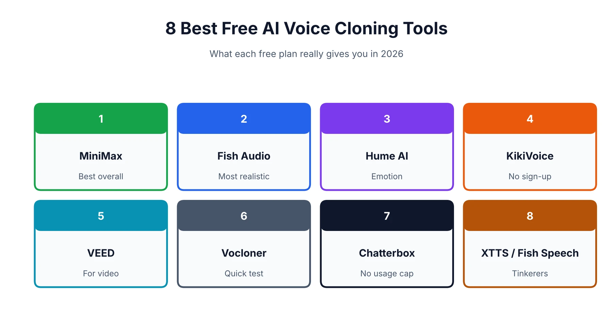
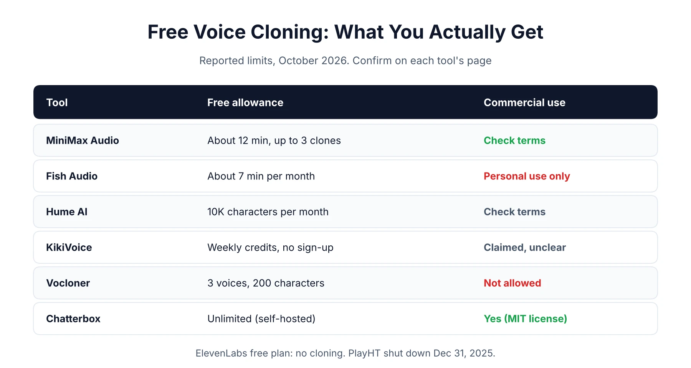
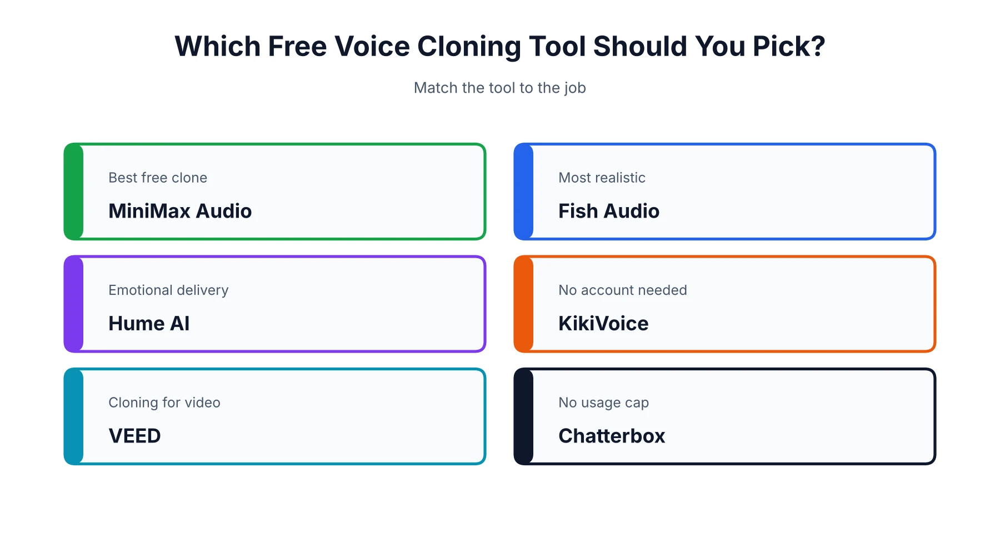

If you just want the answer, it's MiniMax Audio. Fish Audio is a very close second, and open-source Chatterbox wins if you can't stand usage caps. The longer answer is messier, because "free" is doing a lot of work in this category. A few famous names don't clone for free at all. One popular tool has shut down. And nearly every free tier comes with strings attached, usually about what you're allowed to do with the audio afterward. This guide sorts the real offers from the bait-and-switch ones. If you're putting together a bigger toolkit, our [best AI tools for content creation](/best-tools/best-ai-tools-content-creation/) roundup shows where a voice tool fits.

## What "Free" Really Means for Voice Cloning

On a pricing page, three very different things all get called free: a monthly allowance that resets, a one-time pile of credits, and open-source software you run yourself. They look identical until you actually start using them.

### Free tier, free trial, or open source?

A free tier refills every month, so you can keep coming back, though usually only in small doses. A trial runs dry and stays dry. Open source has no cap at all, but you bring the computer and the patience. Before committing to any tool, ask three things. How much audio do I get? Is cloning really included? Can I use the result commercially? Plenty of plans say yes to the first two and a firm no to the third.

### Why isn't ElevenLabs free for cloning?

Everyone searches for ElevenLabs first, so this one catches a lot of people. The free plan gives you about 10,000 credits a month (roughly ten minutes of speech), no commercial rights, and no voice cloning. [Instant cloning starts on the $5 Starter plan](https://elevenlabs.io/pricing), and professional cloning sits a tier above that. A couple of pages ranking right now still list it as a free cloning tool, and they're simply wrong.

## Best Free AI Voice Cloning Tools at a Glance

If you only read one part of this page, read the table. Allowances shift constantly, so think of these numbers as a snapshot from our October 2026 research and double-check before building anything on them.

| Tool | Free allowance | Cloning on free? | Commercial use | Best for |
|---|---|---|---|---|
| MiniMax Audio | About 12 min, up to 3 clones (reported) | Yes | Check terms | Best overall |
| Fish Audio | About 7 min/month | Yes | Personal use only (reported) | Realism |
| Hume AI | 10K characters/month | Reportedly yes | Check terms | Emotion |
| KikiVoice | Weekly credits | Yes | Claimed, terms unclear | No sign-up |
| VEED | Limited credits | In some regions | Check terms | Video creators |
| Vocloner | 3 voices, 200 characters per script | Yes | No | Quick test |
| Chatterbox | Unlimited (self-hosted) | Yes | Yes (MIT) | No caps |
| XTTS-v2 / Fish Speech | Unlimited (self-hosted) | Yes | Often non-commercial | Tinkerers |

## 1. MiniMax Audio: Best Free AI Voice Cloning Tool Overall

Start here. In a hands-on test of ten free cloners, MiniMax was the only one that really nailed the tester's voice, and it scored 9 out of 10 for clean audio and natural pacing. A July 2026 roundup puts the free allowance at roughly 12 minutes of audio and up to three cloned voices.

It needs only about 10 seconds of sample audio, and one Fish Audio versus MiniMax comparison says the clone takes around 30 seconds to build. It also handles little human touches like laughs, breaths, and pause markers. Two things to keep in mind. MiniMax doesn't publish a tidy "free plan" page, so check what you actually receive when you sign up at [MiniMax Audio](https://www.minimax.io/audio). And that same comparison says unused clones get deleted after seven days, so don't treat the account as a vault.

## 2. Fish Audio: Best for Realistic Voices

If MiniMax is the safe first stop, Fish Audio is where you go when the voice has to sound right. It clones from 10 to 15 seconds of audio, and a June 2026 roundup reported its model edging both ElevenLabs and OpenAI in blind listening tests. You get roughly seven minutes of generation a month on the free plan, plenty for judging quality.

Licensing is where it gets restrictive. Third-party roundups describe the free tier as personal use only, so if you plan to publish or sell anything, read [Fish Audio's terms](https://fish.audio) first. One more thing: Fish Audio writes its own comparison articles, and they flatter Fish Audio a little more than a neutral reviewer would.

## 3. Hume AI: Best for Emotional, Directable Speech

Hume is for when the performance matters more than the clone. Its Octave text-to-speech lets you direct delivery in plain English, something like "sound like a tired night-shift nurse delivering good news." Not many tools let you do that.

The free plan gives you about 10,000 characters a month, plus a little time on its conversational product. Reports say voice cloning is included, but one pricing tracker listed it as both included and excluded on the same page, so confirm it on [Hume's site](https://www.hume.ai) before you count on it. Free output carries Hume branding and the limits are tight. Treat it as a way to audition the style, not a production plan.

## 4. KikiVoice: Best No-Sign-Up Option

KikiVoice is the quickest way to get a clone running, because it doesn't want anything from you first. Its page says you can start without registering or entering a card, then upload a 3 to 15 second sample. It covers 75-plus languages and runs on weekly credits that reset.

I'd be cautious about a few gaps. The exact credit numbers aren't published, paid pricing means contacting the company, and the site claims safe commercial use without saying whether that covers free-tier audio. As with every tool here, a messy sample gives a messy clone. Fine for experiments at [KikiVoice](https://kikivoice.ai), but read the terms before anything client-facing.

## 5. VEED: Best for Cloning Your Voice for Video

If the voice is headed straight into a video, VEED saves you a step, since you're already editing there. Its own guide says free cloning only works in regions where the free plan includes AI credits, and it doesn't publish the limits. Speech generation burns credits on every plan.

You record yourself reading a short script, which doubles as your consent statement. VEED's recording tips are good enough to steal for any tool: under a minute, a quiet room, a headset or USB mic instead of the laptop mic. You'll hit the credit ceiling fast. And if you want that voice attached to a talking head, our [HeyGen review](/reviews/heygen-pricing-review/) covers an avatar tool built for exactly that.

## 6. Vocloner: Best for a Quick Throwaway Test

Vocloner is the "does cloning even work for me?" option. In the hands-on test it allowed up to three voices and 200 characters per script, banned commercial use, and produced audio that sounded muffled and only vaguely like the speaker. A July 2026 roundup lists the same limits.

So no, don't build a workflow on it. But if you want to hear what a clone of your voice sounds like in thirty seconds, it'll do.

## 7. Chatterbox: Best Free Option With No Usage Cap

Chatterbox is open source, released by Resemble AI under the MIT license, which means commercial use is fine. It clones from about five seconds of reference audio, and every file it produces carries an inaudible watermark so the audio can be traced.

The price is setup. You'll want a reasonably capable computer, ideally with a GPU, and some comfort installing software, and there's no support desk to call. If you can handle that, it's the closest thing to unlimited free cloning you'll find. The code lives on [GitHub](https://github.com/resemble-ai/chatterbox).

## 8. XTTS-v2 and Fish Speech: For Tinkerers

These are the other self-hosted options, and the licensing story is murkier. A July 2026 roundup reports XTTS-v2 as non-commercial and lists Fish Speech under a non-commercial license too, while another source says a newer Fish Speech release is under Apache 2.0. The sources disagree, so read the license in the repository yourself before using either for anything you plan to publish.

Both are capable and fun to run. You're on your own for setup, tuning, and consent, though. Unless you have a specific reason, pick Chatterbox first.

## Tools That Aren't Really Free (and One That Shut Down)

Plenty of well-known names show up on "free" lists without offering free cloning, and finding that out after you've signed up is annoying. ElevenLabs is the biggest one, covered above.

Voice.ai's free plan gives you 5,000 credits a month for speech, but a May 2026 pricing breakdown lists no instant voice clones, no downloads, and a 500-character cap per conversion, so cloning is a paid feature there. Descript is the confusing one. The hands-on test and a July 2026 roundup both say cloning works on the free plan, but only inside a video or podcast project and with limited transcription time, while other trackers call it paid. If you already edit audio by text, just test it on the free plan and see what you get.

The tester behind that ten-tool experiment cut Murf, Resemble AI, Speechify, and Invideo entirely, because cloning was locked behind a paywall, a sales call, or a paid generation step.

Then there's PlayHT. It was acquired by Meta and shut down on December 31, 2025. If a list still recommends it, that list hasn't been updated in a while.

## Which Free AI Voice Cloning Tool Should You Pick?

Choose by the job, not by whoever has the prettiest landing page.

If you simply want the best free clone, use MiniMax Audio. If realism matters most, try Fish Audio. Need acted emotion in the delivery? Hume. Want zero friction? KikiVoice. Making a video? VEED, or an avatar tool, and our [HeyGen vs Synthesia](/compare/heygen-vs-synthesia/) comparison shows how those two handle voices. And if you're allergic to usage limits and can self-host, Chatterbox is your answer.

## Free AI Voice Cloning With Emotion

Several tools handle emotion, each in its own way. Hume lets you describe the feeling in plain language. MiniMax uses non-verbal tags for laughs and breaths. Fish Audio offers simpler emotion tags. Honestly, though, a clean and expressive source recording does more than any setting. If your sample sounds flat, the clone will too.

## Free AI Voice Cloning for Singing

Most free tools on this list clone speaking voices, and they won't sing. Singing usually calls for voice conversion, where you sing a take yourself and the tool swaps in a different voice. Open-source models exist for that, but they work speech-to-speech rather than text-to-speech, and they take real setup. Be careful about cloning a real artist's voice, which can cause serious legal and ethical trouble. If you're after music visuals rather than vocals, see our [best AI music video generators](/best-tools/best-ai-music-video-generators/).

## Free AI Voice Cloning on iOS and Android

You can usually skip the app. Most of these tools are websites that work fine in a phone browser, and KikiVoice is one example. If a tool does have an official app, get it from the Apple App Store or Google Play. Stay away from APK files on random download sites, which are a common way to spread malware. A cloning app you sideload is a spectacularly bad place to upload recordings of your voice.

## Is Unlimited Free Voice Cloning Possible?

Not on a hosted service. Every one of them caps you with credits, characters, or time. The only truly uncapped route is running an open-source model on your own machine, which swaps money for setup time and sometimes licensing limits. If a site promises "unlimited free" and then asks for a card, read the fine print twice.

## How to Clone Your Own Voice, Step by Step

Once you've picked a tool, the whole thing takes about ten minutes.

1. **Find a quiet room.** Background noise gets baked into the clone.
2. **Use a decent mic.** A headset or USB mic beats a laptop microphone.
3. **Record 30 to 60 seconds.** Read the way you'd talk to a colleague, with natural pauses, not like a news anchor.
4. **Upload it and confirm the voice is yours.** Many tools ask you to read a short consent line.
5. **Test with a short script.** Listen for muffled sound, odd pacing, or flat delivery.
6. **Re-record if needed.** A cleaner sample fixes most problems.

Want that voice in a finished video? Our guide to [using HeyGen](/how-to/how-to-use-heygen/) walks through one way to do it.

## Is Voice Cloning Legal? Consent and Commercial Use

Cloning your own voice is fine. Cloning someone else's without permission is where the trouble starts. Several US states, including California, New York, and Tennessee, are reported to require consent, and the EU asks for AI-generated content to be labeled. A June 2026 guide also warns that ticking a terms-of-service checkbox won't save you as a legal defense. We're not lawyers, so check the rules where you live. Two habits keep you out of most trouble: only clone voices you own or have written permission to use, and don't use free-tier audio commercially unless the terms plainly allow it. ElevenLabs, for one, bars commercial use on its free plan.

## Can ChatGPT Clone Your Voice?

Not in a way you can use yourself, as far as we can confirm. ChatGPT's voice mode talks and listens using preset voices, and OpenAI's text-to-speech API is also built around preset voices with pay-as-you-go pricing. That's voice conversation, not cloning. Features change quickly, so check OpenAI's current documentation if this matters to you. And if you're weighing the assistants more broadly, our [ChatGPT vs Claude](/compare/chatgpt-vs-claude/) breakdown covers that.

## What Do Users Say About Free Voice Cloning Tools?

Mostly they complain about the bait-and-switch. You sign up for something advertised as free, spend time recording a sample, then hit a paywall the moment you try to export or use the clone. The tester behind that ten-tool experiment described the same pattern, which is why he cut five popular tools. Other regular gripes are tiny character limits, watermarks, and unclear commercial terms. For live reports, browse [r/ElevenLabs](https://www.reddit.com/r/ElevenLabs/) and similar communities, and keep in mind that people who ran into trouble post the loudest. For more of our coverage across AI tools, head to the [homepage](/).

*This guide reflects free-tier limits and features as of October 2026. These change often, and several figures here come from third-party roundups rather than the vendors themselves, so confirm the details on each tool's official pricing page before you rely on them.*

## Affiliate Disclosure

This article may contain affiliate links. If you sign up for a tool through a link on this page, we may earn a commission at no extra cost to you. This helps support the research behind guides like this one. Our opinions and recommendations are based on independent research, and affiliate relationships don't influence which tools we cover or how we rank them.