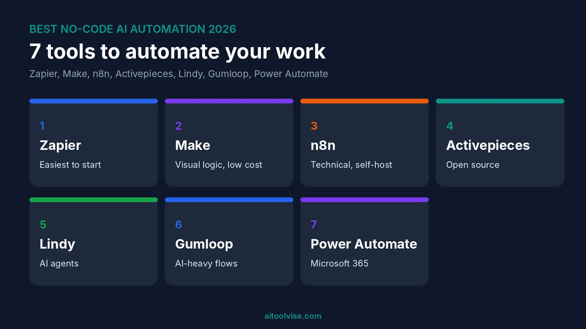
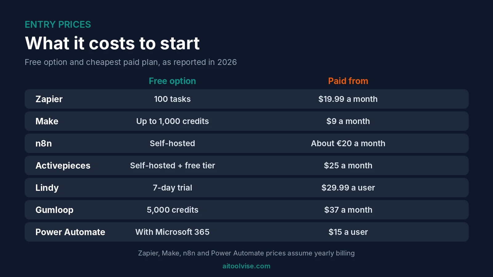
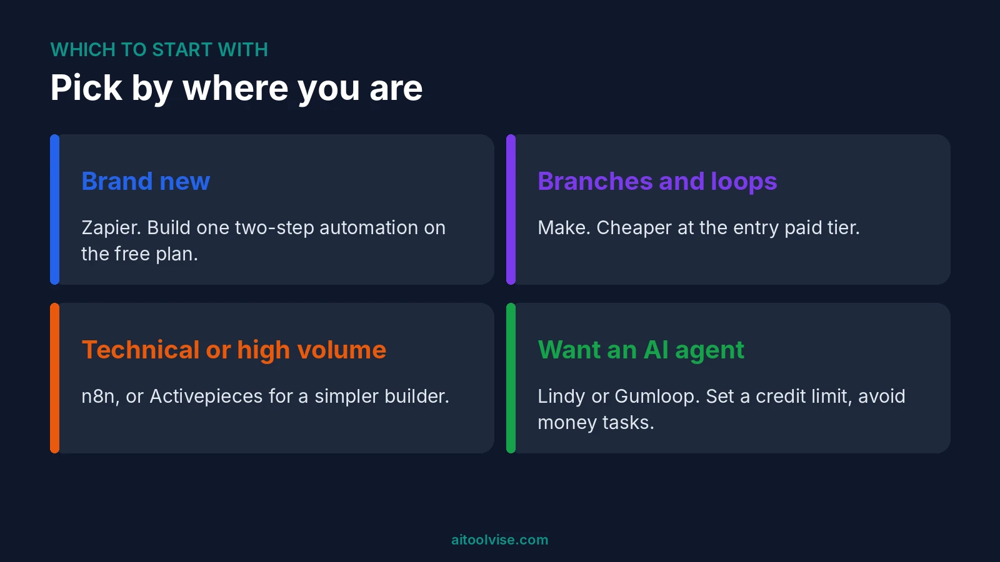

Zapier is the easiest place to start with no-code AI workflow automation. Make is cheaper once your flows get complicated. And n8n is the one to pick if you're comfortable with a bit of tech and want the lowest bill at volume. Those three cover most people. The other four in this list of no-code AI workflow automation tools fit narrower jobs.

I didn't build a workflow in every tool here. This is a research roundup of 2026 pricing pages, guides and vendor docs, and I'll say where sources disagree. Plans change often, so treat every price as a snapshot. If you run a small shop, our [best AI tools for small business](/best-tools/best-ai-tools-for-small-business-2026/) guide is a good companion.

## Best No-Code AI Workflow Automation Tools at a Glance

Here's the quick view. Prices are as reported in 2026, in the currency each source used.

| Tool | Best for | Free option | Paid from |
|---|---|---|---|
| Zapier | Beginners and app count | 100 tasks a month | $19.99 a month, yearly |
| Make | Visual logic on a budget | Up to 1,000 credits | $9 a month, yearly |
| n8n | Technical teams and self-hosting | Self-hosted version | About €20 a month, yearly |
| Activepieces | Open-source simplicity | Self-hosted, plus a cloud free tier | $25 a month, per its own page |
| Lindy | AI agents | 7-day credit trial | $29.99 a user |
| Gumloop | AI-heavy workflows | 5,000 credits | $37 a month |
| Power Automate | Microsoft 365 shops | Free with Microsoft 365, standard connectors | $15 a user, yearly |

Most figures come from [Dupple's workflow automation roundup, updated November 2026](https://dupple.com/learn/best-workflow-automation-tools) and vendor-neutral pricing guides. Check each company's own page before paying.

## How to Choose a No-Code AI Workflow Automation Tool

Ask three things. How many steps will your flows have? How often will they run? And do you want an app that follows rules, or one that works toward a goal?

### Tasks, credits and executions are not the same thing

This trips people up. Zapier bills in tasks. Make now bills in credits. n8n bills one execution per full workflow run, no matter how many steps it has, per one 2026 comparison. So a 20-step flow can cost 20 times more on one tool than another. Honestly, that's the biggest reason your bill surprises you.

## 1. Zapier: Best for Beginners and App Count

Zapier has the lowest learning curve. One guide says you can grasp it in about ten minutes. It has a free plan with 100 tasks a month and two-step Zaps. Professional starts at $19.99 a month billed yearly, or $29.99 monthly, per [Jet Admin's September 2026 pricing guide](https://www.jetadmin.io/blog/zapier-pricing/). Team starts at $69 a month yearly for up to 25 users.

AI is built in. Copilot helps build Zaps, and AI fields sit on Professional. Agents and Chatbots are separate add-ons, and they draw from the same task pool when they act. Jet Admin sells a rival product, so I'd double-check its comparisons.

The catch is volume. Dupple notes overages bill at 1.25 times. If you run thousands of tasks, look at Make or n8n.

## 2. Make: Best for Visual Logic on a Budget

Make is the visual one. You drag modules onto a canvas and branch them. Core is $9 a month yearly ($10.59 monthly) with 10,000 credits. Pro is $16 and Teams $29, and per Jet Admin those tiers add priority, bigger files and collaboration, not more credits.

The free plan gives up to 1,000 credits. That's a ceiling, not a promise. Make renamed operations to credits in August 2025, and most module actions cost one credit. AI modules can cost more, and a couple of sources didn't say how much. Check before you build something heavy.

It's steeper than Zapier. One test had a Slack-to-Airtable scenario live in about ten minutes, though. And loops can multiply cost, because each item runs the steps after it.

## 3. n8n: Best for Technical Teams and Self-Hosting

n8n has no permanent free cloud plan, just a 14-day trial. Cloud Starter was about €20 a month yearly with 2,500 executions. Pro was €50 with 10,000 executions and 150 AI credits, per [Hackceleration's 2026 n8n vs Make comparison](https://hackceleration.com/labs/compare/n8n-vs-make). The free route is the self-hosted Community Edition, with unlimited executions.

Self-hosting isn't free, though. You pay for a server, which that source puts around €5 to €15 a month, and you maintain it. It also uses a Sustainable Use License, not a fully open one.

AI is where n8n shines. Hackceleration counts over 70 AI nodes built on LangChain and native MCP support. It also says juniors took closer to three hours to feel comfortable. And its Business tier figures conflict between pages, so confirm on n8n's site.

## 4. Activepieces: Best for Open-Source Simplicity

Activepieces is MIT-licensed and free to self-host. Its own page, [Activepieces' n8n comparison](https://www.activepieces.com/blog/activepieces-vs-n8n), lists a free cloud tier with 1,000 tasks and 200 AI credits. It also lists a Basic plan at $25 a month with unlimited executions and 10 active flows.

That's vendor marketing, published July 2025 and edited in October 2026. So I wouldn't take the speed or ease claims as fact. It also counts tasks on one plan and executions on another, without defining either. Still, the vertical step builder looks friendlier than n8n's canvas. It's one to try free.

## 5. Lindy: Best for AI Agents

Lindy works differently. You describe a goal and the agent figures out the steps. There's no permanent free plan, just $50 in credits that last seven days. Plus is $29.99 a user with 3,000 credits. Pro is $99.99 with 15,000, and Max $199.99 with 35,000, per [Layer3 Labs' Lindy pricing guide](https://www.layer3labs.io/guides/lindy-ai-pricing).

Credits are the catch. Basic steps use about one to three. Big reasoning steps use about ten. Top-ups are $10 per 1,000. Dupple lists a Team plan at $49.99 a user instead, so the sources disagree. Dupple also says costs are hard to predict and that customer or money tasks need guardrails. I'd keep an agent away from payments.

## 6. Gumloop: Best for AI-Heavy Workflows

Gumloop is built around AI blocks. Dupple lists Pro at $37 a month with 20,000-plus credits, and a free plan with 5,000 credits. It says you can switch models per node across GPT, Claude, Gemini and DeepSeek. It also lists about 130 native integrations, far fewer than Zapier.

I only found one source with these numbers, so verify them. Credits get expensive with premium models. It suits people whose flows are mostly AI steps rather than moving data between apps.

## 7. Microsoft Power Automate: Best for Microsoft 365 Shops

If your company lives in Microsoft 365, Power Automate may already be paid for. Dupple says it's free on standard connectors for Microsoft 365 users. Premium is $15 a user a month yearly. There's also a $500 a month Per Flow plan for five flows.

Licensing is messy. Dupple calls it "a maze" and says it feels heavy outside Microsoft. AI Builder uses its own credits. For a Google or Slack team, I'd pick something else.

## Best Free AI Workflow Automation Tools

Free plans for no-code AI workflow automation are real, but small. Zapier gives 100 tasks. Make gives up to 1,000 credits. Gumloop lists 5,000 credits, and Activepieces says 1,000 tasks. Lindy's is a seven-day trial, not a plan.

### Open-source AI workflow automation tools

Two stand out. n8n's Community Edition and Activepieces both self-host for free. You still pay for the server and your time. And n8n's license limits some uses, so read it first.

### AI automation tools with no restrictions

Nothing free is unlimited. Self-hosting removes execution caps, but adds a server bill and upkeep. Everything else has a cap somewhere. If a site promises otherwise, I'd be careful.

## Best AI Automation Testing Tools

This is a different job. Testing tools check that your software works, not move data between apps. I haven't used any of them. [TestCollab's roundup](https://testcollab.com/blog/ai-testing-tools) is the one I leaned on, and it ranks its own product first, so weigh it.

Katalon covers web, mobile and API testing, from $70 a seat a month with no free plan, per that guide. Testim has a free Community tier and is low-code. Mabl is low-code, with a 14-day trial and custom pricing. Functionize lists a free tier with 200 credits, and Autify has a free tier for individuals and is no-code. Several vendors don't publish prices at all, so costs are hard to compare.

## Questions About No-Code AI Tools

### Which AI is best for non-coders?

For automations, Zapier or Make. For writing and everyday tasks, ChatGPT or Claude. Our [ChatGPT vs Claude](/compare/chatgpt-vs-claude/) comparison helps you pick between those two.

### What are some good no-code tools for AI development?

Gumloop and Lindy are the two here built around AI. n8n and Activepieces suit people willing to learn more. For building an app by chat, our [best AI coding tools](/best-tools/best-ai-coding-tools/) roundup covers vibe-coding options like Replit and v0.

### Which AI is number 1 in coding?

No single winner. Cursor, GitHub Copilot and Claude Code lead most lists I've seen, including ours. Our [guide to using Claude Code](/how-to/how-to-use-claude-code/) is a good start if you're curious.

### Can ChatGPT write its own code?

It can write code for many tasks, yes. It can also get things wrong, so run and test whatever it gives you. If you only want a one-off script, it's often enough.

### Which AI tool is better than ChatGPT?

Depends on the job. Claude is often preferred for writing and coding, and Gemini fits Google apps. We cover that in [Claude vs Gemini](/compare/claude-vs-gemini/).

## Tools I Left Out

Relevance AI is an agent platform. Layer3's guide, updated September 2026, lists a free tier, Pro at $29 monthly and Team at $349. But it says the free allowance is unclear, so check. Relay.app suits approvals, and Workato is enterprise-only and sales-led. One pricing guide says part of Pipedream is closing, though I couldn't confirm that, so I skipped it.

## Which Should You Start With?

### If you're brand new

Zapier. Start on the free plan and build one two-step automation.

### If your flows have branches and loops

Make, because it's cheaper at the entry paid tier.

### If you're technical or watching costs at volume

n8n, or Activepieces if you want a simpler builder.

### If you want an agent that works toward a goal

Lindy or Gumloop. Set a credit limit first. And keep them away from money.

## Where to Start With No-Code AI Workflow Automation

Pick one no-code AI workflow automation tool and one boring task. Something like saving email attachments to a folder. Run it on a free plan for a week. If it works, then think about paying. For more tools to pair with it, see our [best AI tools for content creation](/best-tools/best-ai-tools-content-creation/) roundup, or browse the [home page](/).

## Affiliate Disclosure

Some links on this page may be affiliate links. If you sign up through one, AIToolVise may earn a commission at no extra cost to you. We only recommend tools we'd point a friend toward, and the opinions are ours. Prices and plans shift a lot, so check each company's own pricing page before buying.