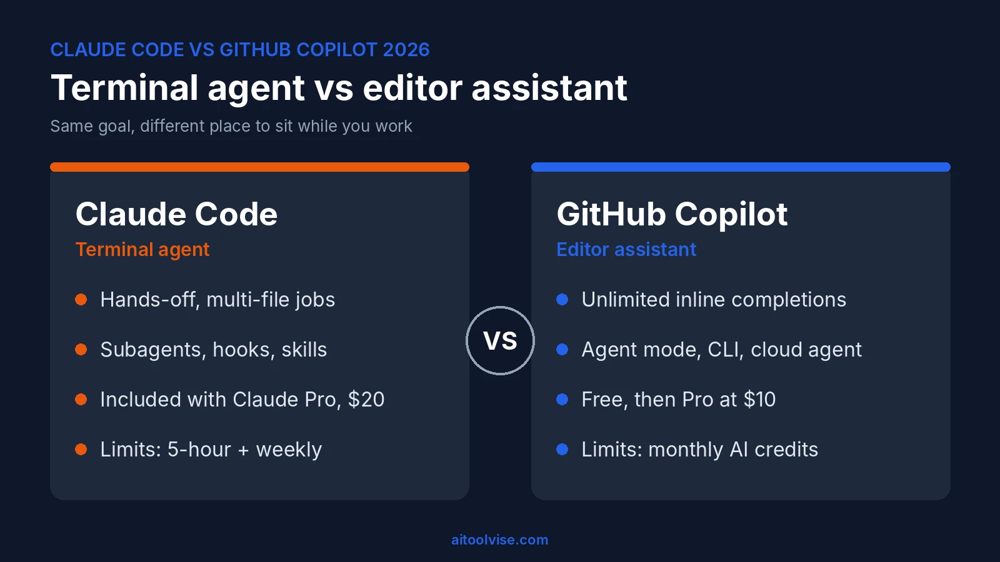
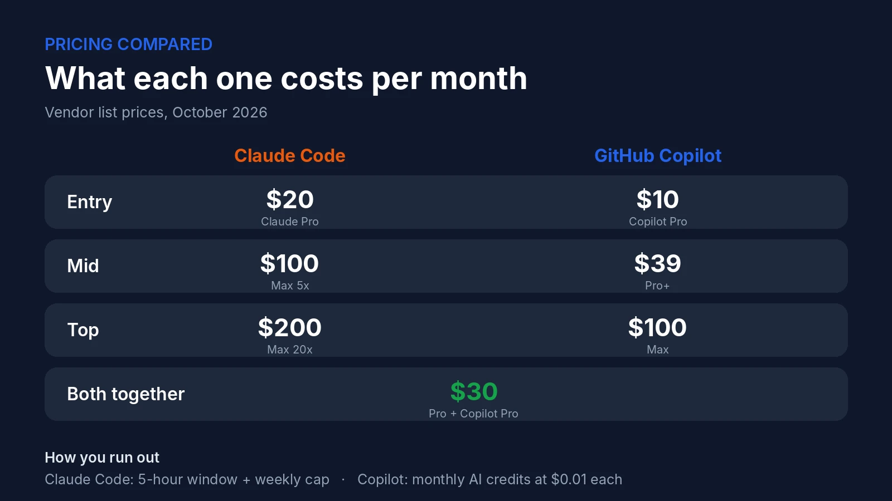
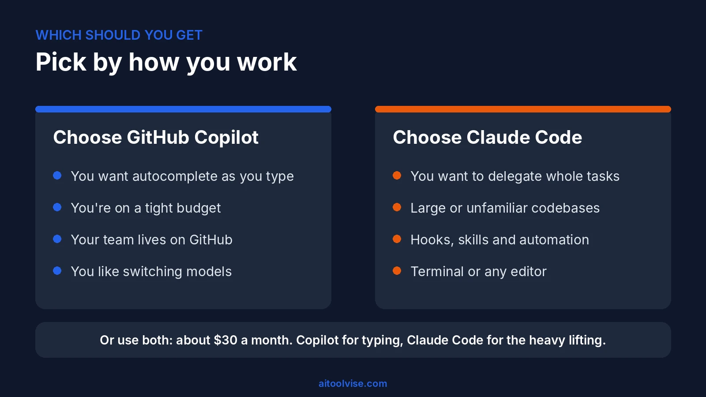

Claude Code vs GitHub Copilot isn't really a fight between two chatbots. It's a question of where you want the AI to sit while you work. Copilot lives in your editor and finishes your sentences as you type. Claude Code sits in your terminal like a colleague you hand a job to, then you review what comes back. Both have grown fast in 2026, both can now run agents, and both have changed how they charge. This guide compares how they work, what each costs, where each one wins, and how to decide. If you want the deeper background first, our [how to use Claude Code](/how-to/how-to-use-claude-code/) guide covers setup, and the [GitHub Copilot pricing review](/reviews/github-copilot-pricing-review/) breaks down every Copilot plan.

## Claude Code vs GitHub Copilot at a Glance

The short version of Claude Code vs GitHub Copilot: Copilot is the cheaper, easier way in, and Claude Code is the stronger pick when you want to delegate whole tasks. Here's the side-by-side.

| | Claude Code | GitHub Copilot |
|---|---|---|
| Main form | Terminal agent, plus VS Code, JetBrains, desktop and web | Extension for VS Code, Visual Studio, JetBrains and more, plus a CLI |
| Models | Claude models | Claude, GPT, Gemini and others |
| Inline autocomplete | No | Yes, unlimited on paid plans |
| Agents | Subagents, background agents, routines | Agent mode, CLI, cloud agent |
| Entry price | Included with Claude Pro, $20/month | Free, then Pro at $10/month |
| Heavy-use tiers | Max from $100/month | Pro+ $39, Max $100 |
| Usage model | 5-hour windows and a weekly cap | Monthly AI credits at $0.01 each |
| Best for | Delegating big, multi-file jobs | Everyday coding and GitHub-centric teams |

## Terminal Agent vs Editor Assistant: How Each One Works

Claude Code is an agent that reads your codebase, edits files, runs commands and works with git. According to [Anthropic's overview](https://code.claude.com/docs/en/overview), it runs in the terminal, in IDE extensions, in a desktop app and on the web, and they all share the same engine, so your CLAUDE.md rules and settings carry across. Copilot started as autocomplete and has grown outward: chat, an agent mode, a command-line tool and a cloud agent.

### Claude Code vs GitHub Copilot in VS Code

Inside VS Code, the difference is obvious within five minutes. Copilot feels native: you type, it suggests, you press Tab. Claude Code's extension works more like a side panel, with inline diffs, plan review and conversation history. You describe the job, review the plan, and approve changes. Neither side of Claude Code vs GitHub Copilot in VS Code is better in the abstract. If you spend your day writing code line by line, Copilot saves more keystrokes. If you spend it asking for changes across several files, the Claude Code panel is nicer.

### Copilot CLI vs Claude Code

In the Claude Code vs Copilot CLI matchup, both can now live in your terminal. Copilot CLI is available on every Copilot plan, and Claude Code needs a paid Claude plan or an API account. Copilot CLI's trick is its link to GitHub: you can start something locally and push it to the cloud. Claude Code's trick is depth, since it has hooks, skills, subagents and MCP connections for plugging into your tools. We covered the Cursor side of this in our [Cursor vs Claude Code](/compare/cursor-vs-claude-code/) comparison, and the same logic applies here.

## Agent Mode Compared: Claude Code Agents vs Copilot Agent Mode

For agents, Claude Code is the more established option in the Claude Code vs Copilot agent matchup, and Copilot is catching up quickly. Claude Code can spin up subagents that work on different parts of a task, run several sessions in the background, and even run on a schedule through routines. It can also work in CI, through GitHub Actions.

Copilot's agent mode works inside your editor and uses whatever context you have open. Where it gets interesting is the handoff. In Copilot CLI you can type `/delegate` (or start a prompt with `&`), and [GitHub's cloud agent](https://docs.github.com/en/copilot/how-tos/copilot-cli/use-copilot-cli/delegate-tasks-to-cca) takes over remotely, keeps working even if your laptop shuts, and opens a draft pull request when it's done. That's a nice workflow if your team lives in pull requests.

### Does Copilot Have Something Like Claude Code?

Yes, in spirit. Copilot CLI plus the cloud agent covers a lot of the same ground. GitHub has also been letting users run Claude and Codex agents inside Copilot through [Agent HQ](https://github.blog/2026-02-04-pick-your-agent-use-claude-and-codex-on-agent-hq/). When that was announced in February, it was a public preview for Pro+ and Enterprise plans, so check your own plan before counting on it.

## Claude Models Inside Copilot vs Claude Code Itself

A lot of people searching this are really asking whether they can get Claude's quality through Copilot instead. You can. Copilot's [supported Claude models](https://docs.github.com/enterprise-cloud@latest/copilot/using-github-copilot/ai-models/using-claude-in-github-copilot) include recent Sonnet, Opus and Haiku versions, and Copilot Free and Student users get models through auto selection only. Two catches are worth knowing. First, the 1 million token context window for Claude models is available in VS Code and Copilot CLI only. Second, a larger context window or higher reasoning level uses more AI credits. Reports also say GitHub pulled Opus models from the Pro plan in April, so the strongest models mostly sit on higher tiers.

So in Claude Code vs GitHub Copilot, the model can be the same while the experience differs. Claude Code is built around Claude models, so its tools, prompts and limits are tuned for them. Copilot is a general host that lets you swap models. Which feels better is down to taste, and our [best AI coding tools](/best-tools/best-ai-coding-tools/) roundup shows where each lands overall.

## Claude Code vs GitHub Copilot Pricing: What Each One Really Costs

In the Claude Code vs Copilot cost question, Copilot is cheaper at the start. Here's what you'd pay for each, using the vendors' own pricing pages.

| Plan | Claude Code | GitHub Copilot |
|---|---|---|
| Free | Not included | $0, 2,000 completions a month |
| Entry | Claude Pro, $20/month ($17 billed yearly) | Pro, $10/month |
| Mid | Max 5x, $100/month | Pro+, $39/month |
| Top | Max 20x, $200/month | Max, $100/month |

On the Claude side, [Anthropic's pricing page](https://claude.com/pricing) says Claude Code is included with Pro and Max. Max starts at $100 and comes in 5x and 20x usage levels. On the Copilot side, the numbers come from [GitHub's plans page](https://docs.github.com/en/copilot/get-started/plans), and the credit math is broken down in the review linked earlier.

What's different is how you run out. Copilot's cost is credits: 1,500 on Pro, 7,000 on Pro+ and 20,000 on Max, at a cent each. When they're gone you pay overage, set a budget or wait. Claude Code's limit is time: a rolling 5-hour window plus a weekly cap that's shared with Claude chat. When you hit it you wait, or move up a tier. One gotcha worth knowing: if an `ANTHROPIC_API_KEY` is set in your environment, Claude Code can bill your API account instead of your subscription, so check which one it's using.

Running both is common. Claude Pro plus Copilot Pro is about $30 a month. If you're a heavy Claude user on Max 5x, add Copilot Pro and you're at about $110. For a Claude-only view, see our [Claude pricing review](/reviews/claude-pricing-review/).

## Can You Use Claude Code if You Have GitHub Copilot?

Yes. Claude Code and GitHub Copilot don't conflict, and a lot of developers run both. A simple split works well. Let Copilot handle autocomplete and quick questions while you type, and bring Claude Code in when a task spans many files, like a refactor, a migration or a big bug. The only real cost is two subscriptions. If you only want to pay for one, pick based on the next section.

## Where Copilot Wins and Where Claude Code Wins

**Copilot wins on:**
- Price: free to start and $10 for Pro
- Inline completions that are unlimited on paid plans
- Support across many editors, including Visual Studio, JetBrains and Xcode
- Model choice
- GitHub integration, from pull requests to the cloud agent

**Claude Code wins on:**
- Long, multi-file tasks you want to delegate
- Depth of customization: hooks, skills, subagents, CLAUDE.md
- Working across the terminal, IDE, desktop and web
- Scheduling and automation

This is also the honest answer to "why do people say Copilot is bad compared to Claude?" Mostly they're judging an autocomplete tool on autonomous work, which isn't what it was built for. And since June, credits that vanish quickly have soured the mood too.

## Is GitHub Copilot Obsolete?

No, but its role has changed. A year ago it was the default AI coding tool. Now it's one of several, and the competition is sharper on agents. What keeps it relevant is the price of entry, how many editors it works in, and its tie to GitHub. If your whole team uses GitHub and wants something cheap and standard, it's still an easy choice.

## Other Options: Cursor, Codex and Beyond

If you're asking whether there's anything better than Claude for coding, the honest answer is that it depends on your workflow. Cursor is an AI-first editor, and our [Cursor vs GitHub Copilot](/compare/cursor-vs-github-copilot/) comparison covers how it differs. Codex is OpenAI's coding agent, and it's now something you can also run inside Copilot on certain plans. Our [how to use Cursor AI](/how-to/how-to-use-cursor-ai/) guide is a good place to start if you want to try the editor route. Give any of them the same small task and compare results.

## What Developers Say About Each Tool

Complaints about each tool share a theme: limits and cost. On the Copilot side, [The Register reported](https://www.theregister.com/ai-and-ml/2026/06/02/github-copilot-users-threaten-exit-as-metered-billing-kicks-in/5249826) on launch day that some Pro+ users used about 8% of their monthly credits in two hours. Visual Studio Magazine kept tracking complaints through the summer, and GitHub has since added spend meters and budgets. On the Claude Code side, usage limits come up again and again, especially mid-session. The people shouting loudest are usually heavy users, so if you code casually you may never hit these walls. For a live read, browse [r/GithubCopilot](https://www.reddit.com/r/GithubCopilot/) and [r/ClaudeAI](https://www.reddit.com/r/ClaudeAI/).

## Claude vs Copilot for Research

A quick note, since Google mixes these up. Searches like "Claude vs Copilot for research" usually mean Microsoft's Copilot assistant, which is a different product from GitHub Copilot. For long documents and careful reasoning, plenty of people lean on Claude. Microsoft's Copilot has the edge if you live inside Word, Outlook and Teams. Neither has much to do with writing code.

## Which Should You Get?

Choose between Claude Code and GitHub Copilot by how you work, not by hype.

**Go with GitHub Copilot if:**
- You want AI autocomplete in the editor you already use
- You're on a tight budget, or want a free plan to start
- Your team lives on GitHub and wants central controls
- You like to switch between several models

**Go with Claude Code if:**
- You're comfortable in a terminal and want to hand off whole tasks
- You work in large or unfamiliar codebases
- You want hooks, skills and automation around your agent
- You'd rather keep your current editor

**Or use both**, if $30 a month fits. That's what I'd do: Copilot for typing, Claude Code for the heavy lifting. If you're starting fresh, begin with the free Copilot plan, then add Claude Code when you feel the need to delegate. Back on the [AI Tool Vise homepage](/) you'll find more comparisons like this one.

*This comparison reflects pricing and features as of October 2026. Both tools change quickly, so check each company's official pages before you subscribe.*

## Affiliate Disclosure

This article may contain affiliate links. If you sign up for Claude, GitHub Copilot, or another product through a link on this page, we may earn a commission at no extra cost to you. This helps support the research behind guides like this one. Our opinions are based on independent research and, where possible, hands-on use. Affiliate relationships don't influence which products we cover or how we rate them.