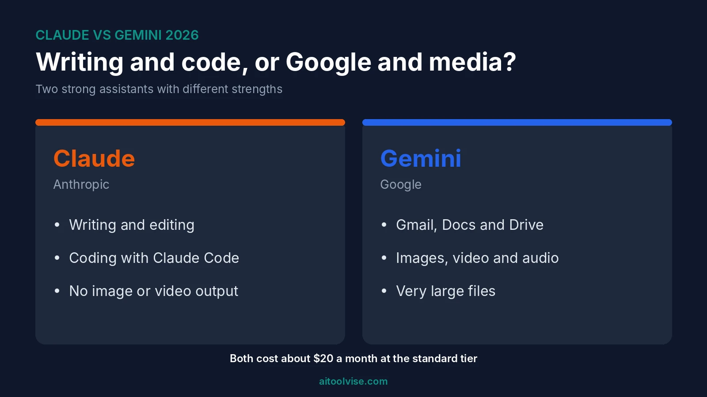
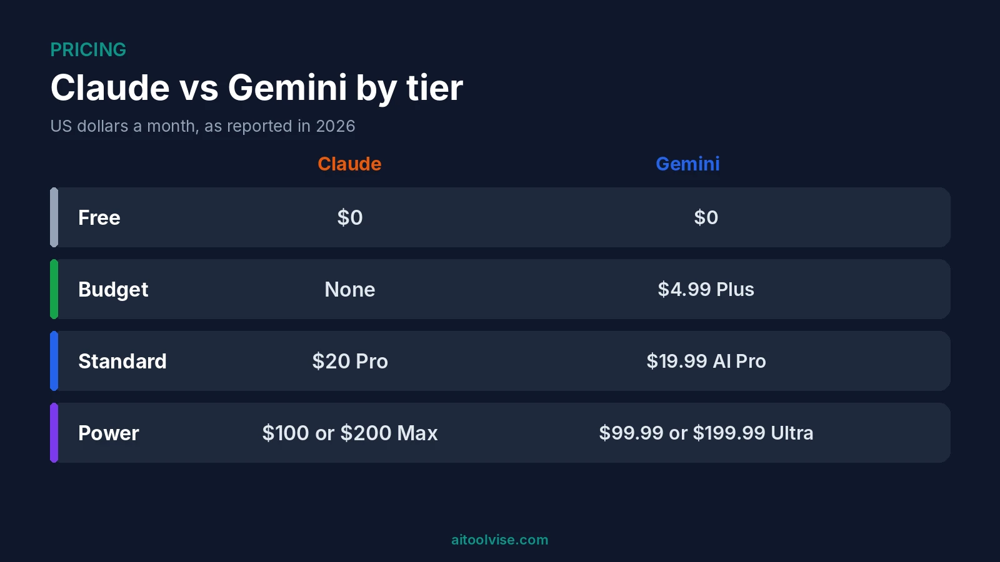
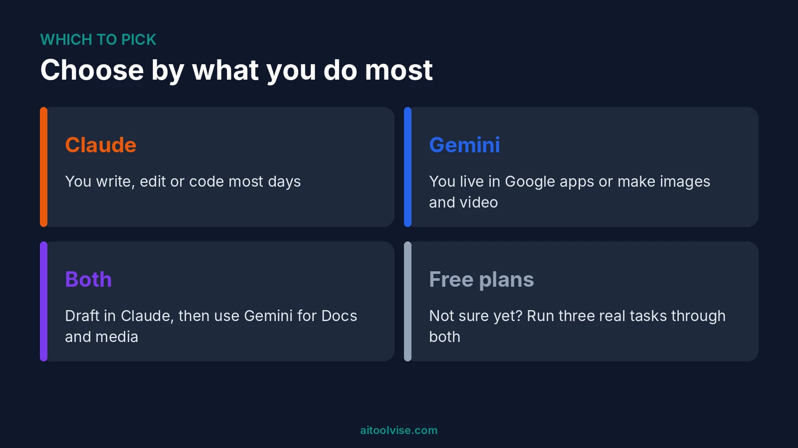

Claude is better for writing and coding. Gemini is better for Google apps, images, video and huge files. That's Claude vs Gemini in two lines. I read a stack of comparison guides before writing this, and none of them crowned a clean winner.

So what do you do all day? Write, edit, code? Take Claude. Live in Gmail and Docs, or make images and video? Take Gemini. Below I cover writing, coding, research, studying, features and price, then the other names people search beside these two. Want plan costs for the Claude side? See our [Claude pricing review](/reviews/claude-pricing-review/).

## Claude vs Gemini at a Glance

Quick table first.

| | Claude | Gemini |
|---|---|---|
| Best for | Writing, coding, long documents | Google apps, images, video, search |
| Made by | Anthropic | Google |
| Paid plan | Pro, about $20 a month | Google AI Pro, $19.99 |
| Top plans | Max, $100 or $200 | Ultra, $99.99 or $199.99 |
| Makes images and video | No | Yes |
| Free plan | Yes, with limits | Yes, with limits |

Prices move. The pages I checked didn't always agree either. Look at each company's own site before you pay.

## Claude and Gemini in Plain English

Claude is Anthropic's assistant. People like it for careful writing and coding help. Paid plans also come with Claude Code, a coding tool that runs in your terminal.

Gemini is Google's. It lives inside Gmail, Docs, Sheets and Search, and it can make images and video. Already pay Google for storage? Then it feels like a natural add-on.

## Is Claude Still Better Than Gemini?

For writing and coding, yes. Most guides I read still give Claude that edge. But "better" depends on the job, and some jobs go to Gemini without a fight.

Gemini wins on price per token, on search, and on anything with video or audio. Claude wins on following detailed instructions and on agentic coding. On general reasoning, a Vellum comparison called them statistically tied. So Claude isn't better at everything. It's better at the stuff more people do at a desk. That's my read, anyway.

## Claude vs Gemini for Coding and Engineering

Most developers pick Claude. Claude Code is part of the reason, since it comes with paid plans. Test scores are the other part. In an April 2026 [DataCamp comparison](https://www.datacamp.com/blog/claude-opus-4-7-vs-gemini-3-1-pro), Claude Opus 4.7 scored 87.6% on SWE-bench Verified. Gemini 3.1 Pro scored 80.6%.

Read that with care. Those are vendor-reported numbers, and the model versions have probably been replaced by now. Models change every few months, and the sources I read disagreed on which is current. So I won't name one.

Gemini has real upsides for engineers. It's cheaper through the API. Its context window is big too, about 1 million tokens on most pages I saw. One source said 2 million, so check Google's docs. Want more coding tools? Our [best AI coding tools](/best-tools/best-ai-coding-tools/) list has them. New to Claude Code? Start with [how to use Claude Code](/how-to/how-to-use-claude-code/).

### Claude vs Gemini for Coding in 2026

Try both on your own repo. Seriously. One guide said Gemini was worth testing on a real codebase, and I agree. A benchmark can't tell you how a tool copes with your messy project.

## Claude vs Gemini for Writing and Everyday Use

For writing, I'd go with Claude. It tends to hold a tone through a long draft and stick to a style guide. Gemini's voice came across as looser and more generic in the guides I read.

Gemini does have one edge on everyday questions. Google Search sits behind it. Ask about something that happened last week and it's often the better bet. Claude has web search too, just not Google's.

For general use, either one is fine. Mostly drafting and editing? Claude. Quick questions and Google apps? Gemini.

## Claude vs Gemini for Studying

I couldn't find a solid test for this one. So it's opinion. Claude is good at explaining a hard idea step by step and working through a long reading. Gemini helps when your notes already sit in Google Drive. One pricing page also mentioned NotebookLM, which turns your sources into study aids.

Pick whichever fits where your material lives. And check what either tool says against your textbook.

## Images, Video and Long Files Compared

This is Gemini's best section. It makes images and video, and it reads video and audio natively. Claude reads images and PDFs. It doesn't make images or video.

On long files, Gemini's bigger window helps. But one guide rated Claude safer for reading a long contract closely, since it more often quoted clauses accurately and flagged what was missing. Bigger isn't automatically better. Fair point.

## Claude vs Gemini Pricing: What You'll Pay

At the standard level, the cost is the same. Claude Pro is about $20 a month, with a lower rate if you pay yearly, roughly $17 on one page. Google AI Pro is $19.99.

| Tier | Claude | Gemini |
|---|---|---|
| Free | $0, Sonnet included | $0, Flash-Lite only |
| Budget | None | Google AI Plus, $4.99 |
| Standard | Pro, about $20 | Google AI Pro, $19.99 |
| Power | Max, $100 or $200 | Ultra, $99.99 or $199.99 |

Gemini has the cheap rung. Google AI Plus at $4.99 has no match on Claude's side. Google AI Pro also bundles a lot of storage, though pages disagreed on how much. Most said 5 TB. One said 2 TB.

One older page listed Ultra at $249. The newer ones said $99.99 and $199.99, so I went with those. Free tiers changed lately too. One source says the free Gemini app has been limited to Flash-Lite since October 9, 2026. These figures come from third-party pages like [Costbench](https://costbench.com/software/ai-chatbots/gemini/) and [GrabAICredits](https://grabaicredits.com/en/pricing/google-ai-plans-pricing), not from Google or Anthropic. Hence my constant "check first."

## What Does Reddit Say About Claude vs Gemini?

I can't open Reddit, so I won't quote it. The Google results for this search did show one thread asking whether to buy a Claude or Gemini subscription. The top answer visible there said it depends on what you're looking for. Which matches everything else I found.

## Claude vs Gemini vs ChatGPT, Perplexity, Grok and Copilot

People search these side by side, so here's a quick rundown.

ChatGPT has the widest toolbox, with voice, images and custom GPTs. Our [ChatGPT vs Claude comparison](/compare/chatgpt-vs-claude/) goes deeper. Perplexity is the pick for sourced research, and our [Perplexity vs ChatGPT comparison](/compare/perplexity-vs-chatgpt/) covers it. Grok is xAI's assistant, tied to X, and I couldn't confirm its current pricing. Microsoft Copilot is built into Windows and Microsoft 365, so check Microsoft's page for its plans.

Gemini's main competitors, then, are ChatGPT, Claude, Perplexity, Grok and Copilot.

## Which AI Is the Best Right Now?

No single one. By web traffic, ChatGPT leads and Gemini comes second, per [Similarweb's data through May 2026](https://aisearch.similarweb.com/blog/chatgpt-vs-gemini-vs-claude-vs-perplexity/). But traffic isn't quality. I never found a test I trusted for "most accurate AI chat," so there's no ranking here. They all make mistakes. Check anything that matters.

## Why Do People Pick Claude Over ChatGPT?

A few reasons come up again and again. Its writing sounds less stiff. It follows instructions well. And Claude Code is a big draw for developers. ChatGPT still has more features. It's a trade-off, not a verdict.

## Should You Pay for Both?

Only if you really use both. At the $20 level that's about $40 a month. Cheaper idea: pay for one and keep the other on its free plan. Some people draft in Claude, then use Gemini for Google Docs and image work. Daily use of both? Fine. Twice a month? Skip it.

## Claude vs Gemini: Which Should You Choose?

Pick Claude if you write, edit or code most days. Pick Gemini if you live in Google's apps or want images, video and giant files handled.

Still stuck? Run the same three real tasks through both free plans. The one you'd reopen is your answer. For more, the [home page](/) lists our other comparisons, reviews and guides. If coding is your main use, the [Cursor vs Claude Code comparison](/compare/cursor-vs-claude-code/) helps too.

## Affiliate Disclosure

Some links on this page may be affiliate links. If you sign up through one, AIToolVise may earn a commission at no extra cost to you. We only recommend tools we'd point a friend toward, and our opinions are our own. Plans and prices change often, so confirm them on each company's own pricing page before you buy.