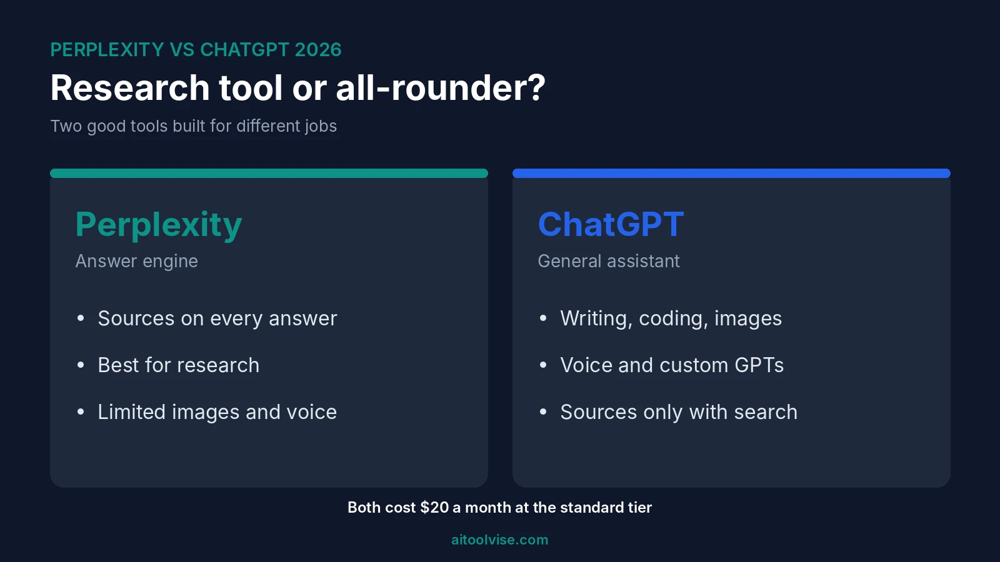
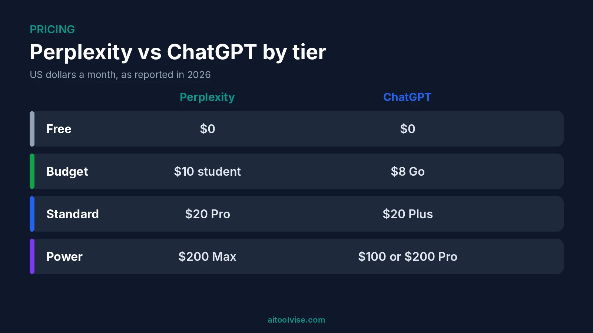
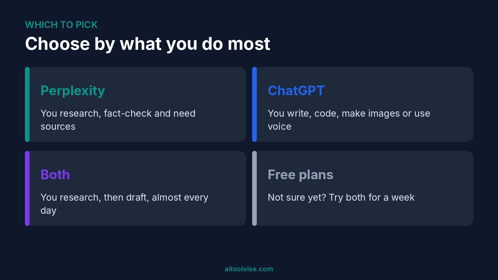

Perplexity is better for research. ChatGPT is better for pretty much everything else. That's Perplexity vs ChatGPT in one breath. I went through a pile of comparison guides before writing this, and almost all of them landed on the same split.

The longer version depends on your day. Spend it chasing facts and sources? Perplexity saves you real time. Spend it writing, coding, making images or chatting out loud? ChatGPT just does more. Below I go through research, writing, coding, features, models and price, then the other names people keep searching for next to these two. For the plan-by-plan costs, see our [Perplexity Pro pricing review](/reviews/perplexity-pro-pricing-review/).

## Perplexity vs ChatGPT at a Glance

Here's the quick view first.

| | Perplexity | ChatGPT |
|---|---|---|
| Best for | Sourced research and fact-checking | Writing, coding, images, voice |
| Cited sources | On every answer | When search is used |
| Entry paid plan | Pro, $20 a month | Go, $8 a month; Plus, $20 |
| Top plan | Max, $200 a month | Pro, $100 or $200 a month |
| Image generation | Limited | Yes |
| Free plan | Yes, with limits | Yes, with limits |

One warning on prices. They move around a lot, and a few sources I read didn't agree with each other. Look at each company's own page before you pay.

## Perplexity and ChatGPT in Plain English

Perplexity is an answer engine. You ask, it searches the web, and it writes you an answer with links to what it used. That's the whole idea. It's also the reason people like it.

ChatGPT is a general assistant. It chats, writes, codes, reads your files, makes images and even talks back. Yes, it can search the web too. But that's just one feature on a long list, not the heart of the thing like it is with Perplexity.

## Perplexity vs ChatGPT for Research and Citations

Here Perplexity wins, and it's not close. Every answer has links, so you can see where a claim came from and click straight through. ChatGPT gives sources when its search tool kicks in. A lot of ordinary answers still show up with none, and you have to ask.

Does that make it more accurate? Not exactly. Guides say its answers are easier to check, which is a different thing. I never found a test I trusted, so there's no percentage here. Both tools get things wrong. If it matters, open the links.

## Perplexity vs ChatGPT for Writing and Coding

For writing, I'd pick ChatGPT. It drafts, rewrites and bounces ideas around well, and it can remember what you like. Perplexity is a better first stop when the piece needs facts from lots of places. If your main job is content, our [best AI tools for content creation](/best-tools/best-ai-tools-content-creation/) roundup has more options.

Coding goes to ChatGPT too. It has coding tools and an agent aimed at developers. Perplexity just wasn't built for that. And if code is your daily work, you'll likely want a dedicated coding tool anyway. Our [Claude Code vs GitHub Copilot comparison](/compare/claude-code-vs-github-copilot/) and the [best AI coding tools](/best-tools/best-ai-coding-tools/) guide cover that.

## Image, Voice and Agent Features Compared

ChatGPT has the bigger toolbox. Voice, image generation, file analysis, custom GPTs, projects, it's all there. Perplexity's image generation is limited, and it has nothing like custom GPTs.

Both are chasing agents now. Perplexity has Comet, a browser, and Computer, an agent that runs tasks on credits. ChatGPT has its own agent features and a browser too. Some guides say Comet is better for research and ChatGPT's agent handles multi-step jobs better. I wouldn't decide on this alone. It all changes fast.

## Which Models Does Each One Use?

ChatGPT runs OpenAI's models. Perplexity is more of a mix. On Pro you can choose models from OpenAI, Anthropic and Google, and it has its own Sonar models too. So yes, you can use a GPT model inside Perplexity. It's still a different product from ChatGPT.

I left out model names on purpose. The sources I read disagreed about them, and they change every few months anyway.

## Perplexity vs ChatGPT Pricing: What You'll Pay

At the $20 level, the price is identical. Perplexity Pro and ChatGPT Plus both cost $20 a month. Pay yearly and Perplexity comes down to about $17.

| Tier | Perplexity | ChatGPT |
|---|---|---|
| Free | $0, limited Pro Searches | $0, limits apply |
| Budget | Education Pro, $10 (students) | Go, $8 |
| Standard | Pro, $20 | Plus, $20 |
| Power | Max, $200 | Pro, $100 or $200 |
| Team | Enterprise Pro, listed at $40 a seat | Business, listed at $25 to $30 a seat |

ChatGPT's Go plan is the cheap one. [OpenAI's help page](https://help.openai.com/en/articles/11989085) says it adds higher limits for images, uploads and data analysis, and that OpenAI may test ads in it. Perplexity has nothing near that price, apart from the $10 student plan. You can read about it on [Perplexity's Education Pro page](https://intercom.help/perplexity-ai/en/articles/12590157-what-is-education-pro).

Both top out at $200. Want a $100 step in the middle? Only ChatGPT has one.

## Perplexity vs ChatGPT for Medical Students and Academic Work

For finding papers, background reading and quick explanations, start with Perplexity. You can click through to what it used, and that counts when you have to back up a claim. Some guides also mention an academic focus mode.

But a firm warning. Neither tool is a medical authority. Don't use either one for patient care or clinical decisions. Check every source against the original paper or a trusted reference. They're a fast way to get started, not the last word.

## Why Isn't Perplexity More Popular?

Perplexity is well known, yet smaller than you'd think. [Similarweb's 2026 data](https://aisearch.similarweb.com/blog/chatgpt-vs-gemini-vs-claude-vs-perplexity/) shows ChatGPT with more web visits than Gemini, Claude and Perplexity combined. Perplexity had the smallest traffic of the four, peaked around October 2025, and has mostly declined since. That data runs through May 2026.

Why? My guess: most people want an all-rounder, and Perplexity is a specialist. It does one job very well. It can't match ChatGPT on images or voice either. That's only a guess, though. I can't prove it.

## Perplexity vs ChatGPT vs Claude, Gemini, Grok and Copilot

People search for these side by side, so here's a quick rundown.

- **Claude:** best for long writing and careful coding. Our [ChatGPT vs Claude comparison](/compare/chatgpt-vs-claude/) goes deeper, and the [Claude pricing review](/reviews/claude-pricing-review/) covers its plans.
- **Gemini:** the better fit if you live in Google's apps. Google AI Pro was listed at $19.99 a month in the US in a January 2026 comparison.
- **Grok:** made by Elon Musk's xAI and tied to X. SuperGrok was listed at $30 a month by one guide, so confirm that on xAI's site.
- **Microsoft Copilot:** built into Windows and Microsoft 365. I couldn't confirm its current consumer pricing, so check Microsoft's page.

For sourced research, Perplexity still leads this group. For one do-everything assistant, it's ChatGPT.

## Should You Pay for Both?

Only if you really use both. Together they run about $40 a month at the $20 tier. Cheaper idea: pay for the one you use most and leave the other on its free plan.

One workflow keeps coming up. Find and check sources in Perplexity, then hand them to ChatGPT for a draft. Do that daily and paying for both makes sense. Do it twice a month and it doesn't.

## Perplexity vs ChatGPT: Which Is Better?

Pick Perplexity if your work lives or dies on sources. Researchers, students, journalists and analysts get the most from it. Pick ChatGPT if you want one tool for writing, coding, images and voice.

Still can't decide? Use both free plans for a week. Whichever one you open first is your answer.

Want to see more? The [home page](/) lists our other comparisons, reviews and guides.

## Affiliate Disclosure

Some links on this page may be affiliate links. If you sign up through one, AIToolVise may earn a commission at no extra cost to you. We only recommend tools we'd point a friend toward, and our opinions are our own. Plans and prices change often, so confirm them on each company's own pricing page before you buy.