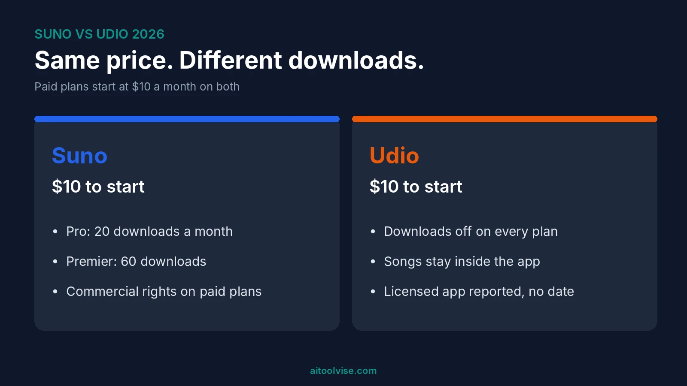
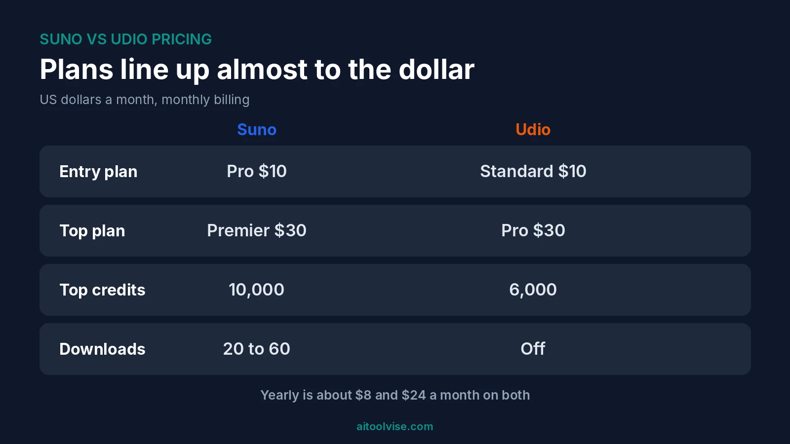
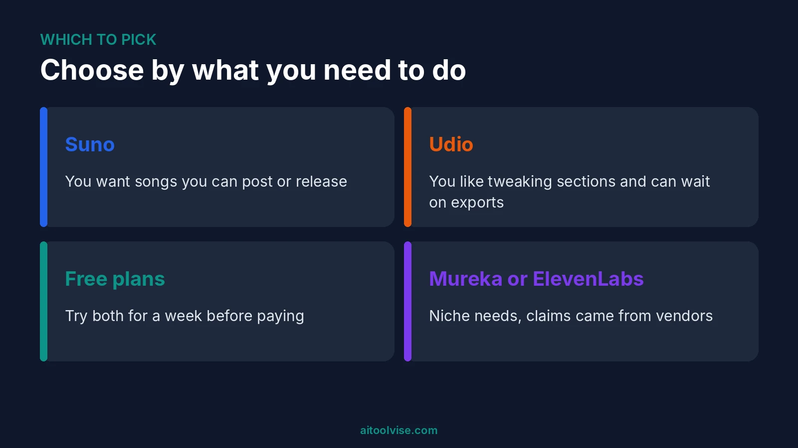

Suno wins for most people in the Suno vs Udio fight, and the reason is a boring one. You can download what you make. Udio switched downloads off on every plan after its Universal deal, so your songs stay inside Udio unless that changes. Prices are nearly identical. That's the short version, but the details matter.

I haven't run my own side-by-side music tests. This is a research roundup of 2026 comparisons, pricing pages and news, and I'll say where sources disagree. If you want Suno's plans in full, our [Suno AI pricing review](/reviews/suno-ai-pricing-review/) goes deeper.

## Suno vs Udio: The Short Answer

Pick Suno if you want files you can post, edit or release. Pick Udio only if you like how it edits songs and you don't need to export anything yet.

That's it. Honestly, the download gap decides most of this. Everything else is close enough that you'd barely notice.

## Suno vs Udio Side by Side

Here's the quick view, using US dollars.

| | Suno | Udio |
|---|---|---|
| Free plan | 50 credits a day | About 10 credits a day, monthly cap near 100 |
| Entry paid plan | Pro, $10 a month ($8 yearly) | Standard, $10 a month ($8 yearly) |
| Top plan | Premier, $30 ($24 yearly) | Pro, $30 ($24 yearly) |
| Monthly credits | 2,500 or 10,000 | 2,400 or 6,000 |
| Downloads | 20 a month on Pro, 60 on Premier | Off on every plan |
| Commercial use | Paid plans, for songs made while subscribed | Unclear, and you can't export anyway |
| Editing | Suno Studio on Premier | In-app section edits, stems play in browser only |
| Latest model | v6 family, September 2026 | Allegro v1.5, nothing newer confirmed |

Most of this comes from [Layer3 Labs' comparison, dated September 24, 2026](https://www.layer3labs.io/comparisons/suno-vs-udio). Neither source is Suno or Udio, so check their own pricing pages before paying.

## Suno vs Udio Pricing

The prices line up almost to the dollar. Suno Pro is $10 and Udio Standard is $10. Both top plans are $30. Pay yearly and you land at about $8 and $24 a month on each side. One guide listed lower Suno prices than every other source I read, so I'd trust your checkout screen over any list, mine included.

Credits differ. Suno's Premier gives 10,000 a month, Udio's Pro 6,000. But credits aren't the same unit. Suno spends roughly five credits on a base generation, per sources I used in the pricing review. Udio charges per clip, so a monthly number doesn't map neatly onto songs. Udio also sells add-on packs, 100 credits for $3 and 1,000 for $25, according to Layer3.

### Is Udio free like Suno?

Yes, there's a free plan. It's smaller, though. One guide puts it at about 10 credits a day and three full-length songs a day. Suno gives 50 credits a day, but remember the units differ, so don't read that as five times more music.

Neither free plan lets you do much with the songs. Suno's free songs are non-commercial. Udio's can't be downloaded at all.

## Udio Downloads: The Catch

Udio turned downloads off on October 29, 2025, the day of its Universal Music Group deal. [Song Creator Pro's October 2026 article](https://songcreator.pro/blog/udio-downloads-disabled) says there was a 48-hour window starting November 3, 2025, then they closed again. It says they were still off in mid-October 2026.

One other guide gives April 2026 as the date. So the dates conflict. The status doesn't. Every source I read said no plan includes audio, video or stem downloads right now.

What can you still do? Make songs, play them, extend them, and regenerate a section. What can't you do, per that article? Drop them into a video, send them to a client or release them through a distributor.

A licensed app called Starstruck was reported in May 2026, and the same article found no launch date. Song Creator Pro sells a competing product, so weigh its framing. Check Udio's help center for the live status.

## Sound Quality and Features

I can't judge the sound myself. One guide, [Dupple](https://dupple.com/learn/suno-vs-udio), says Udio's instrumentals are cleaner and less compressed. That's the author's ear, not a benchmark. Another comparison I saw in search results summed it up as Suno having the new model and the louder complaints, and Udio the older model and more loyal fans.

Suno's v6 family arrived on September 9, 2026. Udio's changelog shows Allegro v1.5 as the latest named model, though that may just mean a missing entry. For editing, Suno Studio sits on Premier and offers a multitrack timeline and stem generation. Udio's stems play in the browser but don't export.

## Which AI Is Better Than Suno?

Nothing beats it at everything. For songs you can actually keep, Suno is the one I'd start with. Others fit narrower jobs.

### Is Suno the best AI music generator?

It's the name most guides lead with. I wouldn't call it "best" without testing your own genre. Try the free plan first.

### Which AI song writing app is the best?

I couldn't find a trustworthy head-to-head for lyric writing. Mureka pitches lyric tools, which I cover below. ChatGPT can help draft lyrics, but it can't make the audio.

### Which AI is best for making music?

Depends on the job. Songs with vocals, Suno. Music plus voices and sound effects in one account, ElevenLabs maybe. Section-by-section tweaking, Udio, if exporting doesn't matter to you. If you also need visuals, our [best AI music video generators](/best-tools/best-ai-music-video-generators/) roundup picks up where this leaves off.

## Suno vs Udio vs Mureka

Mureka is the third name that keeps showing up. According to InsMelo's guide, updated October 8, 2026, Mureka's free plan gives 40 daily credits, about four songs. Pro is $9 a month and Premier $27, and it's on a v7.5 model with reference-audio uploads.

Big caveat. [InsMelo wrote that comparison](https://insmelo.com/blog/suno-vs-mureka), and it's a rival app, mobile-first, with no pricing I could find. It also based its Suno-vs-Mureka judgment on one prompt. So treat the numbers as a lead, not a verdict. I haven't tested Mureka or InsMelo.

## Suno vs Udio vs ElevenLabs

ElevenLabs does more than music. It has voices, sound effects and dubbing too. Its own page, [ElevenLabs' Suno comparison](https://elevenlabs.io/blog/elevenlabs-vs-suno), says its music is commercially cleared and starts at $5 a month, with a free plan. It also says Suno has no official API.

It's marketing, so I'd check every claim. It also lists older Suno details, like a v4.5 free model, which looks stale next to the newer sources. Fair summary: ElevenLabs fits if you want audio tools beyond songs. For full songs with vocals, I'd still start with Suno.

## Lawsuits and Label Deals: Does It Affect You?

Both companies settled with labels in late 2025. Udio settled with Universal on October 29 and Warner on November 19. Suno settled with Warner on November 25. Sony's case against Udio was still active in Layer3's September update. And the same source says Universal and Sony filed a second suit against Suno on September 18, 2026. I'd take that as one report until you see another.

The suits I read about name the companies, not their users. But the deals are why rules keep changing, like Udio's download shutdown and Suno's caps. Back up your songs and prompts. And if a tool matters to your workflow, don't prepay a year.

## Questions People Ask About AI Music

### Is it illegal to make a song with AI?

I found nothing saying that making one is illegal. The live question is copyright. Per a Soundverse explainer, the US Copyright Office wants human authorship. Music made entirely by a machine can't be copyrighted, but your lyrics, edits and arrangement may be. Soundverse sells music tools, and I'm no lawyer. Get advice before you release anything for money.

### Can Suno generate a music video?

No. An October 2026 article quotes Suno saying it doesn't generate the video for you. You download the track and use another tool. Our [best AI tools for content creation](/best-tools/best-ai-tools-content-creation/) list covers options, and [Runway vs Sora](/compare/runway-vs-sora/) helps with the video side. For editing, the [CapCut Pro pricing review](/reviews/capcut-pro-pricing-review/) is worth a look.

### Can ChatGPT make songs?

Not as audio. A September 2026 article says it can't produce playable music or vocals. It can write lyrics and prompts you paste into Suno. If you're posting the results, our [best AI tools for social media content creation](/best-tools/best-ai-tools-for-social-media-content-creation/) guide covers where they fit.

### Does Suno pay you?

I found nothing saying Suno pays you for songs you make. It has run creator programs, like a Growth Ambassador one in January 2026 that paid per approved video. Check the terms. They may be out of date.

## Which Should You Pick?

### If you want songs you can post

Suno, on a paid plan. Start on Free, then move to Pro at $10 once you know you'll keep songs. Pro's 20 downloads a month is the cap to watch.

### If you like tweaking songs section by section

Udio might suit you. But right now your songs stay in the app. Treat it as a place to experiment, not to deliver.

### If you're watching your budget

Run both free plans for a week. Prices at the paid level are the same, so the download rules should decide it.

## Suno vs Udio Verdict

Suno, for almost everyone. Same price, real downloads, commercial rights on paid plans. Udio is worth watching if downloads come back through its licensed app. Until then, it's a playground. Our [home page](/) has more AI tool comparisons.

## Affiliate Disclosure

Some links on this page may be affiliate links. If you sign up through one, AIToolVise may earn a commission at no extra cost to you. We only recommend tools we'd point a friend toward, and the opinions are ours. Prices and plans shift a lot, so check each company's own pricing page before buying.