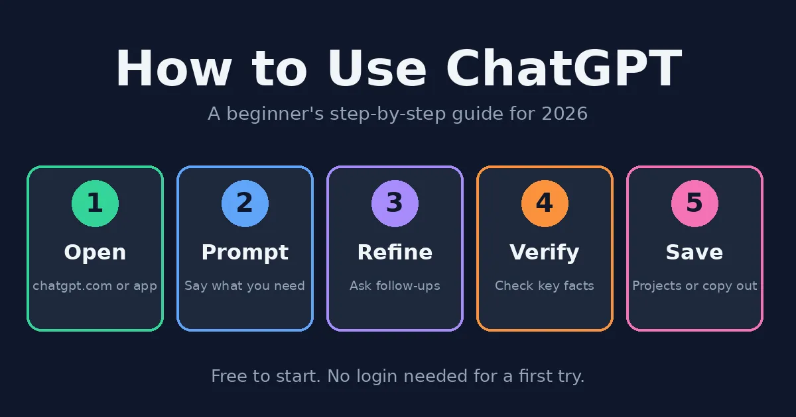
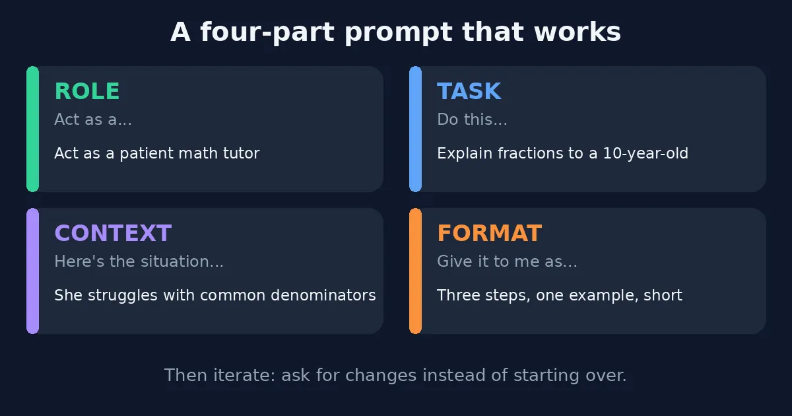
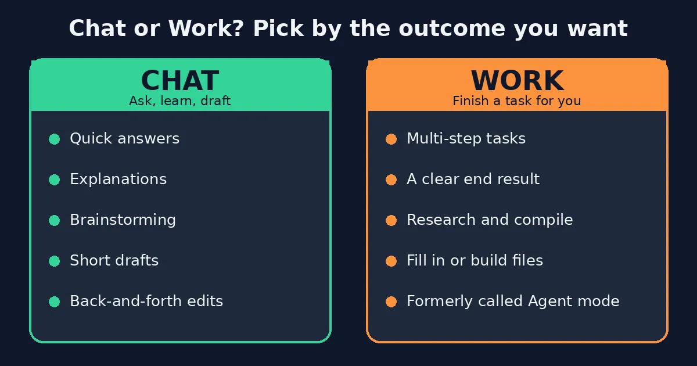
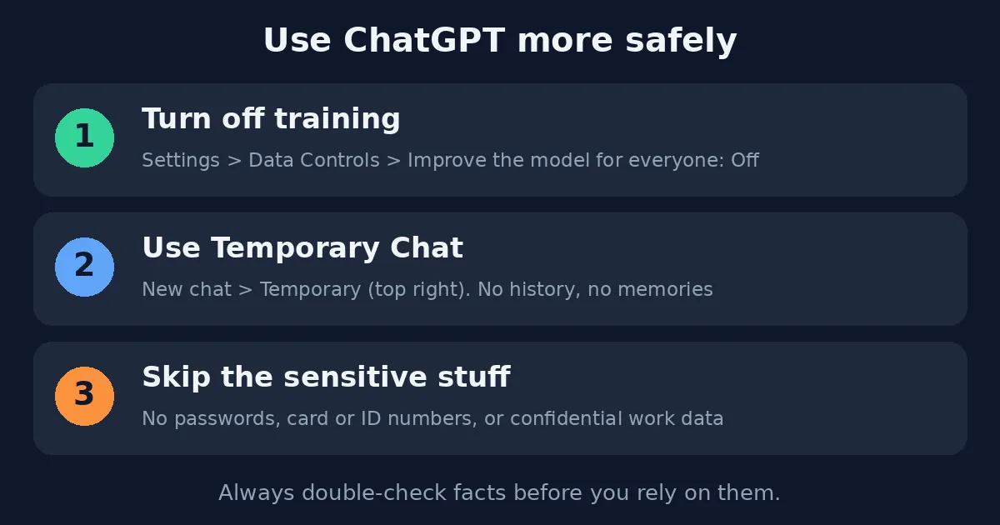

Here's how to use ChatGPT: open chatgpt.com (or the mobile app), type your request the way you'd say it to a friend, and keep tweaking the reply with follow-up messages until it sounds right. In many countries, you can try it without logging in, though a free account is worth the extra minute, since it remembers your chats and lets you upload files — and the free plan, honestly, goes further than most people expect before Go (about $8 a month) or Plus (about $20) starts to tempt you.

These days ChatGPT is three tools wearing one name: a chat box for quick answers, a Work mode that takes a task and runs with it, and a Study mode that walks you through a problem instead of just solving it. Nobody's doing it wrong by sticking to one — they're just built for different jobs, and none needs coding skills or special wording. So this guide covers how to use ChatGPT in all three, plus the questions Google keeps suggesting (free, unlimited, no login), the phone app, spreadsheets, photo edits, and a few privacy settings worth checking early. Still torn between assistants? Our [ChatGPT vs. Claude](/compare/chatgpt-vs-claude/) comparison settles that debate, leaving this page free for the how-to.

## Before You Start

Never touched it before? Fair enough — here's the short backstory: ChatGPT is OpenAI's AI assistant; you talk to it by typing or speaking, and it answers with quick drafts, explanations, summaries, code, and even pictures. That's honestly everything you need to learn how to use ChatGPT, so no what-is-AI lecture is coming. One thing, though: it changes fast, with plan names, limits, and model names reshuffled more than once this year, so when your screen disagrees with this page (a moved button or a renamed plan, say), believe the screen.

## How to Use ChatGPT: Creating Your First Account

Learning how to use ChatGPT starts with a couple of minutes of setup. Head to [chatgpt.com](https://chatgpt.com) (or grab the app for iPhone or Android), sign up with an email address or one of the social logins it offers, and you'll start on the free plan — which is plenty to get a real feel for the thing before you spend a cent.

Once you're in, resist the urge to start typing right away and spend a minute looking around. The message box lives in the middle, old chats pile up in the sidebar on the left, and up top there's a model picker — some guides mention choices like Auto, Fast, and Thinking, though the labels keep changing. Want the official tour? OpenAI's help guide, [Use ChatGPT](https://learn.chatgpt.com/docs/use-chatgpt), walks through it.

## How to Use ChatGPT Without Login

In many regions, you can skip the account altogether — open chatgpt.com, type something, and you're already in a conversation. It's a handy way to test the waters, though you'll typically get fewer features, tighter limits, and no saved history, so if you think you'll be back tomorrow, the free account is worth its minute. Availability depends on your country and can change without notice, and if the logged-out option doesn't show up for you, signing up is the only way in.

## How to Use ChatGPT for Free

Most people pick up how to use ChatGPT on the free plan, and honestly, it takes you a lot further than you'd think. Here's roughly how the tiers line up as of this writing, though plans shift often enough that the [pricing page](https://chatgpt.com/pricing) is worth checking before you pay for anything.

**Free.** Costs absolutely nothing, covers everyday chatting, and comes with usage caps that vary by feature — plus ads in some regions.

**Go.** Around $8 a month, a budget step up for heavier everyday use, also ad-supported in some regions.

**Plus.** Around $20 a month, with more usage, more tools, and no ads — the plan most regular users end up on once free starts to feel cramped.

**Pro.** A high-end tier for power users whose pricing has changed recently, so check the current page rather than trusting any figure here.

### How to Use ChatGPT for Free Unlimited: Is It Possible?

Not really, no — sorry to break the news. Free comes with caps on messages, uploads, images, voice, and the research tools, and OpenAI tweaks them quietly, so anything sold as "free unlimited ChatGPT" is typically a third-party app, a workaround waiting to break, or a scam. Better to stay on free, see which limit you actually bump into, and only pay if it keeps getting in your way.

### How to Use ChatGPT Go and Pro for Free

There mostly isn't a trick. The free year of Go widely reported in India was a limited promotion that started in late 2025 and has reportedly ended, and Go is now sold in many countries as an ordinary paid plan. Partner bundles from telecom or fintech companies do come and go, while Pro has no standard free version. Be wary of videos that tell you to switch regions to dodge pricing — that can break the terms of service and put your account at risk, and a real offer will be listed on OpenAI's own site or come from a named partner.

## How to Use ChatGPT Astra and GPT-6: Is It Free?

Searches like "ChatGPT Astra for free" pop up because model names keep changing. Recent coverage describes Astra as a top-tier model in the newest GPT-6 family, mostly tied to higher plans, though sources disagree on which model each plan gets. The honest framing here: no list of model names, this one included, should be treated as final. Open the model picker in your own account to see what you're offered — and for everyday tasks, the default is fine.

## How to Use ChatGPT the Fastest Way: Just Ask

Want an answer, a draft, or an explanation in the next ten seconds? Skip the setup and ask in Chat. Type a question or task into the message box and see what shows up, then tweak it from there if needed.

Wording matters more than you think. Say "explain interest," and you get a textbook paragraph; say "explain compound interest to a teenager in five short bullets," and you get something you can actually use, with only a small amount of editing left to do. And when an answer is nearly right, don't start over — instead, say what to fix (shorter, more formal, add an example), because the next answer will build on the previous one.

Brand new? Don't try to learn everything at once. Ask an easy question, like what to make with chickpeas and a tired lemon, then ask the same thing worded differently and see how the answers compare. In fact, that kind of little experiment will teach you more about wording than anything else.

## How to Use ChatGPT Effectively: Writing Better Prompts

How to use ChatGPT well mostly comes down to being specific, on the free plan as much as the paid ones. Four small habits cover nearly everything — the closest thing to the "four rules" people search for.

**Give it a role.** Tell ChatGPT who to be — "act as a patient math tutor" — and the tone and level shift before it writes a word.

**State the task.** Spell out the job, like "explain fractions to a 10-year-old," rather than hoping it guesses right.

**Add context.** ChatGPT can't read your mind, so say what's going on: "she struggles with common denominators" tells it exactly where to focus.

**Name the format.** Want three steps, one example, nothing long? Say so, and you won't be reformatting it later.

When a reply lands close but not right, point at what's off ("too formal," "the second point is wrong") instead of starting over. The good parts stay, and only the weak bits get fixed.

## The Task Way: How to Use ChatGPT Work Mode (Formerly Agent Mode)

ChatGPT now works in two ways. According to OpenAI's help documentation, Chat is for answers, explanations, brainstorms, and short drafts, while Work is meant for jobs you want finished with a clear result. If you've heard of agent mode, don't worry — it's the same idea, and recent guides call Work its new name, so anyone searching for how to use ChatGPT agent mode is in the right place.

Here's a rule of thumb: if you'd normally ask a colleague, use Chat, and if you'd hand it over and walk away, give Work a try. OpenAI's [Get started with ChatGPT Work](https://learn.chatgpt.com/docs/get-started-with-work) guide has the details, and what you actually see depends on your plan, platform, and region.

## How to Use ChatGPT for Studying

Figuring out how to use ChatGPT for studying? Start with Study mode. Pick Study from the tools beside the message box, or type @study, and instead of simply handing over the answer, ChatGPT walks you through the problem one step at a time. Recent guides say it works in regular chats and Temporary Chats, though not inside custom GPTs or Projects.

Here's a routine that works for many students: take a first crack at the question yourself, ask for a hint the moment you're stuck, and finish by having it quiz you. It can still get facts and math wrong, so double-check anything important — and follow your school's rules about AI in coursework.

## How to Use ChatGPT in Excel

Good news for spreadsheet people: a ChatGPT add-in for Excel reportedly arrived in beta in March 2026, with Google Sheets following in April. Whether it's available to you depends on your plan and region, so check Excel's add-in store and OpenAI's help center.

No add-in? No problem — here's how to use ChatGPT in Excel anyway. Describe your columns in chat, or upload the file, and ask for a formula, a cleanup step or an explanation. A prompt like "write a formula that sums column B when column A says Paid" works because it names the columns. Whatever you get back, test it on a copy of the sheet first — real data deserves better than a guess.

## How to Use ChatGPT for Photo Editing

Here's how to use ChatGPT for photo editing: upload a photo and describe the change you want — remove an object, swap the background, shift the mood — then keep tweaking with follow-ups like "make it warmer" or "undo the last change." Free plans come with their own image limits, and results vary, so treat the result as a starting point, not a finished edit. And please skip photos of other people unless you have their permission.

## How to Use ChatGPT for Writing, Content and Code

When it comes to how to use ChatGPT for writing, it's a solid all-rounder for blog posts, emails and scripts, though its default voice can sound a little generic. The fix is easy: paste in a sample of your own writing and ask it to match the tone. Our guide to the [best AI writing tools](/best-tools/best-ai-writing-tools/) shows when a specialist tool is worth paying for, and the [best AI tools for content creation](/best-tools/best-ai-tools-content-creation/) roundup covers images, video and audio. For video, see how to use [HeyGen](/how-to/how-to-use-heygen/) and [Runway](/how-to/how-to-use-runway/).

Writing code instead? Paste the exact error message and ask for an explanation before you ask for a fix, so you understand the problem, not just patch it. Our [best AI coding tools](/best-tools/best-ai-coding-tools/) guide covers options built for developers, and our guide on [how to use Claude Code](/how-to/how-to-use-claude-code/) shows one in action.

## How to Use ChatGPT on Your Phone

It works much like the desktop version. Here's how to use ChatGPT on your phone: install the official app on iPhone or Android, or open chatgpt.com in a mobile browser, and sign in with the same account so your chats sync across devices. The app adds voice conversations, photo uploads, and quick questions about whatever your camera is pointed at.

### How to Use ChatGPT on Facebook: Is It Possible?

Not officially, no. ChatGPT doesn't live inside Facebook or Messenger — Meta has its own assistant, [Meta AI](https://www.meta.ai), built into its apps. The ChatGPT WhatsApp number some people used was reportedly retired back in early 2026, so any guide still relying on it is out of date. Honestly, the dependable ways to use ChatGPT are the website and the official apps.

## How to Use ChatGPT Safely

Is ChatGPT safe? For everyday tasks, mostly — with a few precautions, since how to use ChatGPT safely comes down to three habits. OpenAI says you can choose whether your conversations help train future models, and that you shouldn't share sensitive information you wouldn't want used or reviewed. Its [privacy explainer](https://openai.com/index/how-chatgpt-protects-privacy/) lays out the controls.

**Check Data Controls.** Open Settings, then Data Controls, and take a look at "Improve the model for everyone." Just switch it off if you'd rather your chats weren't used for training.

**Use Temporary Chat for sensitive questions.** A Temporary chat won't show in your history, won't create memories and isn't used for training — though some guides add that copies can linger for up to 30 days for safety reasons, so it's closer to "don't save" than "invisible."

**Leave the sensitive stuff out.** Five things to keep away from any chatbot: passwords and login codes, bank and card numbers, government ID numbers, confidential work or client information, and detailed personal medical or legal records.

### What Not to Ask ChatGPT

Beyond privacy, a few requests tend to go badly. ChatGPT shouldn't get the last word on medical, legal or financial decisions, and it can't be trusted blindly on exact statistics, citations or breaking news. It's great for drafts, explanations and ideas — just a poor stand-in for a professional or a primary source.

### Can ChatGPT Tell the Truth Every Time?

No, and anyone who claims a rule that guarantees it is selling something. ChatGPT can state wrong things with total confidence — that's where the word "hallucination" comes from. A few habits cut the risk: ask it to say when it isn't sure, open any sources it gives you and confirm they exist, use search or reasoning options for factual questions when available, and break big questions into smaller ones you can check.

## Practical Tips: How to Use ChatGPT for Better Results

A few small habits make a big difference in how to use ChatGPT well:

**Treat the first reply as a rough draft.** Good results usually come from two or three rounds of tweaking, so writing the tool off after one attempt sells it short.

**Never skip the context.** ChatGPT can't know your audience, budget or deadline unless you tell it — "write something about marketing" gets you generic filler every single time.

**Don't treat it like a search engine.** It's a helper, not a source of record, so confirm anything that matters somewhere reliable.

**Pay only when a limit actually hurts.** Free covers most beginners. Notice which task you keep repeating, and let that decide whether an upgrade makes sense. Curious about other options? Our [ChatGPT vs Claude](/compare/chatgpt-vs-claude/) comparison shows where each is strongest, while our [Jasper vs Copy AI](/compare/jasper-vs-copy-ai/) guide covers the specialist marketing tools.

*Everything here reflects ChatGPT and OpenAI's documentation as of October 2026. Plans, limits, features and model names move around a lot and differ by region, so if something doesn't match what you're seeing, [OpenAI's help center](https://help.openai.com) is the place to check. More of our AI tool guides are waiting on the [homepage](/).*

## Affiliate Disclosure

Quick note on how this site earns money: some links may be affiliate links. If you sign up for ChatGPT or another tool through one, we may earn a commission at no extra cost to you. We choose and rate what we cover based on careful research and real hands-on use, not on who pays us.