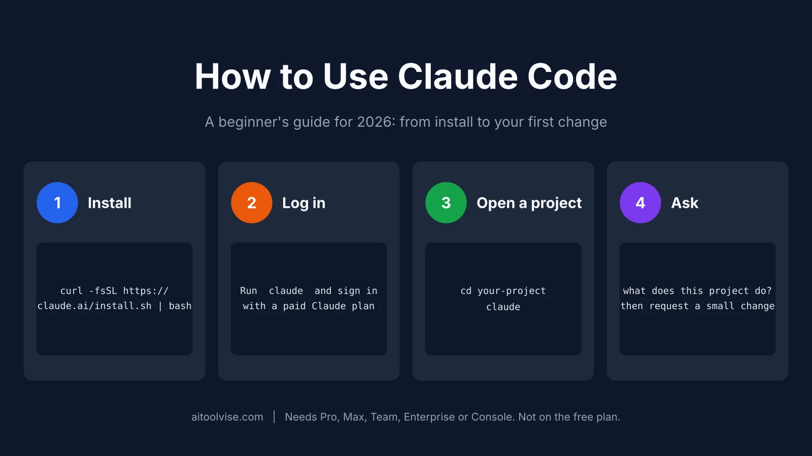
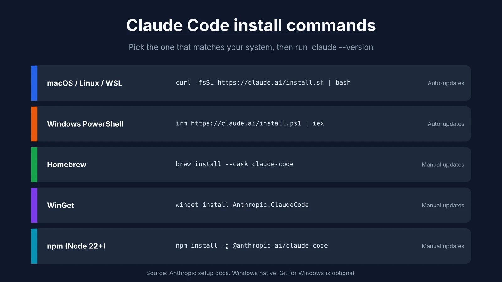
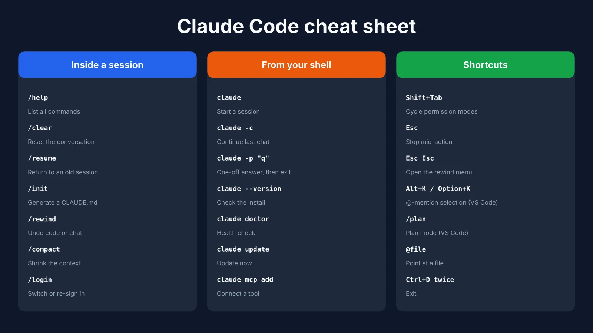

Claude Code can feel like a very different tool depending on where you meet it: a terminal prompt for some people, a side panel inside VS Code for others, a browser tab that works on your repository while you're away from your desk for the rest. None of those ways is wrong — they just suit different habits. This guide walks through all three, starting with the account you'll need (the part most tutorials skip), then installation on Mac, Windows, and Linux, your first real session, and the handful of habits that separate a useful afternoon from a frustrating one. If you're still deciding which plan to pay for, our [Claude pricing review](/reviews/claude-pricing-review/) covers every tier in detail — this guide picks up from there and stays focused on actually using the tool.



## What You Need Before You Start
The one-sentence version if you've never tried to open a Claude code is: it is an AI coding assistant, which works inside your project, parsing files, making changes, doing commands and asking for your approval while it does all of these things. This is more background info, the rest of this guide is going to be about the process of using it, not about why it works this way.

What you do need before installing anything is a paid Claude account, a project folder with some code in it, and a terminal (VS Code works too, since it has one built in). The account is the requirement people miss. Anthropic's [setup documentation](https://code.claude.com/docs/en/setup) says Claude Code needs a Pro, Max, Team, Enterprise, or Console account, and the free claude.ai plan doesn't include access. A Console account just means you pay for API usage out of prepaid credits instead of a monthly subscription.

### Can you use Claude Code for free?
Not officially. A lot of pages that rank for this question are vague about it, but Anthropic's own docs aren't — the free plan is out. The cheapest way in is Pro at $20 a month, or $17 a month if you pay for the year upfront. Prepaid API credits are the other route, and whether they work out cheaper depends almost entirely on how often you use the tool. One cost guide that cites Anthropic's documentation puts the average at roughly $13 per developer per active day, which means credits make sense for occasional use and a subscription usually makes more sense for daily use.

If paying isn't an option right now, a few editors do have genuine free tiers. Cursor's Hobby plan is one, and our [Cursor pricing review](/reviews/cursor-ai-pricing-review/) lays out exactly what's included and what isn't.

## How to Install Claude Code on Mac, Windows and Linux
Installation takes a few minutes. Open a terminal and run the command from your system. The native installer is suggested by Anthropic, but the practical benefit should not be overlooked, as updates are automatically applied in the background so you do not run an old version unknowingly.

On macOS, Linux, or WSL:

```bash
curl -fsSL https://claude.ai/install.sh | bash
```

On Windows PowerShell:

```powershell
irm https://claude.ai/install.ps1 | iex
```

The tool is also available as a software package, which means that, if you prefer using a package manager, Homebrew (`brew install --cask claude-code`) and WinGet (`winget install Anthropic.ClaudeCode`) are also valid installation options, though with the caveat that they do not update themselves, requiring manual intervention to upgrade at some point in the future. Homebrew also offers two casks. `claude-code` follows the stable channel, which runs about a week behind and skips releases with major regressions, while `claude-code@latest` gets every release the moment it ships. There's an npm route as well — `npm install -g @anthropic-ai/claude-code` — which suits anyone who already lives in Node, though it requires Node.js 22 or later. As for your machine, the requirements are modest: macOS 13 or newer, Windows 10 (version 1809 or later), Ubuntu 20.04+ or Debian 10+, and 4 GB of RAM.



### Windows: PowerShell or WSL?
Either one works, so the real question is where your code already lives. Native Windows is the simpler setup, and Git for Windows is recommended but not required. WSL 2 is worth the extra step if your project sits in a Linux toolchain, and it's also the only Windows option that supports sandboxing. The most common stumble is pasting the CMD installer into PowerShell, which produces an error about `&&` not being a valid statement separator. A quick way to avoid it: look at your prompt first. If it starts with `PS C:\`, you're in PowerShell, and you want the PowerShell command instead.

### Check that it worked
Open a new terminal window and run `claude --version`. If you see a version number, the installation was successful. If your shell complains that it cannot find the command, the installation directory is likely not on your PATH, but opening a new window in most cases will suffice. For a more comprehensive check, `claude doctor` prints a read-only diagnostic report about your installation and configuration, without actually starting a session, and is a good first step if you suspect something is wrong.

## How to Use Claude Code in the Terminal (CLI)
Move into your project folder and type `claude`. The first launch opens a browser tab for logging in, and once you're in, it's an interactive session in which you type what you want, like sending a colleague a message, only this one reads your entire code in seconds.

### Your first session in five minutes

Resist the urge to ask for changes right away. Start with a question instead, since the answer tells you whether Claude understands your project before it gets anywhere near your code:

```text
What does this project do?
```

Good follow-ups are `where is the main entry point?` and `explain the folder structure`. Since Claude reads files as it needs them, there's no need to manually add code snippets. Once you're satisfied that the summary accurately reflects your knowledge of the project, ask for a single change. Compare "improve the form" with "add input validation to the signup form" - the latter provides Claude with something to actually do, and something you can review afterwards. Claude asks for permission before making any edits to a file, so you're always in control by accepting or rejecting proposed changes.

Git works in a similar vein. Tell it to "commit these changes with a clear message" or "create a branch called feature/signup-validation", and it'll do just that. There's also a minor trick that's useful in debugging situations: `cat error.log | claude -p "explain this error"` will pipe a file in and print out a response without having to open up a new session.

### The commands you'll use every day
You only really need a few. `/help` lists everything available, `/clear` clears the conversation when you move to a new task, and `/resume` resumes an earlier conversation. From the shell, `claude -c` resumes your most recent conversation in the current folder, and `claude -p "question"` answers once and exits. `Shift+Tab` cycles through permission modes, and `Esc` stops Claude mid-action without losing the conversation — worth remembering the first time it heads in a direction you didn't intend.



## How to Use Claude Code in VS Code
If you'd rather not work in a terminal, the VS Code extension is the more comfortable route. Open the Extensions view (`Ctrl+Shift+X` or `Cmd+Shift+X`), search for "Claude Code", install the extension published by Anthropic, and click the Spark icon in the editor toolbar. It needs VS Code 1.94 or later and the same paid account as the terminal version, so anyone hoping to use it in VS Code for free will run into the same wall — the extension itself costs nothing, but the login behind it does.

What makes this extension so valuable is its ability to understand your selections. Highlight a few lines and Claude knows to apply the edits to those lines, and pressing `Alt+K` (`Option+K` on a Mac) inserts an @-mention like `@app.ts#5-10` directly into your prompt. Proposed changes open as side-by-side diffs that you can accept, reject, or edit before applying, and typing `/plan` switches to plan mode, where Claude presents an outline of its approach before making any edits. The [official VS Code documentation](https://code.claude.com/docs/en/vscode-extension) lists all the available shortcuts.

### How to use Claude Code in Cursor
Cursor is built on a fork of VS Code, so the same extension installs there too, and Anthropic's docs even link to it directly. Running one AI assistant inside another is an unusual setup, but some people do it to have Claude Code's agent sitting next to Cursor's own tools. We compare the two in more detail further down.

## How to Use Claude Code on the Web and in the Cloud
A cloud session takes place in Anthropic's infrastructure, rather than on the user's own machine. This makes them particularly valuable for tasks that one wants to set up, step away from, and return to later. From claude.ai/code, log in, link your GitHub, select a repository, describe the task, and hit Enter; Claude will clone the repository into an isolated environment, make the necessary changes, and push a branch to your repository for review.

At the end of a session, you will be presented with a diff of the changes that have been made, where you can leave feedback on specific lines, request revisions, and submit a pull request from the page. A tab closed on the site will not end a cloud session, and the Claude mobile application will let you check in on running sessions; alternatively, one can launch a new session from a terminal window with `claude --cloud`. Cloud sessions are available to Pro, Max, and Team plan subscribers and consume from the same token budget as the rest of Claude's functionality. Anthropic's website has a [quickstart guide](https://code.claude.com/docs/en/web-quickstart) for setting up a cloud session that walks the user through the process of connecting a GitHub account. Cloud sessions represent a good solution for well-defined tasks that can be neatly handed to a model and returned, but are less useful for tasks that require more of the user's local environment. A cloud session only has access to the contents of the repository passed to it, and can not interact with the user's local tools and configuration.

## How to Use Claude Code to Build a Website or App
Reading about features only gets you so far, so let's turn this into a real-life example that you can follow. For instance, if you want to have one simple website created, you could start by asking Claude to "look through this folder and tell me what you see." If he sees it's empty, you might follow up with

```text
1. build a one-page site for a dog walking company with hero, pricing, contact form
2. just plain HTML/CSS, no frameworks
3. run it locally and tell me how I can open it
```

That's important, by the way - Anthropic's very own beginner's guide advises creating numbered requests when asking for bigger tasks to be broken down into smaller ones, because each of these will give Claude a concrete target to aim at while giving you a sense of accomplishment as you tick off each item on your list. And then when the initial version is done, say things like "make the pricing section have three columns" or "the button is too small on mobile." For anything bigger than a landing page, a better approach is to ask Claude to interview you first, write your answers to a spec file, and then start a fresh session that builds from that file. And if you haven't settled on an assistant yet, our list of the [best AI coding tools](/best-tools/best-ai-coding-tools/) compares the main options.

## How to Use Claude Code Effectively: 7 Habits That Matter
Most things here are dictated by one hard limit: the context window, which gets filled up quickly and is less accurate the more it's used. Anthropic's [best practices guidance](https://code.claude.com/docs/en/best-practices) touches on this, and the following seven tips come from that.

To plan before coding, press `Shift+Tab` until the indicator that plan mode is off disappears, or start a session with `claude --permission-mode plan` and let Claude read and suggest before making any changes. `Ctrl+G` will open the plan in your text editor for you to make changes to. For a small change, this is unnecessary, but planning is most useful when making changes that affect multiple files or when you're not sure what to do.

Give it a way to verify that it's done right. A test, or a build command, or even a screenshot. "Write the function, then run the tests" is a better prompt than "write tests" because it gets you a function that has been verified, and not just one that looks good.

Be specific. "Fix the login bug where users see a blank screen after entering the wrong credentials" will get you a lot farther than "fix login".

**Clear between tasks.** Run `/clear` when you switch topics, since stale context does more harm than a fresh start.

**Rewind when something goes wrong.** Press `Esc` twice or run `/rewind` to restore earlier code and conversation. It only tracks edits Claude made itself, so Git remains your real safety net.

**Correct early.** If you've fixed the same mistake twice, clear the session and write a better prompt rather than carrying on in a cluttered one.

**Send research to a subagent.** Asking Claude to "use a subagent to investigate how auth works" keeps all that file reading out of your main conversation.

## How to Use Claude Code Projects and CLAUDE.md
Claude Code doesn't have a separate "project" object. In practice, a project is simply a folder that contains a CLAUDE.md file. Claude reads that plain-text file at the start of every session, so you stop repeating the same instructions, and running `/init` drafts a starter version from your project structure.

The file works best when it's short. Include the commands Claude can't guess, such as how to run the tests and how to build, plus your code style rules and quirks like a required environment variable. Leave out anything it can work out by reading the code itself. Anthropic's test for each line is whether removing it would cause a mistake, and if not, it should go — overlong files tend to get ignored.

Once that's working, three extras are worth knowing about. Skills are reusable instruction files that you run with `/skill-name`. Hooks are scripts that fire automatically, such as a linter after every edit. MCP servers connect Claude to outside tools through a command like `claude mcp add`. None of them are needed on day one.

## Claude Code for Beginners: Do You Need to Know How to Code?
Short answer: no. Longer answer: sort of, and it depends how much you enjoy living dangerously.

Here’s the thing. Claude Code isn’t a chatbot that hands you a snippet and lets you decide what happens next. It has its hands on your actual files. It can edit them, delete them, and run pretty much whatever it likes in your terminal. Most of the time that’s wonderful. Every so often it’s a “wait, why is my images folder empty?” moment. So you don’t need a computer science degree, but you do need to be able to squint at a change and think either “yep, that looks right” or “hang on, no.”

What does that take in practice? Not much. Know roughly how a project folder is laid out, know that a Git commit is basically a save point, and don’t panic when the terminal asks you a question. Everything else, you can ask Claude to explain. “Pretend I’m new to this and tell me what you just did” is a perfectly good prompt, and it’ll happily oblige.

Nervous? Fair enough. Two switches help. Plan mode makes it talk through an idea without touching anything, and manual permissions mean every single edit waits for your okay. Newer versions start in auto mode, where a separate model waves the boring stuff through for you. Nice later on, a little hands-off for week one.

And pick a dumb first project. A page about your cat. A script that puts dates on your photo filenames. Something you’d just shrug about if it went sideways. The classic beginner trap is asking for “a full app with login and payments” in one message, then hitting approve over and over because everything looks sensible. Looking sensible isn’t the same as working, though. Make a Git commit before you start, read every diff even when it’s tedious, and you’ll be fine. Honestly, that reading habit matters more than any prompt trick you’ll pick up.

## How to Use Claude Code at Work
Always check your company's policy first, as this tool reads and executes code. Team and Enterprise plans include seats with Claude Code, and administrators can control which tools are available to Claude. Keep development on a branch, review each diff like a code review for a teammate's pull/merge request, and commit your CLAUDE.md so that everyone is working with the same rules.

On permissions, recent versions start interactive sessions in auto mode, where a classifier reviews actions instead of prompting you every time. If you'd rather approve each step yourself, switch to manual mode with `Shift+Tab`. And if you're curious how Claude's model compares with its closest rival for everyday work, our [ChatGPT vs Claude](/compare/chatgpt-vs-claude/) breakdown covers it.

## Claude Code Price and Usage Limits
These figures come from a guide that says it checked Anthropic's pages on October 5, 2026. Prices change, so confirm them before you subscribe.

| Plan | Price | Claude Code included? |
|---|---|---|
| Free | $0 | No |
| Pro | $20/mo ($17/mo annual) | Yes |
| Max | From $100/mo (5x or 20x Pro usage) | Yes |
| Team Standard | $20/seat annual, $25 monthly | Yes |
| Team Premium | $100/seat annual, $125 monthly | Yes, 5x usage |
| Console (API) | Pay per token | Yes |

Usage runs on a rolling five-hour window, with weekly limits stacked on top for paid plans, and Claude Code draws from the same pool as Claude chat. When you hit a limit, you can wait for it to reset, move up a plan, or turn on usage credits, which bill at API rates. The pricing review linked at the top of this guide covers what each tier includes.

## Claude Code vs Cursor: Which Should You Learn First?
If you want a visual editor with AI built in, start with Cursor. If you're comfortable handing an agent a task and reviewing what comes back, start with Claude Code. Neither choice locks you in, and plenty of developers end up using both.

The practical difference is the interface. Claude Code is an agent you steer from a terminal, an extension, or the web, while Cursor is a full editor with AI woven through most of its features. Our [Cursor vs Claude Code](/compare/cursor-vs-claude-code/) comparison covers pricing, limits, and where each one is stronger. And if Cursor sounds like the better fit, [how to use Cursor AI](/how-to/how-to-use-cursor-ai/) is the matching walkthrough.

## Common Problems and Fixes
If the terminal says something like `claude: command not found` , make sure to open a new terminal first. If that does not work, the install directory is not on your PATH, and Anthropic's [troubleshooting page](https://code.claude.com/docs/en/troubleshoot-install) will tell you how to add it. Finally, if you are getting errors in PowerShell, it is likely that you accidentally pasted the installer command for CMD into PowerShell or the other way around, since the two shells have different syntax, notably in how they handle environment variables, and the prompt will begin with `PS` if you are in PowerShell

A login that keeps looping is usually the wrong account. Run `/login` in a session and sign in with a paid claude.ai account rather than a free one. And if `ANTHROPIC_API_KEY` is set on your machine, Claude Code will ask you to approve that key instead of opening the browser, which can look like a login problem when it isn't.

When you are rapidly hitting the limits, you should clear context with `/clear` between tasks, keep your prompts focused, and avoid asking the model to investigate a particular topic for you, because extended conversations burn through your allowance much faster than shorter prompts. If the installer itself fails, reporting a 403 or curl error, you may wish to try the Homebrew or WinGet installation methods, or consult the Anthropic documentation for installing Claude for troubleshooting advice.

*This guide reflects Claude Code's capabilities, commands, and pricing as of October 2026. Information changes rapidly, and you should always consult the official documentation for the most up-to-date information. If you would like to see more guides from us to other AI tools, you can always visit the [homepage](/).*

## Affiliate Disclosure
This article may contain affiliate links. If you sign up for a service/tool using an affiliate link, we may earn a commission at no additional cost to you. This helps support the research into guides such as this one. Your opinions are your own and not influenced by affiliate partnerships. Our evaluation and recommendation of tools in this guide are not in any way influenced or biased by affiliate partnerships, if any. We maintain editorial independence and integrity in providing honest recommendations to our readers.