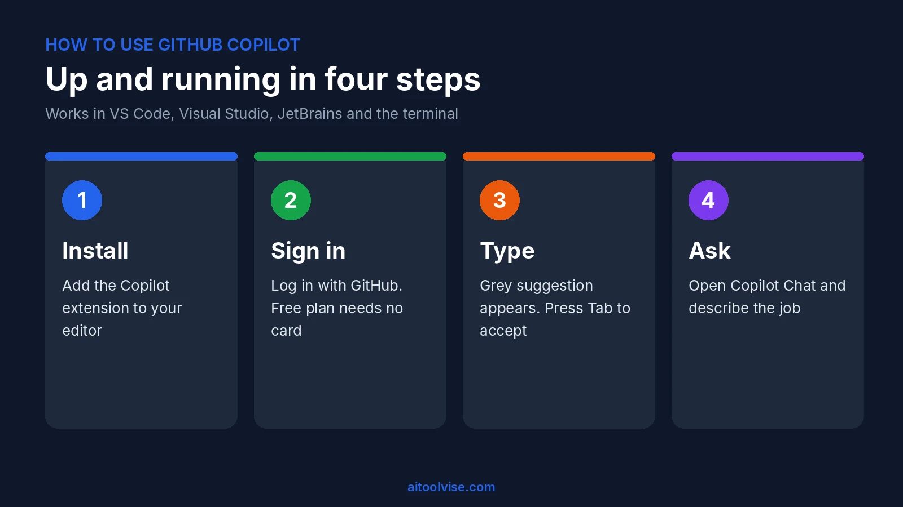
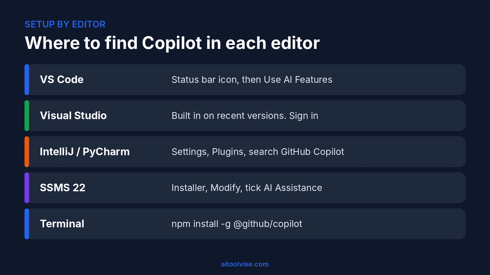
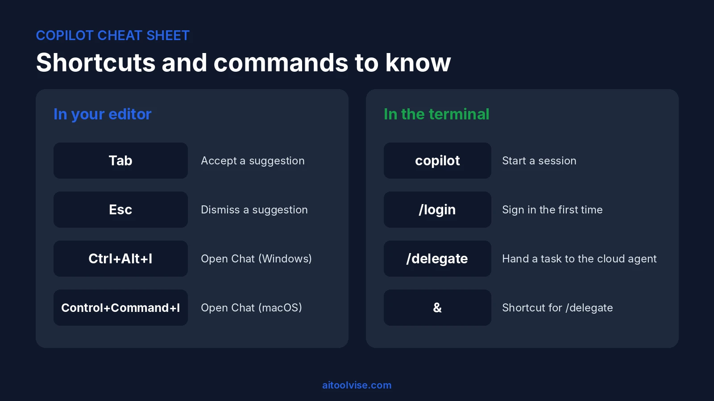

Here's how most people's first day with GitHub Copilot goes. Install it, type a few lines, watch it guess wrong once, close the tab. Yeah, I'd have done that too. What they miss is that Copilot isn't one feature. It's four or five different ways of talking to a model, and each one fits a different job.

This guide gets you set up in whichever editor you use, then covers chat, agent mode, shortcuts and the terminal version. Still weighing the cost? The [GitHub Copilot pricing review](/reviews/github-copilot-pricing-review/) has every plan laid out. This page is just about using it.



## Copilot in Plain English, and What You Need to Begin

Copilot is basically a coding helper that sits inside your editor. While you type, it tries to finish your line. If you ask it something, it looks at the files you've got open and answers from those. And when you've got a bigger job, you can switch to agent mode and let it change a few files at once, then check what it did. It isn't only in the editor either. GitHub says you can get to it from GitHub Mobile, the command line, the website and a desktop app too.

Getting started takes less than you'd expect. You need a free [GitHub account](https://github.com/signup), a Copilot plan (Free works fine here), and an editor that supports the extension: VS Code, Visual Studio, a JetBrains IDE, Eclipse or Xcode. The Free plan doesn't ask for a card, and your project doesn't need any setup.



## Is GitHub Copilot Free? What the Free Plan Covers

It's free, but with strings attached. You get 2,000 completions a month, limited chat and restricted agent access. Chat on Free picks the model for you, so there's no model menu to play with.

Is that enough? For a weekend project or a week of learning, sure. For a full-time job, you'll hit the wall quick. Pro is $10 a month and drops the completion cap, and paid plans run on monthly AI credits, which the pricing review untangles. My advice? Spend a week on Free first. You'll notice which feature you keep reaching for, and that's the one worth paying for.

### Free access for students

Verified students get the Student plan at no cost. Completions are unlimited and auto model selection is included, but third-party agents aren't. You apply through GitHub's education benefits page. Approval can take a few days, so don't leave it until the night before a deadline. Teachers and popular open source maintainers can also qualify for free Pro access.

## How to Use GitHub Copilot in VS Code

VS Code is the easiest place to start. The setup is almost automatic.

1. Open VS Code and hover over the Copilot icon in the status bar.
2. Choose **Use AI Features**.
3. Pick a sign-in method and follow the prompts. Already have a Copilot plan? VS Code uses it. No plan? You're signed up for Free.

Now test it. Make a new file called `test.js` and type this:

```js
function calculateDaysBetweenDates(begin, end) {
```

A grey suggestion should appear. Press **Tab** to accept it. That's the whole inline loop. You type, it guesses, you take it or shrug it off. Nothing showing? Check you're signed in (the status bar icon tells you) and that the file has a proper extension, because Copilot needs to know the language.

Next, open Copilot Chat with **Ctrl+Alt+I** on Windows and Linux or **Control+Command+I** on macOS. Open any file and type "what does this file do". Then select a single line and ask "explain this line". Honestly, those two prompts teach you more about the tool than any docs page, especially in a codebase you didn't write.

One thing to know: telemetry is on by default on the Free plan. Don't like that? Set `telemetry.telemetryLevel` to `off` in settings.

## How to Use GitHub Copilot in Visual Studio

Working in .NET or C++? Then Visual Studio is probably where you spend your day, and the good news is that newer versions come with Copilot already built in. Most of the time there's nothing to install. Log in with your GitHub account (the account menu in the top right is where I'd look first) and open Copilot Chat from the menu bar or the Copilot icon.

I can't give you the exact menu path, because Visual Studio keeps renaming things between releases. If you can't find chat, run the Visual Studio Installer and see whether you're on a current version. Once it's open, it works much like it does in VS Code. Ask about the file you're in, highlight some code and ask for a fix, or try agent mode when a change touches several files.

## How to Use GitHub Copilot in IntelliJ and PyCharm

JetBrains tools don't have Copilot built in. You add it as a plugin.

1. Open **Settings** and go to **Plugins**.
2. Search the Marketplace for **GitHub Copilot** and install it.
3. Restart the IDE when asked.
4. Sign in to GitHub when the plugin prompts you.

It's the same plugin for IntelliJ IDEA, PyCharm, WebStorm and the others, so you only do this once per IDE. GitHub has kept adding agent features to it through 2026, including a Copilot CLI agent and a unified sessions view. If what you see doesn't match these steps, update the plugin first and look again.

## How to Use GitHub Copilot in SSMS

This one surprises people, but yes, SQL Server Management Studio supports Copilot. Microsoft's docs list what you need:

1. **SSMS 22**.
2. Open the Visual Studio Installer, choose **Modify**, and tick the **AI Assistance** workload.
3. Install, open SSMS, and sign in with a GitHub account that has Copilot access. The chat window even offers "Sign up for Copilot Free" if you don't have one yet.

Microsoft's [SSMS installation page](https://learn.microsoft.com/ssms/github-copilot/installation-state) explains the status labels you might see: Active, Inactive, Unavailable and Not installed. And a warning from me: don't run Copilot-written SQL on a production database until you've read it line by line. Try it on a copy.

## Copilot Chat: Ask, Edit and Agent Mode

Tab-completion is the bit everyone knows. Chat is where it gets fun.

**Ask mode** answers questions. Use it to understand code, chase down an error, or plan an approach. Nothing in your files changes.

**Edit and agent mode** do change your code. In agent mode you pick Agent in the chat panel, describe the task, wait, then review the changes and accept them with your IDE's controls. The agent can touch several files at once, so that review step matters. I read every diff before accepting, even when it looks fine at a glance.

Some prompts that work:

- "Add input validation to this form and keep the existing style"
- "Write unit tests for this function, including edge cases"
- "Why does this throw a null reference error on line 40?"

Be specific. "Fix my code" gets you a shrug. "This function returns undefined when the list is empty, fix it without changing the signature" gets you a fix.



### Shortcuts worth memorizing

| Action | Shortcut |
|---|---|
| Accept a suggestion | Tab |
| Dismiss a suggestion | Esc |
| Open Copilot Chat (VS Code) | Ctrl+Alt+I / Control+Command+I |

Learn those three and stop there. Seriously. In other IDEs, find Copilot Chat in the menu bar or sidebar, and use the keymap settings if you want to rebind anything.

## How to Use GitHub Copilot in the Terminal (CLI)

Copilot CLI works on every plan, Free included. Pick the install line for your system:

```bash
npm install -g @github/copilot        # needs Node.js 22+
winget install GitHub.Copilot         # Windows
brew install --cask copilot-cli       # macOS
curl -fsSL https://gh.io/copilot-install | bash   # macOS / Linux
```

Windows needs PowerShell v6 or newer. Run `copilot` inside your project folder and type `/login` the first time. You can also sign in with a fine-grained token that has the "Copilot Requests" permission. GitHub's [CLI install guide](https://docs.github.com/en/copilot/how-tos/copilot-cli/set-up-copilot-cli/install-copilot-cli) covers the options.

My favorite bit is `/delegate`, by far. Start a prompt with `&` and the task goes to the cloud agent, which works in the background and opens a draft pull request when it's done. You keep working meanwhile. GitHub documents it on its [delegate tasks page](https://docs.github.com/en/copilot/how-tos/copilot-cli/use-copilot-cli/delegate-tasks-to-cca).

## How to Use GitHub Copilot on GitHub.com

Some jobs don't need an editor at all, funnily enough. On github.com you can open Copilot chat to ask about a repository, and have it write descriptions of pull request changes. The coding agent is the bigger deal: assign it a task and it researches, plans, makes the changes and opens a pull request for you.

Treat that pull request like one from a new hire. Read it, run the tests, leave comments. It's quick. But it has no idea about your unwritten rules unless someone wrote them down.

## How to Use GitHub Copilot with Cursor or Claude Code

These two questions come up all the time, so here's the short version.

**Cursor.** It's a fork of VS Code with its own AI built in. I couldn't find an official statement that the Copilot extension is supported there, so I wouldn't build a workflow on it. Choosing between the two? Read our [Cursor vs GitHub Copilot comparison](/compare/cursor-vs-github-copilot/). Going with Cursor? The [Cursor AI how-to](/how-to/how-to-use-cursor-ai/) covers setup.

**Claude Code.** Two honest answers, really. Copilot offers Claude models in its model picker on some plans, so you can use Claude without leaving your editor. Or run Claude Code in a terminal next to your editor; they don't get in each other's way. Our [Claude Code vs GitHub Copilot breakdown](/compare/claude-code-vs-github-copilot/) explains where each one wins, and the [Claude Code how-to](/how-to/how-to-use-claude-code/) covers that setup. Picking your first tool? The [best AI coding tools roundup](/best-tools/best-ai-coding-tools/) lines them up side by side.

## How to Use GitHub Copilot for Python (and Other Languages)

Of all the languages, Python seems to be where Copilot is most comfortable. Open a `.py` file, type a descriptive function name or a quick comment, and let it write the body. A comment like `# read a CSV and return rows where status is "active"` is often all it needs.

GitHub's overview page never lists which languages are supported, so I can't point you to an official list. From what I've seen people report, the popular languages work well, while rare languages and very new frameworks are hit or miss. It doesn't matter which one you use. Run what it writes and read it before you trust it.

## How to Use GitHub Copilot Effectively: Habits That Help

Context comes first, since it shapes almost everything Copilot gives you. It reads the files you have open, so leave the interface, the implementation and the tests open and close anything unrelated. Next, write the function signature before you ask for the code. A clear name and a one-line comment will do more than a vague prompt. And you don't have to accept a whole suggestion. Take the half that's right and carry on typing.

Whatever you accept, test it. Suggestions sound confident even when they're wrong, and that's the trap. Keep secrets out of the picture too, so no API keys or passwords in files Copilot can see. And if you work in VS Code, try typing `/init` in chat. It generates starter custom instructions for your project, which saves you repeating yourself.

On paid plans, credits matter too. Bigger context and heavier reasoning burn more of them, and unused credits don't roll over at month end. Watching your spend? The pricing review explains how to set a budget.

## GitHub Copilot vs ChatGPT: Which Should You Use?

Both can help you with code, but they're not really competing for the same job. Copilot lives in your editor. It can see the files you have open and it changes code right where you're working. ChatGPT is a general chat assistant, so it's the one I'd open to understand a concept, weigh two approaches or talk through a design before writing anything.

Is Copilot just ChatGPT underneath? Not really, no. It started on OpenAI's Codex model in 2021, and today it's multi-model, with Claude, Gemini, GPT and others available depending on your plan. I know plenty of developers who let Copilot do the typing and a chat assistant do the thinking. If you want that second tool, our [ChatGPT vs Claude comparison](/compare/chatgpt-vs-claude/) is a decent place to begin.

## Common Problems and Quick Fixes

Nothing showing up? Look at the status bar icon first, make sure you're signed in, and check you haven't used up your monthly allowance. Suggestions bad? That's usually a context problem, so open the related files, write a clearer comment, or move to chat and describe what you need. Can't find chat at all? Look in the menu bar or sidebar, then update the plugin or extension. And if you've run out of credits or completions, you can upgrade, set a budget, or wait, since the reset happens at 00:00 UTC on the first of the month.

Done here? Then the [home page](/) lists our other tool guides and reviews.

## Affiliate Disclosure

Some links on this page may be affiliate links. If you sign up through one, AIToolVise may earn a commission at no extra cost to you. We only recommend tools we'd point a friend toward, and our opinions are our own. Plans and prices change often, so confirm them on GitHub's [plans page](https://docs.github.com/en/copilot/get-started/plans) before you buy.