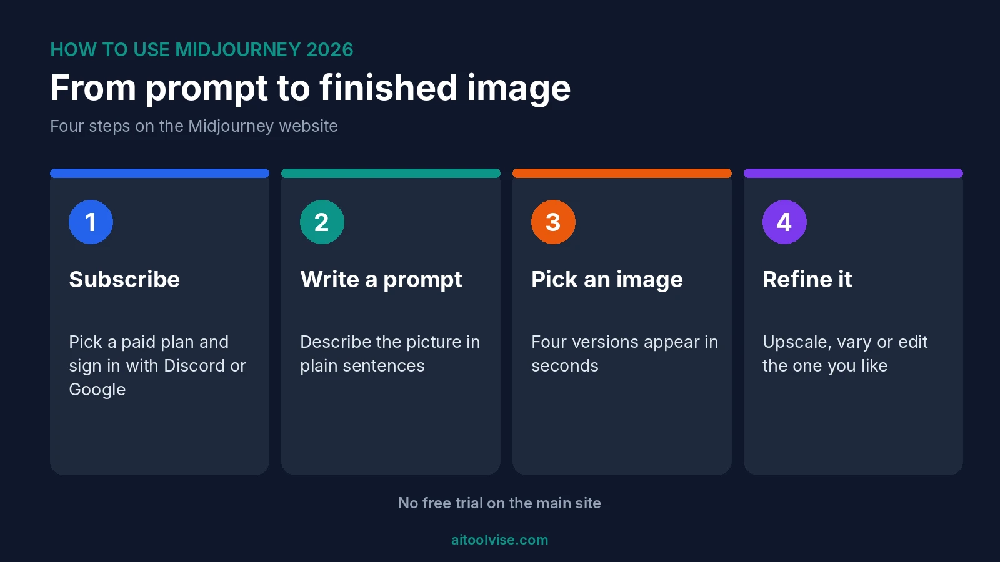
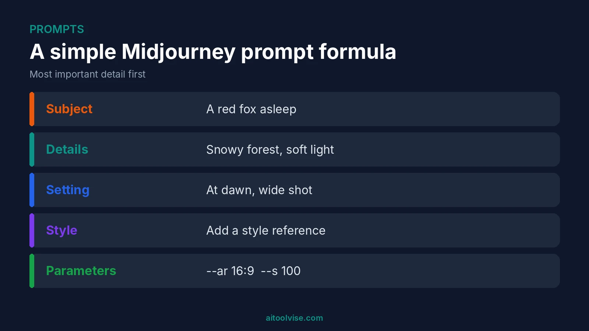
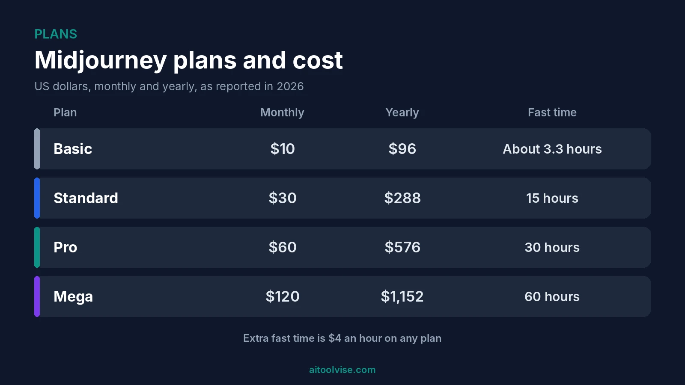

To use Midjourney, go to midjourney.com, pick a paid plan, sign in with Discord or Google, then type a description into the Imagine bar. You get four images back. Pick one and upscale it, vary it or edit it. That's the whole loop. Everything else in this how to use Midjourney guide is just ways to steer it better.

One thing first, because it trips people up. There's no free trial. It ended back in 2023, according to a July 2026 guide from [AI Weekly](https://aiweekly.co/learning-ai/generative-ai/how-to-use-midjourney). So how to use Midjourney for free has a short answer, and I'll get to it, along with a few free tools that do a decent job.

Below I cover the setup, prompts, the editor, the style creator and the plans. I also answer the odd questions people search, like using it for a children's book or inside Meta AI. If you're making images for posts, our [best AI tools for social media content creation](/best-tools/best-ai-tools-for-social-media-content-creation/) guide is a good companion.

## What Midjourney Is and How It Works

Midjourney is an AI image generator. You describe a picture in words, and it makes four versions in a few seconds. People like it for its look. Images tend to come out polished and a bit painterly, which is why it's popular with artists and designers.

How does it work? You type a prompt. A trained model turns that text into pictures. You then pick one and push it further, with an upscale, a variation or an edit. I can't tell you more about the inside of the model, and honestly you don't need to know.

What you do need is a paid plan and a Discord or Google account. The site has no email-and-password sign-up, per the AI Weekly guide. Billing runs through Stripe and access is instant.

## How to Use Midjourney for Free

Short version: you can't, at least not through the main site. There's no free trial on the website or in Discord. [Dupple's October 2026 check](https://dupple.com/learn/is-midjourney-free) says the only trial is inside the niji·journey phone app. The US App Store listing mentions 20 free generations, but the page notes it doesn't clearly renew or allow commercial use.

So is Midjourney AI art free? No. You can browse the public gallery without an account, and the Discord server is free to watch. Making images costs money. Basic is $10 a month, or $8 a month if you pay $96 up front for the year.

### Free tools that do something similar

Dupple lists a few free options. Bing Image Creator gives 15 fast creations a day. Leonardo.Ai offers 150 fast tokens a day. Ideogram gives 30 credits a week. Adobe Firefly has daily generations but doesn't publish a count. Free images on some of these are public. And the limits can change, so check each site.

I'd try one before paying for Midjourney. If the free one covers what you need, great. If not, you'll know what you're paying for.

## How to Use Midjourney Step by Step

Here's how it goes on the web app. Head to midjourney.com and click Subscribe. Sign in with Discord or Google, then choose a plan. Basic is enough to start. Next, open the Imagine page and type your description. Press Enter and four images appear. Upscale one you like, or vary it to see more options. You can edit it too.

That's it. The hard part is the prompt. Your first few will probably be off. That's normal, and it's cheap to retry, as long as you watch your fast hours.

## How to Use Midjourney on Discord

Midjourney started on Discord, and plenty of people still use it there. You join the server, find a bot channel and type commands. It works. But the web app has more: sliders for settings, an editor, and Draft Mode, which Discord doesn't offer, according to AI Weekly.

So if you're learning how to use Midjourney, start on the website. Use Discord if you like the community feed, or if you're following an older tutorial. Both need a paid plan to make images.

## How to Write Midjourney Prompts That Work

Describe the picture the way you'd describe it to a friend. Plain sentences beat piles of keywords. AI Weekly suggests this order: the subject, visual details, the setting, a style reference, then parameters. Put the most important thing first, since the start of a prompt carries more weight.

Want text in the image? Put it in double quotes. Want to leave something out? Use `--no`.

### The parameters worth knowing

These come from the same guide, and they're the ones I'd learn first.

| Parameter | What it does | Default |
|---|---|---|
| `--ar` | Aspect ratio | 1:1 |
| `--s` | Stylize, 0 to 1000 | 100 |
| `--c` | Chaos, 0 to 100 | 0 |
| `--no` | Leave something out | None |
| `--sref` | Style reference | None |
| `--v` | Model version | Current default |

### What are the best AI prompts for images?

No magic list exists. A good prompt is specific. Name the subject, the light, the mood and the framing. "A red fox asleep in a snowy forest at dawn, soft light, wide shot" beats "cool fox picture." Then change one thing at a time. That's how you learn what moves the result.

## How to Use the Midjourney Editor to Edit Images

On the web app, you open an image and choose Edit. The main tool is Vary Region. You select an area, describe what should be there, and Midjourney regenerates only that part. Large selections tend to work best, per the AI Weekly guide. You can also rerun an image in HD from the editor.

What about editing your own existing images? One source describes the web editor as offering pan, zoom, Vary Region and inpainting. But I couldn't confirm exactly how it handles photos you upload yourself. Check the [official Midjourney docs](https://docs.midjourney.com) before you count on it.

## How to Use the Midjourney Style Creator

The style creator helps when you can't describe a look in words. [TechFinitive's June 2026 walkthrough](https://www.techfinitive.com/explainers/midjourney-find-the-exact-image-style-youre-looking-for/) goes like this. Open it on the website and type a prompt for what's in the image. Then browse the grid of styles and pick two or three. Midjourney starts previewing images, and you keep choosing until it looks right.

The payoff is a style reference number. Add it to any prompt with `--sref` and the same look carries over to new subjects. The author called the process hit-and-miss and needed six or seven rounds. If it drifts, starting over can be quicker. Styles also look different across model versions, so use the same version to reproduce one later.

## How to Use Midjourney to Illustrate a Children's Book

This one's popular, and it's the hardest. The challenge is keeping the same character across many pages. Midjourney doesn't remember past images, so you have to give it references every time.

An Upwork guide on consistent characters, written for version 7, suggests this. Make one clear portrait. Build a character sheet from it. Then use the omni reference parameter, `--oref`, plus a `--seed`, on later prompts. Describe the face and outfit the same way each time. Even then, details drift. Seeds give "nearly similar" results, not identical ones, the guide says.

Two warnings. Omni reference wasn't fully available in V8.1 as of AI Weekly's July guide, which suggested `--v 7` for it. And I can't tell you the rules for selling AI-illustrated books on each platform. Check those before you publish. On Basic, commercial use is allowed if your yearly gross revenue is $1,000,000 or less, per Dupple.

## How to Use Midjourney in Meta AI

You probably can't, at least not directly. Meta announced in August 2025 that it would license Midjourney's technology for future models and products, per [VentureBeat](https://venturebeat.com/ai/meta-is-partnering-with-midjourney-and-will-license-its-technology-for-future-models-and-products). That's a licensing deal. I found no evidence that Midjourney itself runs inside Meta AI, so I wouldn't promise that. If you want Midjourney, use midjourney.com.

## Is There a Midjourney App or API?

On the app: AI Weekly says there's no native iOS or Android app. The web app works in a mobile browser. The niji·journey app is a separate thing, and it's the one with the trial.

On the API: I couldn't find an official public one. What turned up were third-party services that sell access. I'd be careful with those, since they aren't made by Midjourney and could break or change.

## Midjourney Plans and Cost

Here's what each plan costs, from [Krater's September 2026 check](https://krater.ai/blog/midjourney-pricing) and the AI Weekly guide.

| Plan | Monthly | Yearly | Fast time |
|---|---|---|---|
| Basic | $10 | $96 | About 3.3 hours |
| Standard | $30 | $288 | 15 hours |
| Pro | $60 | $576 | 30 hours |
| Mega | $120 | $1,152 | 60 hours |

Fast hours reset each billing cycle and don't roll over. Extra fast time costs $4 an hour. Basic has no Relax mode and no Stealth mode, so your images are public. Standard adds Relax. Pro and Mega add Stealth.

My take? Basic runs out quickly if you iterate a lot. Fast hours disappear fast. Standard is the comfortable one for regular use.

## Which Midjourney Version Should You Use?

This is where my sources disagree. Midjourney's own update says V8.1 became the default model on June 11, 2026. A different guide says V8.2 became the default on July 24, 2026. I couldn't settle that. Check what the site offers when you sign in.

What I can say about V8.1: standard images take about 4 seconds, and HD takes about 12, per Midjourney's update. HD gives roughly 2048px images. Draft Mode, web only, makes quick low-res images to test ideas cheaply. If you need omni reference, use `--v 7` for now.

## Can You Make Money With Midjourney?

People ask "how can I make $1000 a day using AI?" a lot. I found no reliable data on what anyone earns from this. Anyone quoting a number is guessing, or selling something. Realistic uses are simpler: social graphics, book covers, mockups, client work. Want to turn the images into video? You could edit them in CapCut (our [CapCut Pro pricing review](/reviews/capcut-pro-pricing-review/) covers the costs), or make clips with [Runway](/how-to/how-to-use-runway/). Our [Runway vs Sora comparison](/compare/runway-vs-sora/) can help you choose.

Running a business? Our [best AI tools for small business](/best-tools/best-ai-tools-for-small-business-2026/) guide covers the wider toolkit, and [best AI tools for content creation](/best-tools/best-ai-tools-content-creation/) has more image and design options.

## Common Midjourney Mistakes

Vague prompts. That's number one. "A nice landscape" gets you something forgettable.

Changing five things at once is next. You can't tell what helped. Then there's burning through fast hours on Basic by retrying without thinking. And forgetting that Basic images are public.

Also check hands, text and small details. They can come out wrong. Look closely before you post.

Want to see more guides like this? The [home page](/) lists our other how-tos, reviews and comparisons.

## Affiliate Disclosure

Some links on this page may be affiliate links. If you sign up through one, AIToolVise may earn a commission at no extra cost to you. We only recommend tools we'd point a friend toward, and the opinions are ours. Prices and plans shift a lot, so check each company's own pricing page before buying.