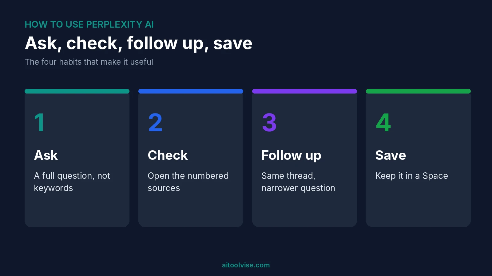
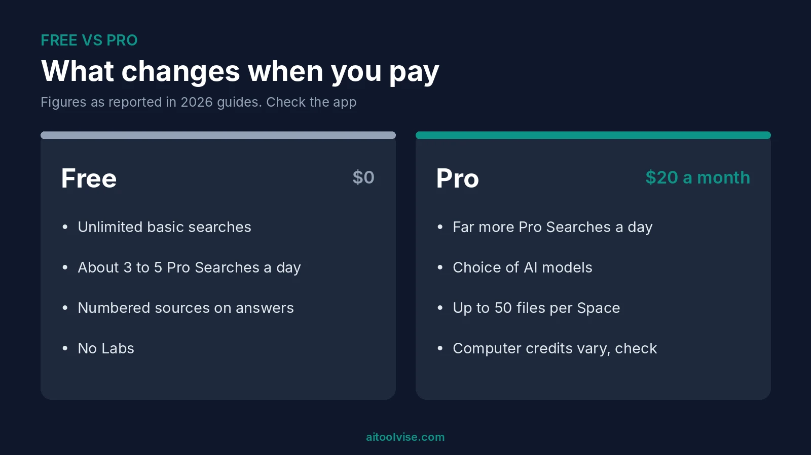
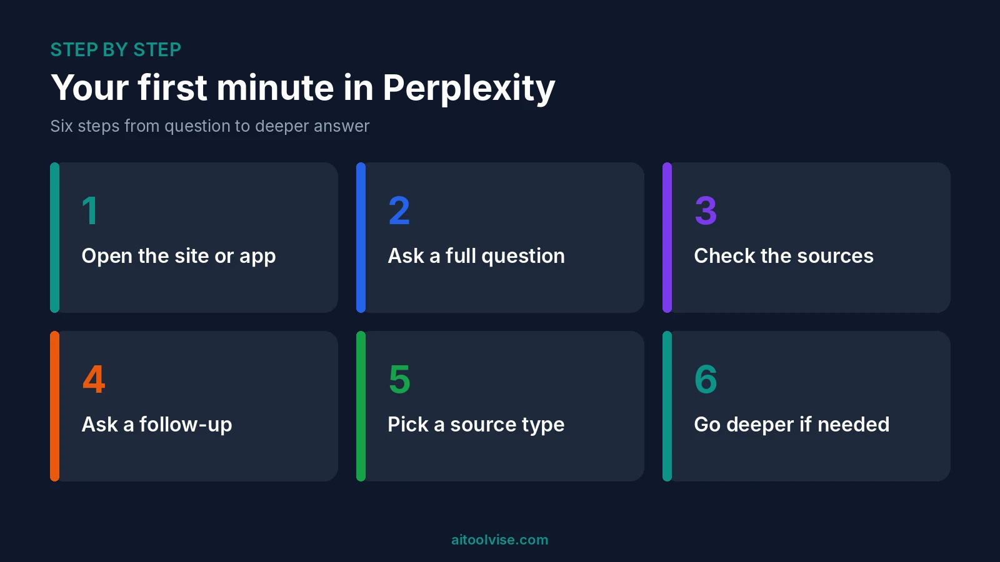

Perplexity looks like a plain search box, and for about ten minutes it feels like one. Then you spot the little numbers under every answer and start clicking around. Nobody really tells you what's behind them. I think that's a shame, because that's where it gets good.

So here's how to use Perplexity AI, in the order I'd pick it up if I were starting over. Basics first, then the free plan, research, Spaces, the phone app, and the newer tools, Comet and Computer. Wherever I could, I checked things on Perplexity's own pages. Where a guide was all I had, I say that. Can't decide between this and ChatGPT? Start with our [Perplexity vs ChatGPT comparison](/compare/perplexity-vs-chatgpt/).

## What Perplexity AI Is and What You Need to Begin

It's an answer engine. You ask something, it goes off and searches the web, and you get an answer with numbered links to the pages it used. [Perplexity's getting-started page](https://www.perplexity.ai/hub/getting-started) says you can hover over or click any citation to read the source. Some even carry labels, like Government, Academic or Trusted.

What do you need? A browser and an email address, and that's it. You can ask a question at perplexity.ai without signing in, but I'd make an account anyway, because it keeps your history and opens up the rest. Google, Apple or plain email all work. You don't install anything or hand over a card.

## How to Use Perplexity AI for Free

Start free. One guide says you get unlimited basic searches and about 5 Pro Searches a day. Others say 3. I'd call it 3 to 5 and look in the app, because numbers like this keep changing. A Pro Search digs deeper than a basic one. When your Pro Searches run out, the basic ones still work.

To learn the tool, that's plenty. If you research every day, though, you'll hit the wall fast.

### Can you get Perplexity Pro for free?

Sometimes. It's just not as simple as some guides pretend. Education Pro is $10 a month for verified students, says Perplexity's [help page](https://intercom.help/perplexity-ai/en/articles/12590157-what-is-education-pro). One guide claims a .edu email gets a free year. I couldn't confirm that, so check the live page yourself. The Airtel offer in India ended on 16 January 2026. If you claimed it before then, you keep your year. Our [Perplexity Pro pricing review](/reviews/perplexity-pro-pricing-review/) covers every plan and the refund rules.

## How to Use Perplexity AI Step by Step

Here's the basic loop. It takes a minute, if that.

1. Open perplexity.ai or the app.
2. Ask a full question. "What changed in the EU's AI rules this year?" works far better than "EU AI rules".
3. Read the answer. Then look at the sources, and click the ones you actually care about.
4. Ask a follow-up in the same thread. It remembers what you just asked.
5. Want a certain kind of source? Guides call this Focus mode, with choices like Web, Academic and Social. Your menu might use another name, so look near the search box.
6. For bigger questions, switch to Pro Search or Deep Research.

Most people stop at step 3, and I think that's a mistake. The follow-ups are where Perplexity earns its keep.

## How to Use Perplexity AI for Research

For anything big, turn on Deep Research. Perplexity's page says it pulls in more sources, and its own example shows 42, six of them premium. One guide says research mode can take 3 to 5 minutes. Don't stand over it. Go make tea.

A few habits help more than you'd expect. Tell it the topic, how wide to go and which dates matter, like "published between 2020 and 2025". Say how you want the answer laid out. Ask for a source and a date on every claim. Then click the citations. Every so often a source doesn't say what the sentence next to it says. Think of the answer as a map and the sources as the actual ground.

Writing a paper? Academic mode sticks to scholarly sources. Labs is a different thing. One guide says it builds dashboards and small web apps from a prompt, and the free plan doesn't include it.

## How to Use Spaces to Keep Your Work Organized

Spaces are basically folders with a brain. Open Spaces in the left panel, hit New Space, name it. Then add custom instructions, say "Always cite sources and keep answers under 200 words." Every chat in that Space will follow them.

[Perplexity's Spaces page](https://intercom.help/perplexity-ai/en/articles/10352961-spaces) says Pro allows up to 50 files per Space and Max allows 500. Paid users can upload files up to 50 MB each, and Pro and Max users can invite up to five contributors. New Spaces start out private. Me, I'd keep it simple and make one Space per project. Ten half-empty Spaces help nobody.

## How to Use Perplexity AI for Job Search

People ask about this a lot, and yes, it works. There's a catch, though. [The Interview Guys' August 2026 guide](https://blog.theinterviewguys.com/?p=17909) calls Perplexity a research engine, not a writing tool. So use it to look a company up. What does it sell, who runs it, what's been in the news, has it raised money or laid people off? Ask for a source and a date every time.

Don't have it write your resume. ChatGPT or Claude does that better. Also check the job is still open, since the same guide says Perplexity won't tell you when a posting has closed. And keep your address, ID numbers and anything confidential out of your uploads.

## How to Use Perplexity Computer

Computer is Perplexity's agent for jobs with lots of steps, like researching a topic, watching something on a schedule or working through files. It doesn't have a price of its own. It runs on your plan and burns credits. Ordinary searches don't.

To start, pick Computer in the app and describe the task in plain words. According to the getting-started page, it connects to tools like Slack, Salesforce and Notion, and repeat jobs can be saved as Skills that run on a schedule.

Credits are the catch. Max includes 10,000 a month, per Perplexity's help page. One guide says Pro gets a one-time bonus rather than a monthly amount, so look at the credit page in your account before you count on anything. That writer also says to start a fresh thread for each task, since long threads cost more.

## How to Download and Use Comet

Comet is Perplexity's browser, with the assistant built in. [Tom's Guide reported in October 2025](https://www.tomsguide.com/ai/perplexity/perplexitys-ai-browser-comet-is-now-free-for-everyone-heres-how-to-download-it) that Comet became free for everyone on Windows and Mac. Head to perplexity.ai/comet, choose Download Comet and run the installer. It offers to bring over bookmarks and passwords from your old browser, and you can skip that. Sign in with your Perplexity account to get the full experience.

Comet can work across your open tabs and fill in forms, according to Perplexity's page. Handy, sure. But it also means an AI can see pages you're logged into. Read what you're approving.

## How to Download Perplexity AI on Your Phone

On a phone, get the app from the App Store or Google Play and sign in. Your saved threads are there, and so is the same search. Perplexity's getting-started page says Computer is on iOS and Android too. On a computer, the website is fine. I saw desktop app listings in a few download directories, so get anything beyond the website from Perplexity's own site.

### How to use Perplexity AI on WhatsApp

Yes, you can use it inside WhatsApp too. [BGR reported in April 2025](https://bgr.com/tech/perplexity-ai-now-works-in-whatsapp-heres-how-to-use-it/) that you save Perplexity's number, +1 (833) 436-3285, as a contact and message it like a friend. The article says it can give answers, sources and images. Check that number on Perplexity's own site before you save it, because scammers copy popular bots. The same article says it's unclear what happens to your data on Perplexity's side. The app is the better experience.

## How to Use Perplexity AI in VS Code

There isn't really a big official coding assistant for this. One video-script guide says to search "perplexity" in the Extensions tab, install "Perplexity.ai" and click the chat icon in the sidebar. I couldn't confirm the extension is official, so check the publisher name first. You can also use the Sonar API in a tool like Cline, but a community thread says Sonar Pro in Cline answers without acting like an agent.

My honest take: use Perplexity to look up a library or decode an error message. Then let a coding tool write the code. Our [best AI coding tools](/best-tools/best-ai-coding-tools/) guide has better options.

## How to Use Perplexity AI to Make Money

Carefully. I couldn't find reliable data on what people actually earn, so ignore any "make $10,000 a month" promise. The real routes are fairly dull. Freelance research and fact-checking for clients. Market and competitor research for small businesses. Faster prep for content you already sell. Perplexity saves you time finding sources. You still get paid for your judgment. For content workflows, see our [best AI tools for social media content creation](/best-tools/best-ai-tools-for-social-media-content-creation/) and the wider [content creation roundup](/best-tools/best-ai-tools-content-creation/).

## What Is Perplexity AI Most Used For?

Mostly research and fact-checking. People use it for quick lookups with sources, comparing products, getting up to speed on a topic, or reading about a company before a meeting. It's weaker at creative writing, images and voice.

### What are the disadvantages of Perplexity?

A few. Citations can look more convincing than they really are, so click through. The free plan caps your daily Pro Searches. Some features cost extra, and Computer runs on credits. Prices vary between guides too. And if you want images, voice or custom GPTs, it won't replace a general assistant.

## How Is Perplexity Different From ChatGPT?

Perplexity starts from search. ChatGPT starts from conversation. Perplexity puts sources on every answer. ChatGPT does more, like writing, coding, images and voice. If you want a single rule, here it is. Perplexity when you need to check where something came from. ChatGPT when you need to make something.

[Similarweb's data through May 2026](https://aisearch.similarweb.com/blog/chatgpt-vs-gemini-vs-claude-vs-perplexity/) puts ChatGPT far ahead on traffic, with Gemini second and Perplexity smaller. Our [ChatGPT vs Claude comparison](/compare/chatgpt-vs-claude/) covers another option.

## Free AI Tools Like Perplexity

No big AI is completely free without limits. ChatGPT, Gemini, Claude and Perplexity all have free plans, and every one of them caps something. The only truly free route is running an open-source model yourself, which takes a decent computer and some patience. As for a top three, by web traffic it's ChatGPT, Gemini and Claude, with Perplexity smaller. Whether any of them beats ChatGPT depends on the job.

## Prompt Tips That Get Better Answers

Ask full questions, because "Why did X happen?" beats "X reasons". Say what you want back, whether that's a table, five bullets or two paragraphs. Put in a date range for anything recent. Ask it to flag whatever it can't verify. Keep follow-ups in one thread, and when the topic changes, start a new one.

## When Perplexity Gets It Wrong

It will, now and then. When an answer looks a bit too tidy, open the sources. If one doesn't say what the sentence claims, ask again with a narrower question, or change the source type. Same question failing again and again? Word it differently. Still stuck? Go to the original source yourself. And for anything medical, legal or financial, treat Perplexity as a starting point, then ask a professional.

Want to see more? The [home page](/) lists our other guides, comparisons and reviews.

## Affiliate Disclosure

Some links on this page may be affiliate links. If you sign up through one, AIToolVise may earn a commission at no extra cost to you. We only recommend tools we'd point a friend toward, and our opinions are our own. Plans and prices change often, so confirm them on each company's own pricing page before you buy.