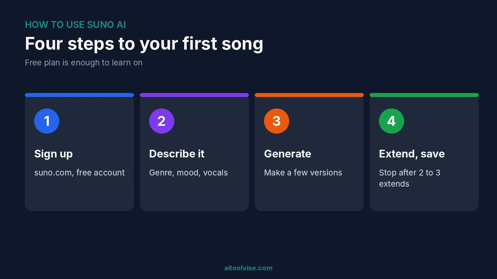
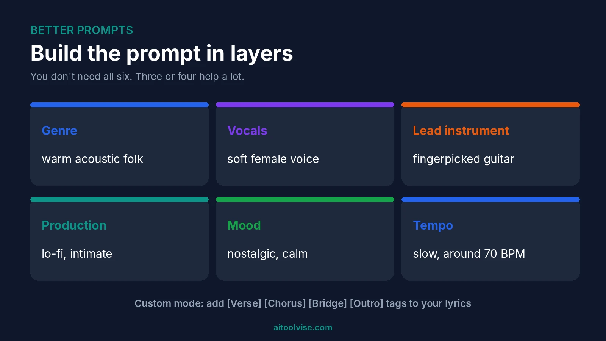
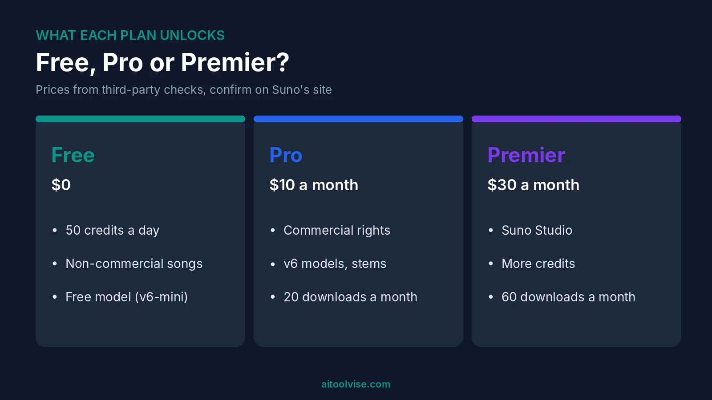

To use Suno AI, go to suno.com, sign up free, click Create and describe the song you want. Pick a genre, a mood and a vocal style. Hit generate and Suno gives you finished tracks in a minute or so. That's the whole loop. Everything else in this how to use Suno AI guide is just ways to get better songs out of it.

I haven't run my own long sessions in Suno. This guide is built from 2026 tutorials, Suno's help pages and pricing guides, and I'll flag where sources disagree. Suno changes fast, so treat details like model names and limits as a snapshot. If you want the money side first, our [Suno AI pricing review](/reviews/suno-ai-pricing-review/) covers every plan.

## What Suno AI Is and What You Need to Use It

Suno is an AI music generator. You type a description or paste lyrics, and it makes a full song with vocals and instruments. It runs in your browser. You don't install anything.

You need an account and an idea. That's it. A free plan exists, and it's enough to learn on. Paid plans add commercial rights, better models and downloads.

## How to Use Suno AI for Free

Sign up and you get 50 credits a day. That's roughly ten songs, going by Suno's own estimate in the sources I used. Credits don't roll over. [CostBench's free-plan page, last verified November 5, 2026](https://costbench.com/software/ai-music-generators/suno/free-plan) lists the free model as v6-mini, with paid users getting v6 and v6-wild.

The catch is what you can do with the songs. Free songs are non-commercial. And downloads are tight: that page says none a month on free, while another guide says seven lifetime trial downloads. I couldn't settle that, so check your own account.

### Can I make a song on Suno for free?

Yes. Sign up, click Create, and make one. You can listen, share and learn what prompts do. You just can't monetize it.

### How to use Suno AI Pro for free?

I found no official way. CostBench lists no free trial of Pro. Some sites sell cheap or shared Pro accounts. I'd steer clear. They likely break Suno's terms, and you could lose access. The free plan is the honest route.

## How to Use Suno AI to Make a Song

Here's the simple path. Do it once on the free plan before you think about anything fancier.

### Step 1: Sign up and open Create

Go to suno.com and create an account. Nothing to download. Click Create. That's how to use Suno AI at its simplest.

### Step 2: Start in Simple mode

Describe the song in a sentence or two. Be specific. A scene, a feeling, a genre, the kind of voice. [A 2026 DEV Community tutorial](https://dev.to/zyvop/how-to-make-real-music-with-suno-ai-in-2026-even-if-youve-never-written-a-song-3n37) says vague prompts like "a happy song about summer" give generic results. I believe it. Try "warm acoustic folk, soft female vocals, a song about driving home at night" instead.

### Step 3: Switch to Custom mode when you have lyrics

Custom mode lets you paste your own words and add a style line. Put structure tags in brackets, like [Verse], [Chorus], [Bridge] and [Outro]. The same tutorial says bracketed cues get followed. No lyrics yet? Ask a chatbot for a draft, then edit it until it sounds like you.

### Step 4: Generate a few versions

Results vary every time. The tutorial suggests making about four versions of the same prompt and picking the best. That costs credits, so on free it's one idea a day or two.

### Step 5: Extend, then download

Pick a track you like and choose Extend, then describe what should come next. The tutorial says to stop after two or three extends, because later ones can get glitchy. When you're happy, download. Remember the plan limits above.

## How to Use Suno for Best Results

Most bad songs come from lazy prompts, so learning how to use Suno AI well mostly means writing better ones. The tutorial gives a rough formula: genre, vocals, lead instrument, production style, mood and tempo. You don't need all six. Three or four help a lot.

A few habits worth stealing. Read your lyrics aloud with a beat before you paste them. Keep lines a similar length. Avoid long verses and awkward names, which are hard to sing. And change one thing at a time, so you know what worked.

## How to Use Suno AI to Cover Songs

Cover turns an existing track into a new style. You can use it on your own audio. Uploads run up to eight minutes on free and 30 on paid, per CostBench.

Be careful with rights. [Dynamoi's April 2026 guide](https://dynamoi.com/learn/ai-music-distribution/can-i-monetize-suno-remixes) says remixes of other creators' songs can't be monetized on any plan, and that Suno advises against monetizing something you don't own. Even with new vocals, the melody may still belong to someone else. The one exception it describes is your own original, made while subscribed. Distributors may also reject a cover. So use Cover for your own material, or for fun.

## How to Use Suno AI With Your Own Voice

Suno calls this Voices. You record or upload a sample of your singing, and Suno builds a voice it can use as the lead vocalist. [Dubspot's June 2026 guide](https://blog.dubspot.com/suno-voices-your-own-voice-2026) says it arrived with the v5.5 model, works on the web and is limited to paid plans.

There's a guardrail. You read a random phrase aloud, and Suno matches it against your sample to confirm the voice is yours. Files with backing music are accepted, since Suno strips the vocals first. That guide recommends at least a minute of material, and clean acapellas work best. It's from June, so details may have shifted with newer models.

## How to Use Suno Studio for Beginners

Studio is Suno's workspace for editing songs. It's Premier only, and Studio 2.0 launched on August 13, 2026, per [Dubspot's write-up](https://blog.dubspot.com/suno-studio-2-0). It runs in the browser, mainly Chrome, and phones aren't supported.

Suno's [own help article](https://help.suno.com/en/articles/7940161) says you open it from the Studio icon, under Create. You can layer tracks, pull out stems and record audio. Generated takes show up in lanes, so you can audition them and stitch the best bits. Exports can be a full song, a time range or separate tracks.

My read for a first session: open a song, add a MIDI track so the built-in synth plays, then try the chat bar. That's my inference, not Suno's advice. The chat bar is in beta, and one source lists a small timing drift on some generations. Use the metronome if something sounds off.

## How to Use Suno AI on Mobile

Suno has a mobile app. It launched on iOS in July 2024, in the US first, according to [Suno's own announcement](https://suno.com/blog/suno-for-mobile). It lets you make songs from text, record audio and listen to other people's music.

For Android, that post only said it was coming. Suno's page footer now links an Android app, and a May 2026 CometAPI article says both apps are on the stores. That's a third-party source, so check your store listing. Studio, as noted, is web-only.

## Can You Sell Music Made With Suno AI?

On a paid plan, yes, for songs made while you're subscribed, per Dynamoi. Free songs stay non-commercial even if you upgrade later. Ownership is murkier than rights, and fully AI music may not qualify for copyright. I'm no lawyer. Our [Suno AI pricing review](/reviews/suno-ai-pricing-review/) goes through this in detail, and [Suno vs Udio](/compare/suno-vs-udio/) shows how the other big tool differs.

## Questions People Ask About Suno and AI Music

### Can ChatGPT make music?

Not as audio. A September 2026 article says it can't produce playable music or vocals. It can write lyrics and prompts you paste into Suno.

### What is the most successful AI-generated song?

Nobody agrees. [Billboard's tally](https://billboard.substack.com/p/how-many-ai-artists-have-debuted) names Xania Monet, who it says used Suno, with 44.4 million US streams and several chart debuts. It also says Telisha "Nikki" Jones writes about 90 percent of her lyrics. Breaking Rust's "Walk My Walk" was reported at number one on Country Digital Song Sales in November 2025. But those sales charts move on small download counts, and Billboard lists the act at around 1,000 to 2,000 downloads. It didn't name the tool.

### Are musicians using Suno?

Some are. Headlines I saw say Timbaland joined Suno as a strategic advisor and partner. I couldn't find a trustworthy count of working musicians using it. Since Xania Monet's creator writes lyrics and uses Suno for the music, the human still does a lot.

## Common Suno Mistakes

Vague prompts. Extending too many times. Long, clumsy verses. Posting free-plan songs somewhere you hope to earn. Uploading someone else's song and expecting to monetize the cover. And forgetting that downloads are capped separately from credits.

## Where to Start With Suno AI

If you're wondering how to use Suno AI without wasting money, start free. Make five songs this week. Change one thing each time. If you like what comes out and want to post it with ads, upgrade to Pro. Making a video for the track? Our [best AI music video generators](/best-tools/best-ai-music-video-generators/) list covers options, [how to use Midjourney](/how-to/how-to-use-midjourney/) helps with cover art, and the [CapCut Pro pricing review](/reviews/capcut-pro-pricing-review/) covers editing. For posting, see our [best AI tools for social media content creation](/best-tools/best-ai-tools-for-social-media-content-creation/), or browse the [home page](/).

## Affiliate Disclosure

Some links on this page may be affiliate links. If you sign up through one, AIToolVise may earn a commission at no extra cost to you. We only recommend tools we'd point a friend toward, and the opinions are ours. Prices and plans shift a lot, so check each company's own pricing page before buying.