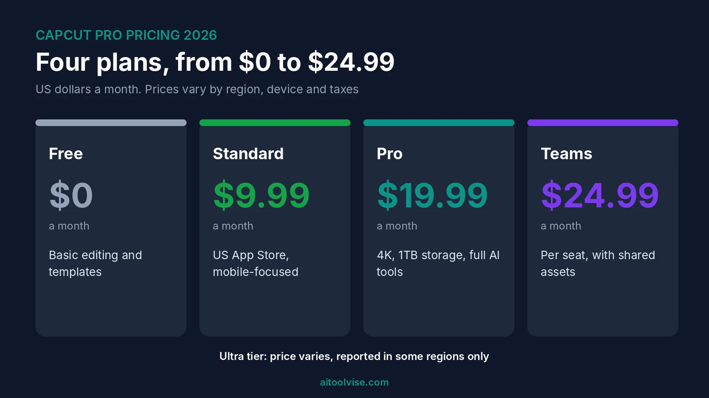
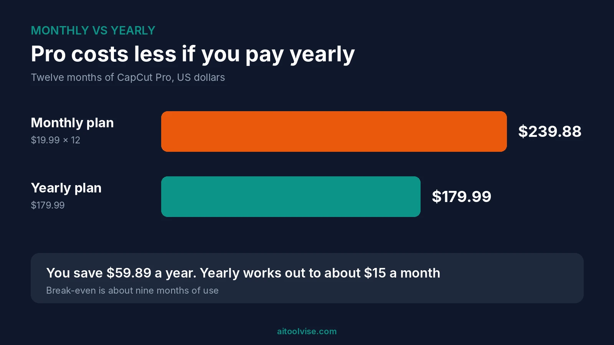
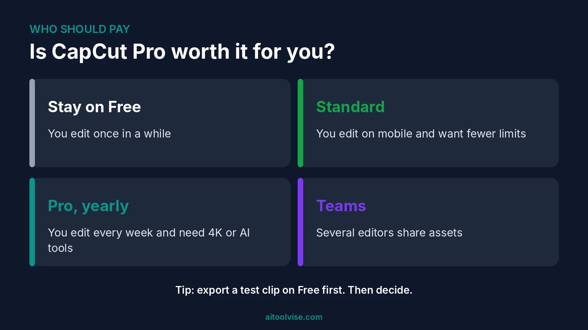

CapCut Pro costs $19.99 a month, or $179.99 a year. That's what CapCut lists on its site in October 2026. And honestly? It used to be a lot less. Back in 2025, guides were quoting $7.99 a month. Plenty of people noticed when their bill jumped. So this review covers what you pay now, what each plan gives you, and whether Pro is worth it for you. I've tried to answer the questions people keep asking too, like what it costs in Pakistan and how to pay less. A few prices differ between sources. When they do, I say so. Picking video tools for TikTok or Reels? Our [best AI tools for social media content creation](/best-tools/best-ai-tools-for-social-media-content-creation/) guide shows where CapCut fits.

## CapCut Pro Pricing at a Glance

Here's the short version. All prices are in US dollars, from guides published between August and October 2026.

| Plan | Price | Best for |
|---|---|---|
| Free | $0 | Basic editing, trying it out |
| Standard | About $9.99 a month (US App Store, varies) | Mobile editors who want fewer limits |
| Pro | $19.99 a month or $179.99 a year | Regular creators, 4K, full AI tools |
| Ultra | Not fixed. One report lists RM198 a month in Malaysia | Heavy AI video users |
| Teams | From about $24.99 per seat a month | Groups sharing projects |

CapCut itself says there's no single global price. What you pay depends on your region, your device, taxes and any promotion running. So use this table as a rough guide, and trust the number on your own checkout screen.

## Why Is CapCut Pro So Expensive Now?

Short answer? The price went up. A lot. [Newsweek reported in February 2026](https://newsweek.com/app-used-millions-nearly-doubles-subscription-price-overnight-11535999) that the yearly plan jumped from about $77 to $179.99. That's over 100%. Older guides agree. A May 2025 review quoted $7.99 a month or $74.99 a year, which was the going rate back then.

Why? CapCut never gave a clear, number-by-number answer. A help article dated March 25, 2026 says price increases are "usually the result of upgrades to the membership plans." Standard and Pro, it says, gained more editing tools, more assets and more cloud storage. It never mentions old or new prices. To me, that's an explanation, not a justification. Some users in the Newsweek piece said they'd switch editors. Others said the desktop app is still worth the money. Honestly, I can see both sides.

## What the Free Plan Gets You

Free CapCut is still pretty good. You get basic cutting, text, filters and templates for nothing, and reviewers praise the auto-captions most. One August 2026 review says they're free, though a table in the same review lists them as Pro, so check the app. Free also has no cloud storage, and exports stop at 1080p, according to [that tlinky review](https://tlinky.com/capcut-review/). The same review contradicts itself on watermarks, so export a test clip before you rely on it.

Here's a tip from [Dupple's October 2026 guide](https://dupple.com/learn/is-capcut-free). Many templates end with a CapCut logo clip, and you can delete it. But if you use Pro assets in a free project, you can hit a paywall at export. Better to know that before you spend an hour on a template.

## CapCut Pro Subscription: What $19.99 a Month Includes

Pro is the main paid plan. For $19.99 a month you get 4K export, 1TB of cloud storage, the full AI toolkit, and access on mobile, desktop and web. The tlinky review says AI video generation, AI avatars and AI images are Pro-only. It also says the AI points allowance went from 550 to 1,200. Its verdict on the AI video? Fine for rough drafts and concept tests, not for finished ads.

Notice the word "points". Pro isn't unlimited AI. The heavier generation tools spend credits, and top-ups cost extra. So look at your account before you buy a plan just for the AI.

### CapCut Pro monthly price vs yearly subscription

Monthly is $19.99. Yearly is $179.99, or about $15 a month. Over twelve months, monthly adds up to $239.88, so yearly saves you $59.89. Dupple's guide puts the break-even at about nine months. If you'll use Pro for less than that, monthly is cheaper. Longer than that, go yearly.

## CapCut Standard vs Pro vs Ultra

Standard is the cheaper step. Dupple's guide found it at $9.99 a month on the US App Store, but CapCut's web pricing page showed no Standard plan at all. Another guide says it's mobile-focused with no annual option. A third mentions an $89.99 yearly store listing with no tier name. It's messy, honestly. Check the in-app screen.

Ultra is the newest one. [TechNave reported in June 2026](https://technave.com/gadget/Capcut-released-a-new-Capcut-Ultra-subscription-plan-for-RM198-monthly-46945.html) that Ultra launched in Malaysia at RM198 for the first month, then RM329.90 after that. It comes with about 40,795 monthly credits and 1TB of storage. Another guide says Ultra has no fixed price. Unless you generate a lot of AI video, I wouldn't bother.

## CapCut Pro Team Price

Teams plans start at about $24.99 per seat a month, according to two guides. Your region and the number of seats will change that. The tlinky guide says the per-seat math matters more than the individual price. If three or four of you edit together, work out what shared assets are worth first. If not, separate Pro accounts may be simpler.

## How Much Does CapCut Pro Cost in Pakistan and in Rupees?

I couldn't find a trustworthy figure, and I'm not going to invent one. CapCut's own help page says Pro pricing "can vary depending on your region, device, and available promotions," and it doesn't list prices for Pakistan or India. A price-tracking site lists Pakistan only as a wide range of Google Play in-app purchases, which isn't the Pro price.

So here's what I'd do. Sign in from your own country, open the Pro upgrade screen on the web or in the app, and read the price in rupees. That's the only number that counts. Expect taxes and payment fees on top.

### In which country is CapCut Pro the cheapest?

CapCut says prices can be lower where affordability matters and higher elsewhere. [Its help page on price differences](https://www.capcut.com/help/capcut-pro-prices) gives four reasons. Local taxes, currency exchange rates, regional pricing and payment fees. It publishes no ranked list. One price tracker shows Turkey far below the US, but that same site also pushes VPN links. Buying through another country's store can need a local billing address, and it may break the store's rules. I wouldn't.

## How Much Should You Pay for CapCut Pro?

Yearly, on the web, if you're sure you'll use it. That comes to about $15 a month. One guide says app-store purchases cost more, with Pro near $22, because of store commissions. Another says the base subscription stays the same. I can't settle that for you. Just compare the web price with the app price before you tap Subscribe.

My rule of thumb: pay for Pro if you edit video at least weekly and need 4K export or the AI tools. If not, free is probably enough.

## What Is the Cheapest Way to Buy CapCut Pro?

Pick yearly over monthly. Subscribe on CapCut's website instead of an app store, if your region offers it. Try the free plan for a few weeks first. Watch for promotions, since CapCut says price can depend on them and on your market. And cancel before renewal if you're done. All of that is above board. The sketchy tricks on forums, like VPNs and gift-card arbitrage, can land your account in trouble.

## CapCut Pro vs Canva: Which Is Better?

For short video, CapCut. For brand graphics, Canva. [Tlinky's August 2026 comparison](https://tlinky.com/capcut-vs-canva/) says CapCut wins on auto-captions, timeline control and TikTok export. Canva wins on brand kits and resizing. Lots of creators just use both. Canva's paid price depends on your billing country, so look at its page. Our [best AI tools for content creation](/best-tools/best-ai-tools-content-creation/) roundup covers Canva in more detail.

## Is CapCut Pro Worth It?

For regular creators, yes. For casual ones, probably not. If you post short videos every week, the 4K export, the bigger asset library and the AI tools save you real time. Even at about $15 a month, it's a fair price if you use it every week.

But the price doubled, and that matters. Edit once a month, or you're fine with the free plan's limits? Skip it. And if what you really want is AI video generation, compare CapCut's credits with dedicated tools first. Our [Runway Gen-4 pricing review](/reviews/runway-gen-4-pricing-review/) and [Sora pricing review](/reviews/sora-ai-pricing-review/) show what those cost.

## Where CapCut Pro Falls Short

A few things bug me. First, the price jump came with very little explanation. Second, pricing varies by region and platform, so you don't really know what you'll pay until checkout. Third, guides contradict each other on what's free, so it's easy to buy Pro for something you already had. And AI generation runs on points, not unlimited use.

Then there's music licensing. One review says CapCut's commercial sounds are licensed only for use inside CapCut, TikTok and TikTok for Business. Want to run the same video as an ad somewhere else? You'd need separate permission. If you make avatar videos for clients, our [HeyGen pricing review](/reviews/heygen-pricing-review/) covers another route. And for clips set to music, see our [best AI music video generators](/best-tools/best-ai-music-video-generators/).

## How to Cancel CapCut Pro and Ask for a Refund

Cancel wherever you subscribed. Paid through Apple or Google? Cancel there. Paid on the web? Cancel in your CapCut account. Do it at least a day before it renews. One 2025 guide says most subscriptions don't offer refunds after payment, so I wouldn't count on one. Export and download your projects first, because cancelling ends Pro features and cloud access.

## CapCut Pro Pricing Verdict

CapCut Pro is a good editor at a price that's not really a bargain any more. At $179.99 a year, it's fair if you edit every week. At $19.99 a month, it's best for short bursts. My advice is to start free, test an export, then decide.

Before you pay, look at the price on your own checkout screen. It's the only one that applies to you, whatever any guide says, this one included. And if you want more? The [home page](/) lists our other reviews, comparisons and guides.

## Affiliate Disclosure

Some links on this page may be affiliate links. If you sign up through one, AIToolVise may earn a commission at no extra cost to you. We only recommend tools we'd point a friend toward, and our opinions are our own. Plans and prices change often, so confirm them on each company's own pricing page before you buy.