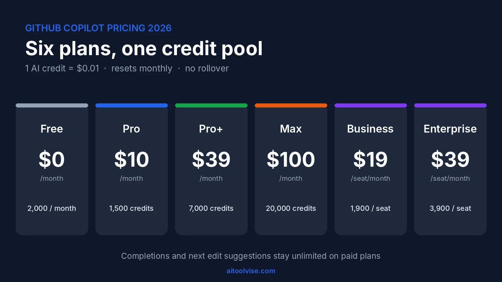
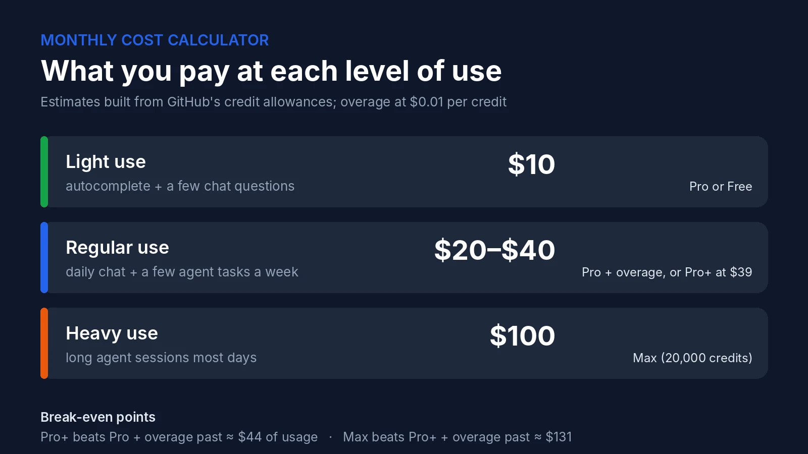
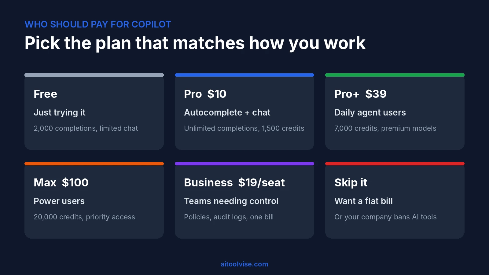

GitHub Copilot pricing looks simple on the pricing page and gets messy the moment you start using it. The sticker prices are straightforward: $0 for Free, $10 a month for Pro, $39 for Pro+, $100 for Max, then $19 and $39 per seat for Business and Enterprise. What changed on June 1, 2026 is what those prices buy. Every plan now comes with a monthly pool of AI credits, and a long agent session can drain that pool faster than you'd expect. This review covers each plan, shows how the credit math works with real numbers, and tells you who should pay for Copilot and who shouldn't.

## GitHub Copilot Pricing at a Glance

The short answer on GitHub Copilot pricing is that it costs between $0 and $100 a month for one person, and $19 to $39 per seat for a team. Here is every plan side by side, using the numbers from [GitHub's own plans page](https://docs.github.com/en/copilot/get-started/plans).

| Plan | Price | Monthly AI credits | Best for |
|---|---|---|---|
| Free | $0 | Limited (2,000 completions) | Trying it out |
| Pro | $10/month | 1,500 (about $15 of usage) | Everyday coding |
| Pro+ | $39/month | 7,000 (about $70) | Regular agent users |
| Max | $100/month | 20,000 (about $200) | Heavy daily agent work |
| Business | $19/seat/month | 1,900 per seat | Small and mid-size teams |
| Enterprise | $39/seat/month | 3,900 per seat | Large organizations |

Code completions and next edit suggestions are unlimited on every paid plan, so the credit pool only matters when you use chat, agents or code review. That's the detail most people miss, and it's why a $10 plan can feel generous for one developer and tight for another.

## From Premium Requests to AI Credits: What Changed in June 2026

Until the end of May, GitHub Copilot pricing was built on "premium requests." You got a set number per month, each model had a multiplier, and the bill was easy to predict. On June 1, 2026 GitHub replaced that with usage-based billing, and [The Register reported](https://www.theregister.com/ai-and-ml/2026/06/02/github-copilot-users-threaten-exit-as-metered-billing-kicks-in/5249826) that Microsoft said the product is "not the same product it was a year ago." The pitch is that agents use far more compute than autocomplete ever did, so a flat count no longer made sense.

### What an AI Credit Actually Buys

One credit equals one cent. What each request costs depends on the model you pick and how many tokens go in and out, including cached tokens. A short question to a small model costs almost nothing. A long agent session that keeps re-sending a big codebase to a frontier model can cost dollars. GitHub's [billing documentation for individuals](https://docs.github.com/en/copilot/concepts/billing/billing-for-individuals) also notes a 10% discount on model costs when you let Copilot pick the model with auto selection.

### What Stays Unlimited

Completions and next edit suggestions don't use credits on paid plans. If you mostly accept inline suggestions and rarely open chat, you may never touch your pool.

### What Happens When Credits Run Out

Credits don't roll over, and the pool resets at 00:00 UTC on the first of the month. Your own plan's credits are used in order, base first and flex second. When they're gone, individuals can upgrade and pay the price difference, set a USD budget for extra usage, or wait for the reset. Organizations pay $0.01 per extra credit.

## GitHub Copilot Free, Pro, Pro+ and Max

All four individual plans include the Copilot CLI and the Copilot app. What changes as you go up is the credit pool and which models you can reach.

### Copilot Free: What You Get for $0

Free gives you 2,000 completions a month and limited chat, with the model chosen automatically for you. Agent features are restricted, and code review is limited to reviewing a selection in VS Code. It's enough to decide whether you like the workflow, and not enough for a full workday.

### Copilot Pro: The $10 Plan Most People Should Start With

Pro removes the completion cap and gives you 1,500 credits, split into 1,000 base and 500 flex. At a cent each, that's about $15 of usage for a $10 fee. Third-party reviews put a long Claude Sonnet agent session at around $12 in credits, so one big afternoon could eat most of the month. That's a rough number from one reviewer's test, not a guarantee, but it shows how fast agent work adds up.

### Copilot Pro+: Seven Thousand Credits for $39

Pro+ includes 7,000 credits (3,900 base, 3,100 flex) and access to the premium models, including Opus-class options that were pulled back from the entry tier. It's the plan for developers who use agents daily and kept hitting the wall on Pro.

### Copilot Max: The $100 Tier for Power Users

Max arrived this summer for people who need more capacity. It includes 20,000 credits (10,000 base, 10,000 flex) and priority access to premium models. Availability for new sign-ups has been rolling out in stages, so check your account before planning around it.

### How to Upgrade Your Copilot Plan

Upgrade from your Copilot settings on GitHub. GitHub's docs say individuals who run out of credits can upgrade and pay the price difference. Cancellation takes effect at the end of your billing cycle, so you can downgrade without losing what you've already paid for.

## Monthly Cost Calculator: Three Real Usage Scenarios

The simplest way to forecast your Copilot pricing bill is to ask how much of your work goes through agents. These three scenarios use GitHub's credit values, and the dollar figures are my estimates built from reported usage, not official quotes.

**Light use: autocomplete and a few chat questions.** You stay inside Pro's pool and pay $10. Free might even cover you if you stay under 2,000 completions.

**Regular use: chat every day and a few agent tasks a week.** You'd probably use $25 to $45 of credits. On Pro that's $10 plus overage, which lands at roughly $20 to $40. Pro+ at $39 gets you $70 of credits, so it starts to win here.

**Heavy use: long agent sessions most days.** Reports from developers range from a $12 session on one afternoon to Visual Studio Magazine's own stress test, which [projected a $180 monthly bill](https://visualstudiomagazine.com/articles/2026/08/07/copilot-credit-complaints-keep-coming-too-expensive-to-use.aspx) from a single marathon troubleshooting session. At that level Max is the only plan that makes sense.

The break-even math is simple. Pro costs $10 for $15 of credits, so overage turns it into usage minus $5. Pro+ becomes the cheaper choice once you use about $44 of credits in a month. Max beats Pro+ plus overage once you pass roughly $131. If you're under those lines, stay on the lower plan.

## Individual vs Business vs Enterprise Plans

If you're deciding between an individual plan and a company plan, the main differences in Copilot pricing are control and billing. Business costs $19 per seat and includes 1,900 credits per user, while Enterprise costs $39 per seat and includes 3,900 per user. Both add organization policies, audit logs and centralized billing. When an organization assigns you a seat, your personal plan is cancelled automatically with a prorated refund.

### How Much Does GitHub Copilot Enterprise Cost?

Enterprise is $39 per seat per month, and it needs GitHub Enterprise Cloud, which is a separate subscription. A 10-seat Business team pays $190 a month. A 50-seat Enterprise team pays $1,950 a month for Copilot alone, before the GitHub Enterprise Cloud licenses. During the transition GitHub gave Business and Enterprise customers larger promotional credits, but those ended on August 31, 2026, so the included credits are now $19 and $39 per seat.

### Is Business or Enterprise Worth It?

For a team that wants audit trails and central policy, Business is the sensible default. Enterprise makes sense when you need the full GitHub Enterprise Cloud feature set anyway. If you only need to give five developers autocomplete, individual Pro plans are cheaper and give you more credits per dollar.

## Copilot Student, Teacher and Open Source Access

Copilot pricing drops to zero for verified students, verified teachers and maintainers of popular open-source projects. GitHub's [free access guide](https://docs.github.com/en/copilot/how-tos/manage-your-account/get-free-access-to-copilot-pro) explains the steps: open Copilot settings from your profile, and if you qualify there will be a button to claim access. Eligibility is rechecked every month, and you can't cancel a grant that was given to you this way.

The student plan is not identical to paid Pro. GitHub's plans page says it includes unlimited completions and automatic model selection but excludes third-party agents. Student users have also complained that the credit allowance is very small, with one commenter quoting around 200 credits, or about $2. Treat that figure as user-reported. If you're in school and mostly want autocomplete, it's still excellent value for $0.

## Copilot Code Review Pricing

Copilot code review pricing changed too. Since June 1, 2026 each Copilot code review is billed twice: AI credits, and GitHub Actions minutes on private repositories. [GitHub's changelog](https://github.blog/changelog/2026-04-27-github-copilot-code-review-will-start-consuming-github-actions-minutes-on-june-1-2026/) says public repositories are not affected because Actions minutes stay free there.

GitHub doesn't publish a flat per-review price, and the cost depends on the size of the pull request. If your team reviews dozens of pull requests a week on private repos, set an Actions budget before you turn this on everywhere. The related question, the cost of GitHub Actions itself, depends on the plan of your GitHub organization and its included minutes.

## Hidden Costs in GitHub Copilot Pricing

- **No rollover.** Unused credits vanish on the first of the month.
- **Context is the real meter.** Long conversations keep re-sending earlier messages, so the same question costs more at the end of a session than at the start.
- **Model choice matters more than plan choice.** A frontier model can cost many times more per task than a small one.
- **Actions minutes on private repos** when you use code review.
- **Third-party estimates disagree.** Some pricing pages online still describe the old premium-request system. Check GitHub's pages before you budget.

## Why Developers Are Angry About the New Copilot Pricing

The backlash started on launch day. The Register reported a Pro+ user who used about 8% of their monthly credits in two hours, and another who said one project change cost more than $6. Forum threads kept going through the summer, and by August some users had cancelled and moved to Claude, Codex or other tools.

To its credit, GitHub kept shipping fixes. VS Code now has a spend meter, there are session limits for the CLI, user-level budgets, and an AI Usage dashboard. The billing model itself hasn't been reversed. If you've been following the wider [Cursor AI pricing](/reviews/cursor-ai-pricing-review/) story, you'll recognize the pattern: flat plans turned into credit pools, and the people who lose out are the heaviest users.

## Is GitHub Copilot Worth It? Who Should Pay and Who Shouldn't

My verdict on GitHub Copilot pricing is yes for most developers, with a clear warning for agent-heavy users. At $10 a month, Pro is one of the cheapest ways to get AI help inside your editor, and unlimited completions mean the core experience never runs dry. It's the agent workflow that makes GitHub Copilot pricing unpredictable.

**Pay for Pro** if you want autocomplete, quick chat and the occasional agent task. **Go to Pro+ or Max** if you can see yourself using over $44 or $131 of credits a month. **Choose Business** if you need central billing and policies. **Skip it** if you want a flat monthly bill with no meter, or if your company doesn't allow AI tools on its code.

For a head-to-head view, our [Cursor vs GitHub Copilot comparison](/compare/cursor-vs-github-copilot/) goes through features, and the [best AI coding tools](/best-tools/best-ai-coding-tools/) roundup shows where Copilot ranks overall. As a sanity check on whether anyone uses it: GitHub Copilot passed 20 million all-time users in mid-2025, [according to TechCrunch](https://techcrunch.com/2025/07/30/github-copilot-crosses-20-million-all-time-users/), and the company says 90% of the Fortune 100 use it.

## Better Alternatives to Copilot

If the Copilot pricing model doesn't suit you, there are two obvious directions. Cursor is the AI-first editor, and our [Cursor vs Claude Code comparison](/compare/cursor-vs-claude-code/) shows how it stacks up against terminal agents. Claude Code suits terminal-based agent work, and you can learn it from our [how to use Claude Code guide](/how-to/how-to-use-claude-code/). If you're weighing the Claude plans too, the [Claude pricing review](/reviews/claude-pricing-review/) covers what each tier costs. For more tools across categories, start from the [AI Tool Vise homepage](/).

## Affiliate Disclosure

Some links on AI Tool Vise may be affiliate links, which means we could earn a commission if you buy through them, at no extra cost to you. We don't take payment for reviews, and every price in this article comes from the vendor's own documentation or from published reports, as linked above.