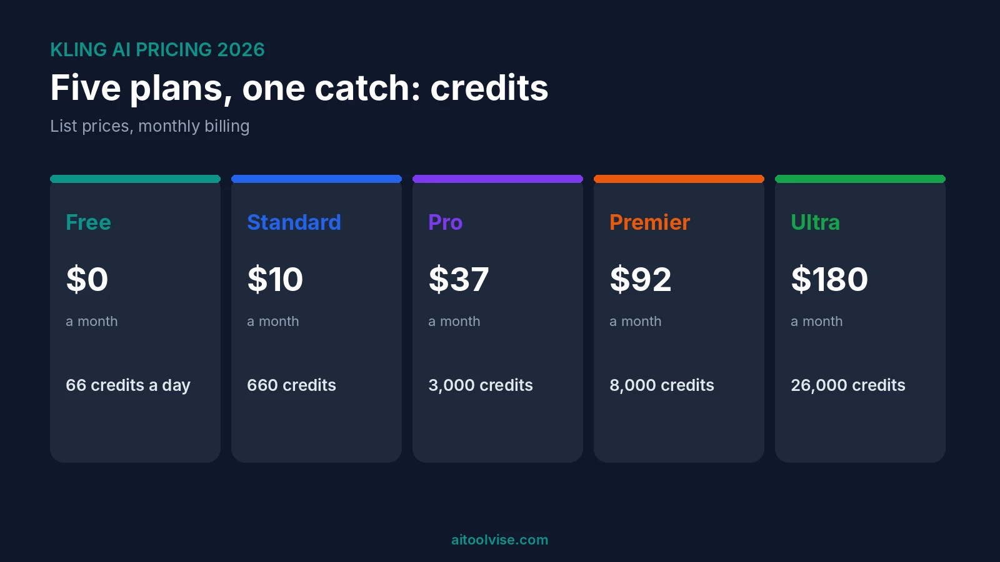
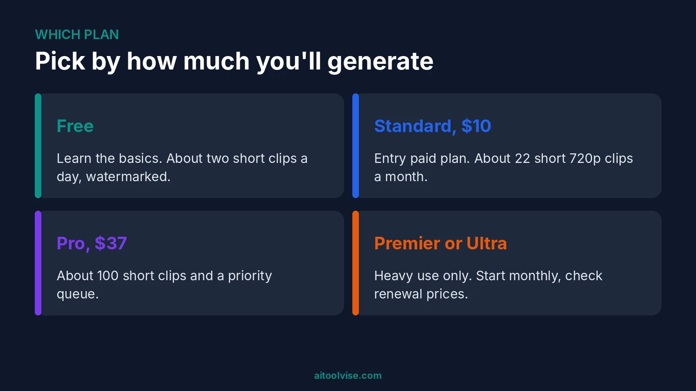
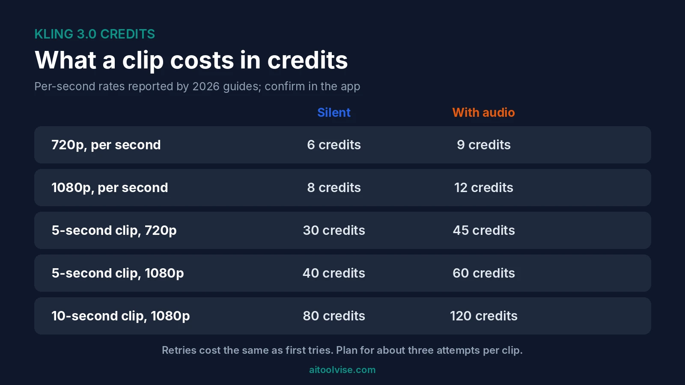

Kling has a free plan, then four paid ones. Standard is $10 a month, Pro is $37, Premier is $92 and Ultra is $180. Pay yearly and Standard drops to about $6.60 a month. That's Kling AI pricing in one breath. But the sticker price isn't the catch. Credits are, and a retry costs the same as a first try.

I spent a while on this one because the sources disagree. Premier's credits, renewal prices and even the free-tier resolution differ from page to page. So I'll flag what I'm sure of and what I'm not. If you're comparing video tools, our [Runway Gen-4 pricing review](/reviews/runway-gen-4-pricing-review/) is the closest match.

## Kling AI Pricing at a Glance

Here's the quick view. Prices are US dollars, list price, monthly billing.

| | Free | Standard | Pro | Premier | Ultra |
|---|---|---|---|---|---|
| Monthly price | $0 | $10 | $37 | $92 | $180 |
| Yearly price | $0 | $79.20 | $293.04 | $728.64 | None |
| Credits | 66 a day | 660 a month | 3,000 a month | 8,000 a month | 26,000 a month |
| Watermark | Yes | Removed | Removed | Removed | Removed |
| Commercial use | No | Yes, per eesel | Yes, per eesel | Yes | Yes |

The prices agree across [eesel's June 2026 guide](https://eesel.ai/blog/kling-ai-pricing), [DIY AI's November 2026 update](https://diyai.io/ai-tools/video-generation/kling-ai-pricing/) and CloudZero's. The credit counts come from eesel and DIY AI. None of those is Kling itself, so check Kling's pricing page before you pay. One tracker listed Premier at $181.99 with 18,000 credits, which conflicts. I'd trust the majority, but confirm.

## What the Kling Free Plan Includes

Free gives you 66 credits a day, and they expire after 24 hours. That's about two short 720p clips a day. [AIReiter's July 2026 article](https://aireiter.com/blog/kling-ai-free-tier-2026) says the allowance used to be higher, 166, and was cut. I can't confirm that history.

Free output carries a Kling watermark. You also sit in a slower queue, with reports of 5 to 20 minutes per clip. And commercial use isn't allowed. It's for trying things, not for client work.

### Is Kling AI still free?

Yes, as of the sources I read. But it's tight. Kling AI pricing free means roughly one or two clips a day, watermarked. One source also says eligibility can vary by account, so your balance may differ. Check the app.

One more conflict. eesel says free output is capped at 360p to 540p. AIReiter lists 1080p export, with some users reporting 720p. I can't settle that, so test it yourself.

## Kling AI Pricing Plans: Standard, Pro, Premier and Ultra

Standard is the entry paid plan. It gives you 660 credits a month, no watermark and faster generation. That's about 22 short 720p clips, by DIY AI's math. It's enough to learn on.

### Kling AI standard plan price

$10 a month, or $79.20 a year. First-month promos exist, around $6.99 per CloudZero, but the renewal price is higher.

Pro is $37 with 3,000 credits, about 100 short clips. It adds a priority queue, per one tracker. Premier is $92 with 8,000 credits, per two guides. Ultra is $180 with 26,000 credits, and has no yearly option as of mid-2026. Sources disagree on when the top plan's price jumped: April 2026 per one tracker, between August 2025 and January 2026 per eesel.

## Kling AI Pricing Per Month vs Yearly

Monthly is $10, $37 and $92 for the three middle plans. Pay yearly and you save roughly 34 percent. That's $6.60, $24.42 and $60.72 a month. You pay up front.

Watch the renewal. CloudZero lists first-month promos of $6.99 for Standard and $25.99 for Pro. Independent checks it cites put renewal at $8.80 and $32.56. So the promo isn't the real price. Credits also expire at the end of each billing month, so a quiet month wastes them. I'd start monthly.

## Kling Credits: How Far Do They Go?

This is the part most pricing pages skim. Kling doesn't publish a clean per-clip price list. But sources agree on the Kling 3.0 rates per second.

### Kling AI credits per video

At 720p with no audio it's 6 credits a second. At 1080p it's 8. Native audio pushes that to 9 and 12. A voice-control add-on is 2 more. So a five-second 720p silent clip is about 30 credits. A five-second 1080p clip with audio is 60.

### Kling AI price per second

On Standard, DIY AI works out about $0.45 for a five-second 720p silent attempt. A ten-second 1080p clip with audio runs around $2. Those are attempts, not finished videos.

That's the catch. Retries cost full price, and failed consumer generations still use credits, per eesel. CloudZero models a 70 percent first-take rate, which means finished clips cost roughly 1.4 times more. It's an assumption, so yours will differ.

## Kling AI Pricing Unlimited: Is There an Unlimited Plan?

I found none. No source I read described an unlimited Kling plan. The biggest plan, Ultra, has 26,000 credits a month. If you see a site promising unlimited Kling, I'd be careful.

You can buy extra credits. Top-ups run about $1 per 66 credits per CloudZero, while another source says they cost 20 to 40 percent more than subscription credits. Add-on packs may last longer than monthly credits, but sources differ on how long.

## Kling AI Pricing in India and the UK

The only regional prices I found are App Store ones, from a third-party tracker's [November 2, 2026 snapshot](https://opentherank.com/ai-pricing/kling-ai/). In India, Standard was ₹999 a month and Pro ₹3,999, with 18% GST included. In the UK, Standard was £10 and Pro £39, with VAT included.

That UK price works out well above the US one in dollar terms. App Store prices can also differ from Kling's website. The same tracker logged big Standard-plan increases on August 14, 2026 in Turkey, Japan, Brazil and Canada. India, the UK and the US weren't in that change log. Check your checkout screen.

## Kling API Pricing

The API is separate from the app. A subscription doesn't give you API access, and API units don't move to a subscription, per CloudZero. It bills per second of video.

[CostBench's tracker](https://costbench.com/software/ai-media-apis/kling-api/), last verified August 2026, lists about $0.084 a second for Standard 720p without audio and $0.112 for Pro 1080p. 4K is $0.42. It marks several tiers as not re-verified. Its prepaid package figures also conflict between sections. CloudZero says third-party resellers list Kling 3.0 from around $0.075 a second. Failed API generations aren't billed. Confirm everything with Kling before budgeting.

## Kling Commercial Use and Watermarks

Free clips are watermarked and personal-use only. Standard and above remove the watermark and include commercial use, according to eesel. One tracker only states a commercial license explicitly for Premier and Ultra, and says lower tiers may have restrictions. So read Kling's terms before you sell a video from a Standard account.

## Cheap Cinematic AI Video Generator: How Does Kling Compare?

On sticker price, Kling's entry plan is cheap. DIY AI puts Runway's entry at $12 a month billed yearly. Our [Runway vs Sora](/compare/runway-vs-sora/) comparison and the [Sora AI pricing review](/reviews/sora-ai-pricing-review/) cover the other two. I'd be careful comparing credits across tools, though. Units differ, and retries decide your real bill.

If you want to learn the editing side, our [guide to using Runway](/how-to/how-to-use-runway/) is a good start. For cutting clips together, the [CapCut Pro pricing review](/reviews/capcut-pro-pricing-review/) covers costs.

## Is Kling Worth It?

If realistic motion matters and you can live with trial and error, Standard probably is. It's cheap per attempt. DIY AI says Kling suits people who want photorealistic movement more than a full editing suite.

If you need finished, usable clips on a schedule, budget more than the rate card suggests. Plan for three tries per clip. And keep an eye on the renewal price.

## Where Kling Falls Short

There's no public per-clip price list. Credits expire monthly. Retries cost money. Free is small and watermarked. And the pricing pages I read disagree with each other, which makes any guide age quickly. Want more tools? Our [best AI tools for content creation](/best-tools/best-ai-tools-content-creation/) roundup covers the wider field, and the [home page](/) lists everything else.

## Kling AI Pricing Verdict

Start free. Move to Standard at $10 a month once you know you'll use it, and go monthly first. Pay for Pro only if the queue time hurts. Test at 720p without audio, then render finals at 1080p. Treat the retry cost as part of the price.

## Affiliate Disclosure

Some links on this page may be affiliate links. If you sign up through one, AIToolVise may earn a commission at no extra cost to you. We only recommend tools we'd point a friend toward, and the opinions are ours. Prices and plans shift a lot, so check each company's own pricing page before buying.