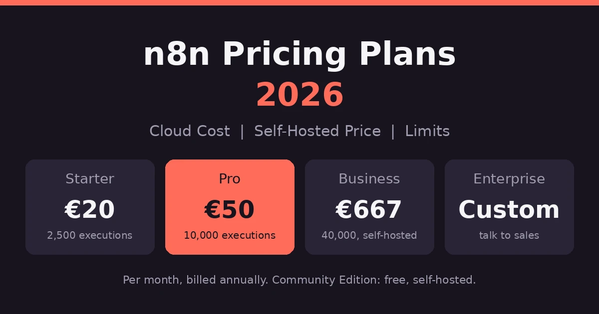
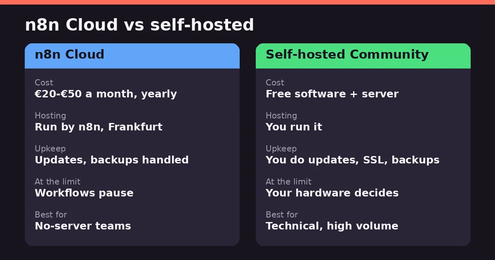
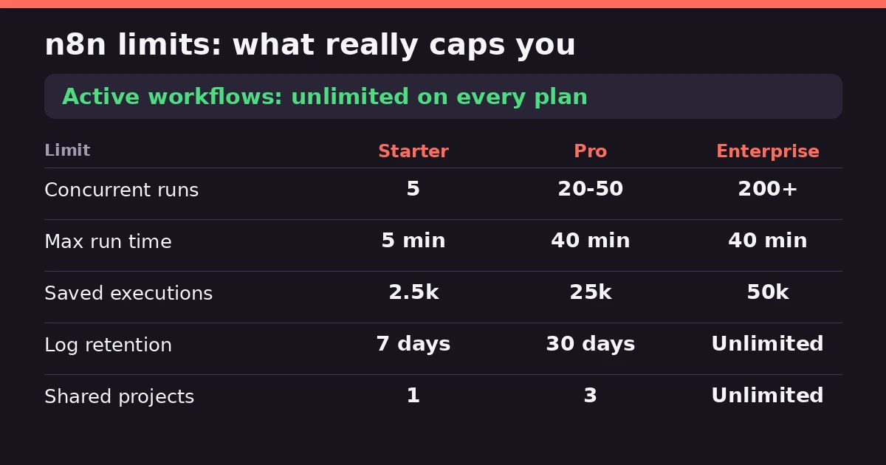
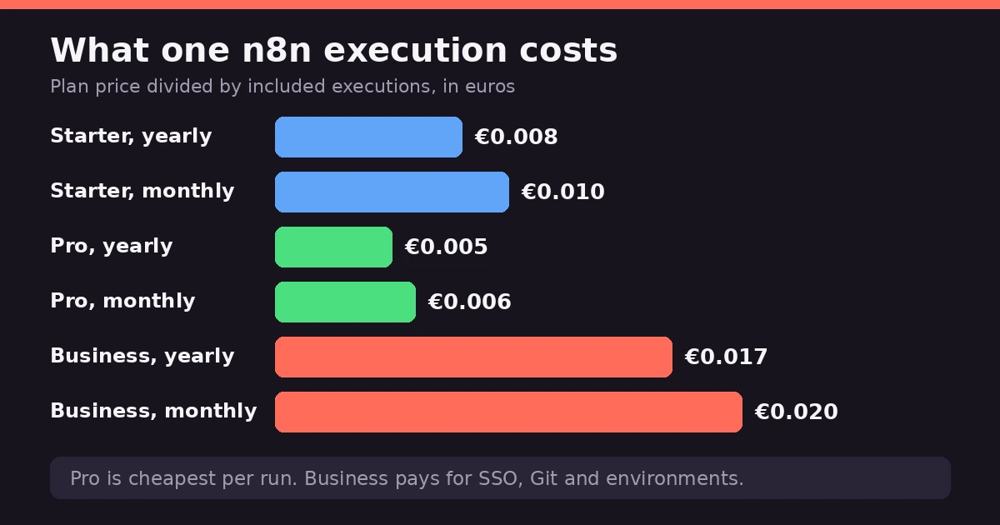

n8n is a workflow automation platform. It connects your apps, runs the logic in between, and lets you add code when the visual editor isn't enough. For this look at n8n pricing plans, the numbers first. Starter is €20 a month on yearly billing. Pro is €50. Business is €667 and self-hosted only. Enterprise is custom. Host the Community Edition yourself and the software is free. You're billed by execution, not by step. Good value, if you can live with the learning curve.

Here's what trips people up. Plenty of articles say n8n caps your active workflows. It doesn't. The real limits sit somewhere else.

So this page covers the plans, the cloud cost, self-hosting, and who actually saves money.

Prices come from [n8n's own pricing page](https://n8n.io/pricing/), in euros, and they change. Check before you pay.

## What Is n8n?

n8n is a visual workflow builder. You drop in nodes, one for each step, and connect them. A trigger starts things off, like a webhook or a schedule. After that, the nodes pull data, change it and pass it along.

That's why some people call it backend automation. A workflow can take in a request, process the data and send back a response, a bit like a small server would.

When the visual editor runs out of road, you add a code step in JavaScript or Python.

The license is fair-code, which isn't quite the same as open source. The code sits on [GitHub](https://github.com/n8n-io/n8n), with more than 200,000 stars, and you can host it yourself. On n8n's hosted plans, your data lives in Frankfurt, Germany.

## n8n Pricing Plans at a Glance

Four paid plans, plus a free self-hosted edition. Prices are in euros, because that's how n8n lists them.

| Plan | Yearly billing (per month) | Monthly billing | Executions per month | Hosting |
|---|---|---|---|---|
| Community | Free | Free | Your hardware | Self-hosted |
| Starter | €20 | about €24 | 2,500 | n8n Cloud |
| Pro | €50 | about €60 | 10,000 | n8n Cloud |
| Business | €667 | about €800 | 40,000 | Self-hosted only |
| Enterprise | Custom | Custom | Custom | Either |

Every plan has unlimited users, unlimited workflows and every integration. What changes is how many executions you get, how many can run at once, and the team features.

### n8n Starter Plan

€20 a month if you pay yearly. It gives you 2,500 executions, five running at once, and one shared project. Support is the [community forum](https://community.n8n.io/). A decent place for first workflows, and there's a 14-day free trial with no card. Just don't expect to run much on it.

### n8n Pro Plan

€50 a month yearly. You get 10,000 executions, up to 50 running at once, and three shared projects. Admin roles arrive here, along with workflow history. It's the plan for production work, and most small teams land on it.

### n8n Business Plan

€667 a month yearly, and here's the surprise: it's self-hosted only. There's a waitlist for a cloud version. You get 40,000 executions, six shared projects, SSO, Git version control and multiple environments. n8n aims it at companies under 100 people.

### n8n Enterprise and Start-up Plans

Enterprise has no public price. It adds 200-plus concurrent runs, unlimited projects, a year of insights, log streaming and dedicated support with an SLA. Under 20 employees? The [Start-up plan](https://n8n.io/pricing/startup-plan/) gives 50% off Business.

## n8n Cloud Cost: What You Actually Pay

Cloud means Starter or Pro. Business isn't hosted by n8n yet, so it doesn't count here.

Billing is your first choice. Pay yearly and Starter is €20 a month, which is €240 a year. Pay monthly and it's about €24, so roughly €288. Pro comes to €600 a year against about €720. Yearly billing saves around 17%.

Watch the currency. n8n lists euros. Some sites just swap the € for a $, and that isn't the same number once exchange rates get involved.

Not sure yet? The [14-day trial](https://app.n8n.cloud/register) needs no credit card. It caps you at 1,000 executions and five at once, though, and each run times out after three minutes.

What happens at the limit? On Starter and Pro, workflows pause until next month or until you upgrade. Plan for that before you go live.

## n8n Self-Hosted Price: Is It Really Free?

The software is free. The server isn't.

The Community Edition sits on GitHub, and you [run it yourself](https://docs.n8n.io/hosting/installation/). There's no execution cap beyond what your hardware can handle. A small cloud server runs roughly $3 to $7 a month, and managed hosts like Elestio cost closer to $17. Those are third-party estimates, so check current prices.

Then there's the time. You handle updates, backups, SSL and uptime. One G2 reviewer called deploying and maintaining n8n in production still quite complicated, and they weren't wrong.

The Community Edition also lacks the business features. SSO, Git version control and multiple environments sit behind the paid Business plan.

Business is the self-hosted paid tier. It costs €667 a month yearly, about €800 monthly, for 40,000 executions. Your license key pings n8n's server daily to report usage. Go over, and workflows keep running. The overage is €4,000 per extra 300,000 executions, billed 45 days later.

Under 20 employees? The Start-up plan takes 50% off Business.

One more thing. The license is [fair-code](https://docs.n8n.io/choose-n8n/faircode-license), not open source. If you plan to resell n8n itself, read it first.

## n8n Active Workflow Limits

Here's the myth to retire. n8n doesn't limit how many workflows you can have, or how many are active.

Every plan includes unlimited workflows, unlimited users and every integration. The [official limits table](https://n8n.io/pricing/) says it plainly: max active workflows, unlimited. Some competing articles claim 5 on Starter, 15 or 50 on Pro. They're wrong, or very out of date.

So what does cap you? Executions come first: 2,500 on Starter, 10,000 on Pro, 40,000 on Business. Then there's concurrency, meaning how many workflows run at the same moment. Starter allows 5, Pro between 20 and 50, Enterprise 200-plus.

Run time matters too. A single execution can last 5 minutes on Starter and 40 on Pro. Shared projects are capped as well, at 1, 3 and 6, then unlimited on Enterprise.

Saved history has limits. Starter keeps 2,500 executions for 7 days. Hit that cap and the oldest runs get deleted, but your workflows don't stop.

## How n8n Executions Work (and What One Costs)

An execution is one full run of a workflow. Ten steps, a hundred steps, one run. That's the main difference from tools that charge per step or per task.

So the math is about triggers, not complexity. A workflow that runs daily uses about 30 executions a month. One that fires every five minutes uses roughly 8,640. That's 288 a day, so it empties a Starter plan in under nine days. On Pro, it fits, with about 1,360 to spare. It does leave almost no room for anything else.

Webhooks work the other way. Every event that hits the webhook is one execution. Count your daily events and you've got your number.

Now the cost per run. Divide each plan's price by its executions. Yearly billing gives about €0.008 on Starter and €0.005 on Pro. Monthly billing comes to roughly €0.010 and €0.006.

Business is the odd one at around €0.017 yearly, more than three times Pro. You're not paying for volume there. You're paying for SSO, Git and environments.

The cheapest per run is Pro. Always has been. If you're close to Starter's ceiling, upgrading usually costs less per execution than staying put.

To see your real usage, open the [Insights dashboard](https://docs.n8n.io/insights/).

## Hidden Costs to Watch For

The plan price isn't the whole bill.

Limits come first. On Starter and Pro, workflows pause when you hit the cap, until next month or until you upgrade. Business and Enterprise keep running, but the overage is €4,000 per extra 300,000 executions, billed 45 days later.

Next, the jump from Pro to Business. It's €50 to €667 a month, and Business is self-hosted only, so you also take on the server.

Self-hosting costs time. Updates, backups, security, uptime. None of it shows on an invoice, but someone's doing it.

Support is another gap. Starter, Pro and Business get the community forum. A dedicated team with an SLA only comes with Enterprise.

Connected tools cost money too. If a workflow calls an AI voice service, that bill is separate, and our [ElevenLabs pricing and review](/reviews/elevenlabs-pricing-review/) shows what one costs.

Finally, the euro. If you pay in dollars, exchange rates move the bill.

## n8n Review: Ease of Use and Coding

Simple flows are easy. You drag nodes onto a canvas, connect them and run. There are [thousands of templates](https://n8n.io/workflows/) to start from, and on the cloud plans a built-in Assistant helps you build.

Do you need to code? Not for the basics. Code steps in JavaScript or Python are there when you want them, and they're included on every plan. If you write code in an editor, our [Cursor AI pricing review](/reviews/cursor-ai-pricing-review/) covers one developers use.

But it helps to understand APIs and JSON. That's where people get stuck. A [Capterra reviewer](https://www.capterra.com/p/198028/n8n-io/reviews/) called the learning curve very steep for beginners with no API background. G2 users say the same about non-developers handling complex workflows. Another reviewer put it more kindly: some initial learning, but far easier than learning to code from scratch.

If you're used to Zapier, expect friction. Several reviews say it's less plug-and-play. It's more powerful once you've put in the time.

So is it hard? Depends where you start. A developer will feel at home. A marketer may need a few weekends.

## What Users Like and Don't Like

Gartner Peer Insights shows 4.7 out of 5 from 18 reviews, and [G2](https://www.g2.com/products/n8n/reviews) sits around the same. That's a peer-review score, not a Magic Quadrant placement. One competitor's review also mentions a much lower Trustpilot score of 3.2, so opinions aren't uniform.

### What People Tend to Praise

Flexibility comes up first, every time. Reviewers like being able to start simple and go deeper only when a project demands it.

Price and control are next. Self-hosting and the execution-based billing make it cheaper than per-step tools for complex workflows. A reviewer also credited it with building AI workflows when other tools hit limits.

### What People Tend to Dislike

The learning curve is the loudest complaint, especially for people without a technical background.

Running it yourself comes second. One G2 reviewer said deploying and maintaining it in production is still quite complicated, between Docker, SSL and scaling.

Costs can surprise you too. A reviewer warned that a single misconfigured workflow burned a month's credits in two days. And support is community-only outside Enterprise, which some people on self-hosted setups don't love.

## n8n vs Zapier and Other Alternatives

People put these side by side constantly. They suit different people.

### n8n vs Zapier

n8n bills per run of a whole workflow. Tools like [Zapier](https://zapier.com/) bill by task, so every step counts. A complex workflow can get expensive there and stay cheap here.

Then there's the learning curve. Zapier is the easy one. n8n takes more effort, and reviewers say it's less plug-and-play for marketing teams. In exchange you get code steps, self-hosting and far more control.

Simple app-to-app jobs? Zapier is fine. Complex logic, high volume or AI workflows? n8n usually wins.

### Other Alternatives Worth a Look

Capterra reviewers who picked n8n also compared [Make](https://www.make.com/), Microsoft Power Automate and Relevance AI. Make suits visual builders who don't want to host anything. Power Automate fits companies already on Microsoft.

For AI agents that decide things as they go, our [Relevance AI pricing and review](/reviews/relevance-ai-pricing-review/) covers that side.

## Is n8n Cloud Worth It?

For most people starting out, yes. Then it depends on volume.

Cloud makes sense if you don't want to run a server. You pay €20 to €50 a month on yearly billing, n8n handles updates and backups, and the trial costs nothing. It's the easy route for solo builders and small teams. Automating AI video work too? Our [HeyGen pricing review](/reviews/heygen-pricing-review/) covers one tool for it.

Watch your execution count, though. A workflow that fires every five minutes fills Starter in under nine days. Pro is the first plan that feels like production.

Self-hosting wins when you run a lot and know your way around servers. The software is free and the cap is your hardware. Third-party breakdowns suggest the savings can reach hundreds of euros a year at volume. You do take on the maintenance.

Need SSO, Git and environments? That's Business, self-hosted.

My rule would be to start on the cloud trial, count your executions for a month, then decide whether to stay or move.

## The Bottom Line

The short version of these n8n pricing plans: the software is cheap, and the limits are about runs, not workflows. Our [homepage](/) has more AI tool coverage if you're building a wider stack.

Start on the free trial or Starter, and count your executions for a month. If you're close to the ceiling, Pro is the cheaper way to keep going. If you're technical and run a lot, self-hosting can save real money, as long as you're happy doing the maintenance. Weighing other AI tools too? Our [Sora AI pricing review](/reviews/sora-ai-pricing-review/) covers another.

Prices are in euros and they change. Check [n8n's pricing page](https://n8n.io/pricing/) before you pay.

*This review is based on publicly available pricing information and independent user feedback as of October 2026. Pricing, plan limits and features are subject to change. Always confirm current details on n8n's official pricing page before subscribing.*

## Affiliate Disclosure

This article may contain affiliate links. If you sign up for n8n or another product through a link on this page, we may earn a commission at no extra cost to you. This helps support the research and testing that goes into guides like this one. Our opinions and recommendations are based on independent research and, where possible, hands-on use of the platform — affiliate relationships don't influence which products we cover or how we rate them.