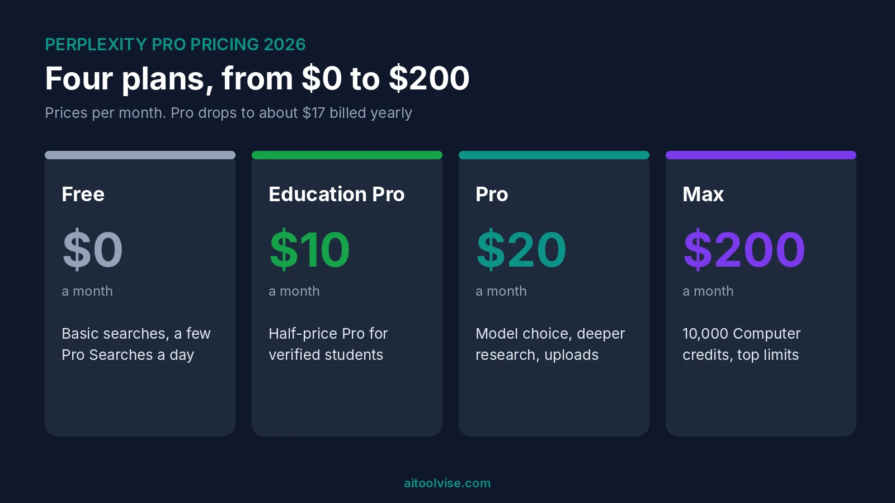
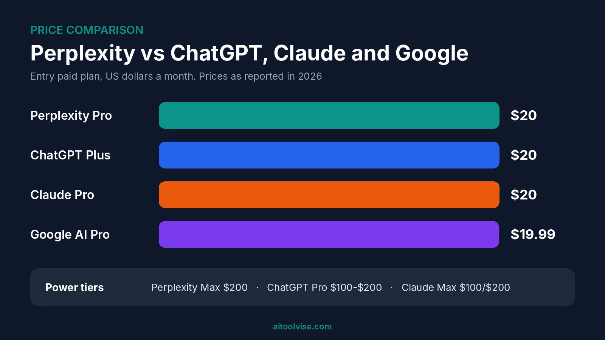
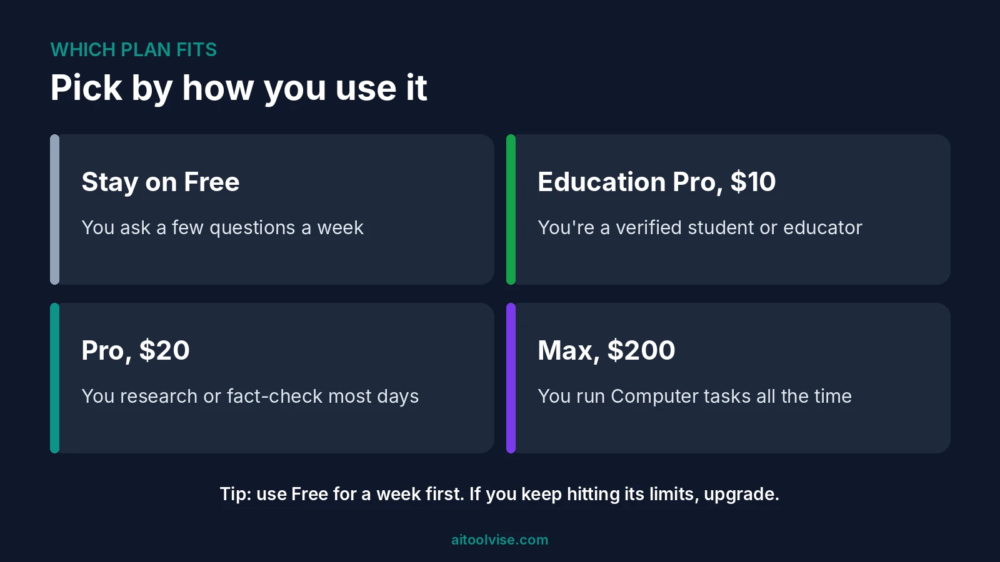

Perplexity Pro pricing starts at $20 a month, or about $17 a month if you pay for a year up front. That's the short answer. The longer one is that Perplexity now has more tiers than most people realize: a free plan, a $10 student plan, Pro, a $200 Max plan, and enterprise seats on top.

I went through Perplexity's own help pages and the main pricing guides to sort out Perplexity Pro pricing and what changed in 2026. Where sources disagreed, I've said so. If you're also weighing other $20 subscriptions, the [Claude pricing review](/reviews/claude-pricing-review/) covers that side, and the [Cursor AI pricing review](/reviews/cursor-ai-pricing-review/) does the same for coding.

## Perplexity Pro Pricing at a Glance

Here are the plans as they stand. Prices come from Perplexity's help pages and recent pricing guides, and the enterprise figures are the least certain.

| Plan | Price | Best for |
|---|---|---|
| Free | $0 | Trying it out |
| Education Pro | $10 a month | Verified students and educators |
| Pro | $20 a month (about $17 billed yearly) | Daily research and fact-checking |
| Max | $200 a month ($2,000 a year) | Heavy users of Computer and top models |
| Enterprise Pro | Listed at $40 per seat a month | Teams |
| Enterprise Max | Listed at $325 per seat a month | Large teams with heavy use |

One thing to know up front. Perplexity jumps from $20 straight to $200, with nothing in between. ChatGPT and Claude both have $100 tiers, and that gap is a real complaint.

## What the Free Plan Gets You

The free plan is better than you'd expect. You get unlimited basic searches with cited answers, a few Pro Searches a day, and a very small number of deep research runs a month. Guides disagree on the exact daily Pro Search number (three or five), which tells you Perplexity changes it often.

What you don't get is model switching, image generation or real Computer access. File uploads are limited too. My suggestion is to use Free for a week before paying anything. If you keep hitting the wall, that's your sign.

## Perplexity Pro Subscription Cost: What $20 a Month Includes

Pro is the plan most people mean when they search for Perplexity Pro pricing. It costs $20 a month. For that you get access to models from OpenAI, Anthropic and Google, plus Perplexity's own Sonar models. You also get deeper Pro Search and Research, larger file uploads, image generation and Labs.

Recent guides also say Pro now includes access to Perplexity Computer, with a one-time bonus of 4,000 credits. I'd treat that as likely but worth confirming on Perplexity's own page, since this has changed more than once. Weekly and monthly limits for Pro Search and Research aren't published as fixed numbers either.

### Perplexity Pro price per month vs per year

Paying yearly brings Perplexity Pro pricing down to roughly $17 a month. Most guides list the annual price as $200, a few say $204, and Perplexity's public page has at times shown monthly pricing only. So check the number at checkout. One tip I like: pay monthly for two months first, then switch to yearly if you're still using it.

## Perplexity Pro Price in India, the UK and Australia

Perplexity lists its prices in US dollars. I couldn't find an official rupee, pound or Australian dollar price, so what you pay locally depends on your card's exchange rate and any local tax. A UK guide from Wise says Perplexity bills in dollars wherever you live, though that article dates from June 2025.

India deserves its own note. Airtel gave customers a free year of Perplexity Pro, but the offer ended on January 16, 2026, according to [Voice&Data's report](https://www.voicendata.com/software-apps/airtel-wraps-up-perplexity-pro-deal-rolls-out-new-benefit-11066197). People who claimed it before the deadline keep access for their year. Airtel's replacement perk is Adobe Express Premium.

## Perplexity Education Pro: The Student Price

Students pay $10 a month, which is half the Pro price. [Perplexity's help page](https://intercom.help/perplexity-ai/en/articles/12590157-what-is-education-pro) says it's for current students and faculty at a university-level institution or higher. You verify through SheerID, and the email you use there doesn't have to match your Perplexity account.

It includes everything in Pro, plus education shortcuts and prompts. Some promotions have offered a first year free, but the help page doesn't mention one, so don't count on it. Students who code might also like [GitHub Copilot's student plan](/how-to/how-to-use-github-copilot/), which is free once you're verified.

## Is Perplexity Pro Free Now? Getting It Free for a Year

Mostly no. The big giveaways have ended. Airtel's was the largest, and the PayPal free-Pro deal reportedly ended on December 31, 2025. A student referral program reportedly ran until May 31, 2026, so it's probably over too.

If you want Pro for free, your best bet is a student promotion, and those come and go. Read the fine print before you sign up. Trials that need a card usually renew at the normal rate unless you cancel.

## Perplexity Max and Computer Credits

Max costs $200 a month or $2,000 a year, according to [Perplexity's help page](https://intercom.help/perplexity-ai/en/articles/11680686-perplexity-max). It includes everything in Pro, faster access to new frontier models, the Max Assistant in Comet, priority support and 10,000 Computer credits every month. Unused credits don't roll over.

Credits are where the cost can surprise you. Computer is an agent that works through tasks for you, and heavier jobs use more credits. Perplexity doesn't publish a per-task price list, so estimating cost in advance is hard. You can set spending limits and turn on auto-refill at perplexity.ai/account/credits. My advice is to turn auto-refill off until you understand your own usage.

Most people don't need Max. It's for people who run Computer often, or who need the highest limits all day.

## Perplexity Enterprise Pricing

Enterprise Pro is listed at $40 per seat a month, or $400 a year. Enterprise Max is listed at $325 per seat a month. Those plans add admin controls, SSO and SCIM, and SOC 2 Type II compliance, and your company's data isn't used to train models.

I'd be careful here. One pricing tracker says the enterprise tiers were retired in June 2026, while other pages still list them, and some say to contact sales. If you're buying for a team, get a quote in writing.

## Does Perplexity Use GPT? Models Inside Pro

Partly. With Pro you can pick models from OpenAI, Anthropic and Google, alongside Perplexity's own Sonar. So yes, GPT models are in there, but so are Claude and Gemini. That model choice is a big part of the pitch: you can try several without paying for each one.

Perplexity isn't a chatbot clone, though. It's built as an answer engine, so most answers come with citations to web sources. That's what you're paying for. If you mostly want a chatbot for writing, our [ChatGPT vs Claude comparison](/compare/chatgpt-vs-claude/) is a better starting point.

## Perplexity Pro vs ChatGPT Plus vs Gemini Pro

Is Perplexity cheaper than ChatGPT? Not at the $20 level. Perplexity Pro and ChatGPT Plus both cost $20 a month, and Claude Pro does too. ChatGPT has a cheaper Go tier listed at $8, and Google AI Pro was listed at $19.99 a month in the US in a January 2026 comparison.

| Service | Entry paid plan | Power tier |
|---|---|---|
| Perplexity | Pro, $20 a month | Max, $200 |
| ChatGPT | Plus, $20 a month | Pro, $100 to $200 |
| Claude | Pro, $20 a month | Max, $100 or $200 |
| Google | AI Pro, $19.99 a month (US) | AI Ultra, $249.99 |

So the price is the same. What differs is the product. Perplexity is better for quick, cited answers. ChatGPT is better for writing and open-ended work. Gemini makes more sense if you live in Google's apps. If you're using AI for content, our [best AI tools for content creation](/best-tools/best-ai-tools-content-creation/) roundup compares more options.

## Is Perplexity Pro Worth It?

If you research, fact-check or write with sources most days, I think it is. The model choice and the cited answers save time, and $20 is about what any other AI subscription costs. If you ask a handful of questions a week, it isn't, and the free plan will do.

A simple test works well. Use Free for a week. If you hit its limits on most days, upgrade. If you barely notice them, stay put. An unused subscription is just a monthly leak.

For how this stacks up against other usage-based plans, the [GitHub Copilot pricing review](/reviews/github-copilot-pricing-review/) shows how credit systems can change what a plan really costs.

## Where Perplexity Pro Falls Short

There are a few things I'd want you to know before paying.

- **Limits keep changing.** Perplexity changed its plans several times in 2026, and some users reported tighter limits without any announcement.
- **Numbers are vague.** Pro Search and Research caps aren't published as fixed numbers, so you can't plan around them.
- **Model fallbacks.** Some users report being served a cheaper model without choosing it. I couldn't verify how often this happens.
- **The $100 gap.** Going from $20 to $200 is steep if you outgrow Pro.
- **Credits are hard to predict.** Computer credits depend on the task, and failed tasks can still use them.

None of these is a dealbreaker on its own. Together they're why I'd start on the monthly plan.

## How to Cancel Perplexity Pro and Get a Refund

On the web, go to perplexity.ai/pro, click Manage Subscription, then Cancel Plan. Cancelling stops renewal, and you keep access until the period ends. Subscribed through an app store? Cancel there instead.

Refunds depend on where you live, according to [Perplexity's refund policy](https://intercom.help/perplexity-ai/en/articles/10354288-refunds). In the EU, UK and Turkey you have 14 days. In South Korea and Brazil it's 7 days. Elsewhere, monthly plans have 24 hours and annual plans 72 hours. Only one refund is processed per account, so don't wait.

## Perplexity Pro Pricing Verdict

At $20 a month, Perplexity Pro pricing is fair for researchers, students and anyone who needs sourced answers fast. It isn't a replacement for a full chatbot, and the unpublished limits are annoying. Start on Free, try Pro monthly, and only move to yearly if you're still using it after two months.

Want to look at other tools? The [home page](/) lists our reviews, comparisons and guides.

## Affiliate Disclosure

Some links on this page may be affiliate links. If you sign up through one, AIToolVise may earn a commission at no extra cost to you. We only recommend tools we'd point a friend toward, and our opinions are our own. Plans and prices change often, so confirm them on [Perplexity's own pricing page](https://www.perplexity.ai/pro) before you buy.