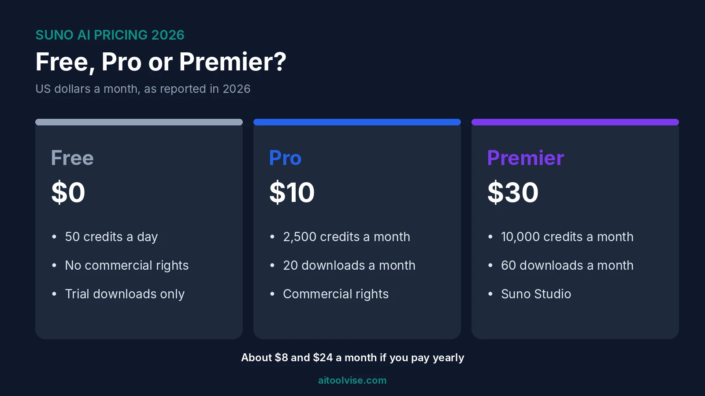
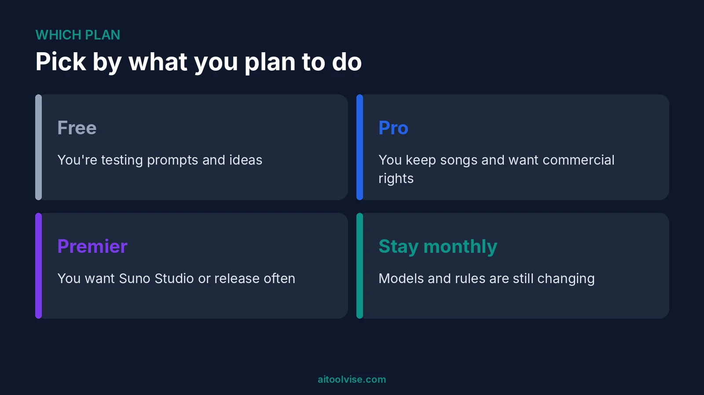
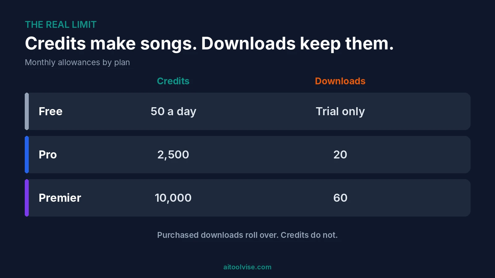

Suno has three plans. Free is $0 with 50 credits a day. Pro is $10 a month, or $8 a month if you pay yearly. Premier is $30 a month, or $24 yearly. That's Suno AI pricing in one breath. But the credits aren't the catch. Downloads are, and I'll explain why below.

I spent a while on this one because the sources disagree in places. Model names, download rules and the free tier all shifted in 2026. So I'll flag what I'm sure of and what I'm not. If you want the bigger picture on AI music tools first, our [best AI music video generators](/best-tools/best-ai-music-video-generators/) roundup is a good start.

## Suno AI Pricing at a Glance

Here's the quick view. Prices are US dollars.

| | Free | Pro | Premier |
|---|---|---|---|
| Monthly price | $0 | $10 | $30 |
| Yearly price | $0 | About $8 a month ($96) | About $24 a month ($288) |
| Credits | 50 a day | 2,500 a month | 10,000 a month |
| Songs, roughly | About 10 a day | About 500 a month | About 2,000 a month |
| Downloads | A few trial downloads | 20 a month | 60 a month |
| Commercial rights | No | Yes | Yes |
| Suno Studio | No | No | Yes |

These figures come from [Margabagus's September 2026 check](https://margabagus.com/suno-pricing/) and [Layer3 Labs, updated September 28, 2026](https://www.layer3labs.io/guides/suno-pricing). They agree on the numbers. Neither is Suno itself, so check Suno's own pricing page before you pay.

## What the Suno Free Plan Includes

Free gives you 50 credits a day, and they don't roll over. That's about ten songs a day by Suno's own estimate, per the sources I read. You can listen, play with ideas and learn how prompts behave.

What you can't do is use those songs commercially. And downloads are the real limit. One source says free accounts have no monthly download allowance, only "a small number of trial downloads." Another says up to seven lifetime trial downloads for accounts made before September 3, 2026. I couldn't pin down the exact number, so don't count on it.

### Is Suno AI free unlimited?

No. It's free, but capped. You get a daily pile of credits, and when they're gone you wait until tomorrow. Nothing carries over.

I'd also treat the free model details with caution. One source lists the free model as v6-mini. Its own FAQ section says v4.5-all. They contradict each other, so I won't name one.

## Suno Pro and Premier: What Each Plan Includes

Pro is the entry paid plan. You get 2,500 credits a month, which works out to roughly 500 songs. You also get 20 downloads a month, priority in the queue, and commercial rights for eligible songs. Audio uploads go up to 30 minutes.

Premier gives you 10,000 credits, roughly 2,000 songs, and 60 downloads a month. It's also the only plan with Suno Studio. Stem splitting is richer on Premier too: three types against Pro's two, per Layer3.

Here's a number I liked. Layer3 estimates about five credits per base generation. That's roughly two cents a song on Pro and about 1.5 cents on Premier. Extends, stem splits and regenerations cost more credits, so real cost per finished track is higher. Still low, though.

## Suno Pro vs Premier: Which Plan Fits?

Pro is enough for most people. Honestly, I'd ask how many songs you'll actually keep. If it's a handful a month, Pro covers it, and the 20-download cap won't bite.

Premier makes sense if you want Suno Studio, or you're releasing lots of finished tracks. The jump from $10 to $30 is big. So don't pay it for credits alone. Most people won't use 2,000 songs' worth.

## Suno AI Pricing Per Month vs Yearly

Monthly is $10 for Pro and $30 for Premier. Pay yearly and Pro drops to about $8 a month, $96 up front. Premier drops to about $24, $288 up front. That's roughly 20 percent off.

Yearly is only cheaper if you actually stay. Suno is changing fast, and one source expects older models to be retired when licensed ones launch. I'd go monthly for the first couple of months, then switch if you're still using it.

## Suno Credits and Downloads: How Far Do They Go?

This is the part most pricing pages skim. Credits make songs. Downloads let you take them out of Suno. They're separate allowances.

So how many songs can you create with Suno Pro? Around 500 a month on credits. But only 20 downloads. You'll generate plenty, then pick the best ones. Layer3 says the caps took effect on September 3, 2026. Purchased downloads and download packs roll over, per Margabagus, though neither source listed a price. Extra credit packs exist for paid plans too, also without a listed price.

Free users, as noted, get trial downloads at most. The tightening followed Suno's settlement with Warner Music Group in November 2025. A [Music in Africa report](https://www.musicinafrica.net/magazine/suno-adjusts-ai-music-ownership-terms-after-warner-music-partnership) said monthly download caps for paid users were planned.

## How Much Does Suno AI Cost in India and the UK?

The only regional prices I found are App Store ones, from a third-party tracker's [October 28, 2026 snapshot](https://opentherank.pages.dev/ai-pricing/suno/). In India, Pro was ₹999 a month and Premier ₹2,999, with 18% GST included. In the UK, Pro was £10 and Premier £30, with VAT included.

That UK price works out well above the US one in dollar terms. Also, App Store prices can differ from what you'd pay on Suno's website. Check the checkout screen where you live. Layer3 notes Suno usually bills in US dollars, with your bank handling conversion.

## Suno Commercial Rights by Plan

Free songs are non-commercial. That's simple. Paid plans include commercial use for songs you make while you're subscribed. You can distribute and monetize them, and Suno takes no cut of your streaming or YouTube earnings, per [Dynamoi's September 2026 guide](https://dynamoi.com/learn/ai-music-distribution/suno-commercial-rights-explained).

There's a catch. Subscribing later doesn't turn earlier free songs commercial. Music in Africa quotes Suno's terms on this: starting a subscription "will not give you a retroactive license." Songs made while subscribed reportedly keep their status after you cancel, but one source says the terms don't state it explicitly. So keep receipts and dates for anything you release.

And ownership is murkier than rights. Suno now says subscribers generally aren't the owners of the songs. Dynamoi also notes that fully AI-made music may not qualify for copyright. One source says some distributors, like CD Baby, don't accept fully AI-generated music. I'm no lawyer. If you're releasing music for real, get proper advice.

## Can You Monetize Suno AI Music on YouTube?

On Pro or Premier, yes, according to Dynamoi. Paid plans allow monetized YouTube uploads through the Partner Program. Content ID may not be available through many distributors for AI music, though.

### Can I use Suno AI music on YouTube for free?

You can post it, but you shouldn't monetize it. Free plan songs have no commercial rights. A video built on one is a poor fit for ads. If you plan to earn from it, subscribe before you make the song.

Making visuals too? Our [CapCut Pro pricing review](/reviews/capcut-pro-pricing-review/) covers editing costs, and the [Runway Gen-4 pricing review](/reviews/runway-gen-4-pricing-review/) covers AI video.

## Does Suno Pay Creators?

I found nothing saying Suno pays you for songs you make. It takes no cut of your earnings, but it doesn't add to them either. What it has done is run creator programs. One guide says a Growth Ambassador program, promoted in January 2026, paid per approved short video, plus bonuses and affiliate revenue. The guide says terms may be out of date. A separate program, Spark, launched in June 2026 for unsigned artists, with grants and mentorship.

Check Suno's own pages before applying. Both could have changed.

## Does Suno Make AI Videos?

No. Suno makes songs. [Stork's October 2026 article](https://www.stork.ai/blog/can-suno-make-a-music-video) says Suno states it "doesn't generate the video for you." It has short looping cover art and a feature that pairs your own footage with a song, but not full video. For a proper video, creators download the track and use another tool. Our [best AI music video generators](/best-tools/best-ai-music-video-generators/) list covers those, and our guide to [how to use Midjourney](/how-to/how-to-use-midjourney/) helps with the visuals.

## Can ChatGPT Create Songs?

Not as audio. CometAPI's September 2026 piece says ChatGPT can't produce playable music files or vocals. It can write lyrics, structure and prompts for Suno. That article sells related tools, so take its recommendations loosely. But the workflow makes sense: write lyrics in ChatGPT, generate in Suno. For more tools, see our [best AI tools for content creation](/best-tools/best-ai-tools-content-creation/).

## Suno AI Pricing API: Is There One?

Not an official one. A guide from AIMLAPI, last updated August 2026, says Suno has no sanctioned public API. Third-party wrappers exist, but they likely break Suno's terms and can stop working without notice. Their commercial claims also can't be guaranteed. I'd avoid building a product on one.

## Suno App, Download and Login

People also search for the Suno app, download and login. I didn't verify the app-store listings myself, so I can't describe the app in detail. The App Store prices above suggest there's an iOS app. For anything else, go to Suno's own site.

## Is Suno Worth It?

If you make music for fun or for videos, Pro probably is. It's cheap per song, and the commercial rights matter if you post anywhere with ads. If you only want to try it, stay on Free for a week first.

If you're a producer expecting finished, ownable, copyrightable music, slow down. The ownership terms are unsettled. The Warner deal also points to licensed models coming, and one source expects older models to be retired. Songs already made keep their commercial status, per Dynamoi, but back up your tracks.

## Where Suno Falls Short

Downloads are tight. Ownership is unclear. Free songs can't earn money. And the rules keep changing, which makes any pricing guide, including this one, age quickly. I'd also check how your distributor treats AI music before you upload.

Want more guides like this? The [home page](/) lists our other reviews, comparisons and roundups. For social posting, our [best AI tools for social media content creation](/best-tools/best-ai-tools-for-social-media-content-creation/) guide goes further.

## Suno AI Pricing Verdict

Start on Free. Move to Pro at $10 a month once you know you'll keep songs and want commercial rights. Go Premier only for Studio or heavy release schedules. Watch the downloads, not the credits.

## Affiliate Disclosure

Some links on this page may be affiliate links. If you sign up through one, AIToolVise may earn a commission at no extra cost to you. We only recommend tools we'd point a friend toward, and the opinions are ours. Prices and plans shift a lot, so check each company's own pricing page before buying.